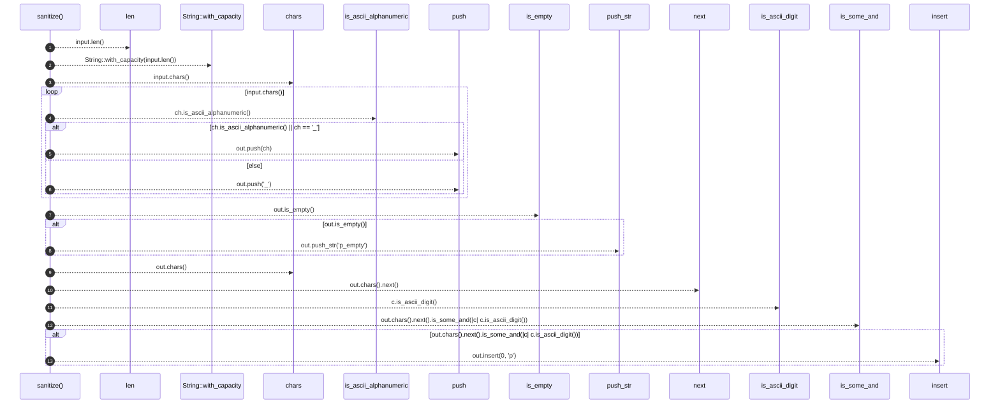

# `robby_extract::typescript::sanitize`

[Self-model](../../README.md) · [typescript](index.md)

| | |
|---|---|
| kind | `code.function` |
| signature | `fn sanitize(input: &str) -> String` |
| location | [`crates/robby-extract/src/typescript.rs:1020`](../../../../crates/robby-extract/src/typescript.rs#L1020) |
| provenance | extractor · confidence 1.00 |

```rust
fn sanitize(input: &str) -> String {
    let mut out = String::with_capacity(input.len());
    for ch in input.chars() {
        if ch.is_ascii_alphanumeric() || ch == '_' {
            out.push(ch);
        } else {
            out.push('_');
        }
    }
    if out.is_empty() {
        out.push_str("p_empty");
    }
    if out.chars().next().is_some_and(|c| c.is_ascii_digit()) {
        out.insert(0, 'p');
    }
    out
}
```



13 steps · 0 observed · 13 possible only

**Edges**

- calls → [`robby_render::report::impl Report::push`](../../robby_render/report/index.md)
- calls → [`robby_render::report::impl Report::push`](../../robby_render/report/index.md)
- calls → [`robby_ir::span::impl Span::is_empty`](../../robby_ir/span/index.md)
- calls → [`robby_ir::model::impl Document::insert`](../../robby_ir/model/index.md)

## References

- calls → [`robby_ir::model`](../../robby_ir/model/index.md) — insert
- calls → [`robby_ir::span`](../../robby_ir/span/index.md) — is_empty
- calls → [`robby_render::report`](../../robby_render/report/index.md) — push

## Referenced by

- calls ← [`robby_extract::typescript::build_function_process`](build-function-process.md)
- calls ← [`robby_extract::typescript::emit_variable`](emit-variable.md)
- calls ← [`robby_extract::typescript::ensure_participant`](ensure-participant.md)
- calls ← [`robby_extract::typescript::walk_expr`](walk-expr.md)

