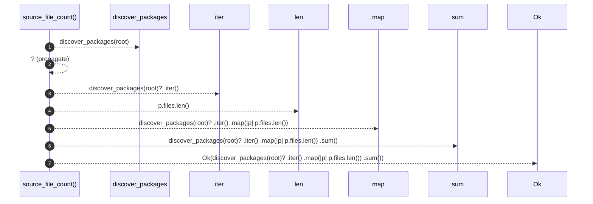

# `robby_extract::typescript::source_file_count`

[Self-model](../../README.md) · [typescript](index.md)

| | |
|---|---|
| kind | `code.function` |
| signature | `fn source_file_count(root: &Path) -> Result<usize>` |
| location | [`crates/robby-extract/src/typescript.rs:48`](../../../../crates/robby-extract/src/typescript.rs#L48) |
| provenance | extractor · confidence 1.00 |

```rust
pub(crate) fn source_file_count(root: &Path) -> Result<usize> {
    Ok(discover_packages(root)?
        .iter()
        .map(|p| p.files.len())
        .sum())
}
```



7 steps · 0 observed · 7 possible only

**Edges**

- calls → [`robby_extract::typescript::discover_packages`](discover-packages.md)

## References

- calls → [`robby_extract::typescript`](index.md) — discover_packages

