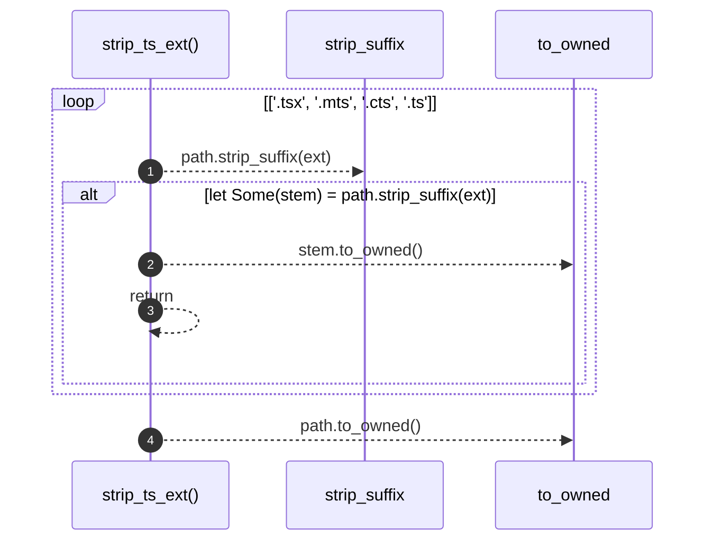

# `robby_extract::typescript::strip_ts_ext`

[Self-model](../../README.md) · [typescript](index.md)

| | |
|---|---|
| kind | `code.function` |
| signature | `fn strip_ts_ext(path: &str) -> String` |
| location | [`crates/robby-extract/src/typescript.rs:187`](../../../../crates/robby-extract/src/typescript.rs#L187) |
| provenance | extractor · confidence 1.00 |

```rust
fn strip_ts_ext(path: &str) -> String {
    for ext in [".tsx", ".mts", ".cts", ".ts"] {
        if let Some(stem) = path.strip_suffix(ext) {
            return stem.to_owned();
        }
    }
    path.to_owned()
}
```



4 steps · 0 observed · 4 possible only

## Referenced by

- calls ← [`robby_extract::typescript::module_fqn`](module-fqn.md)
- calls ← [`robby_extract::typescript::resolve_relative_import`](resolve-relative-import.md)

