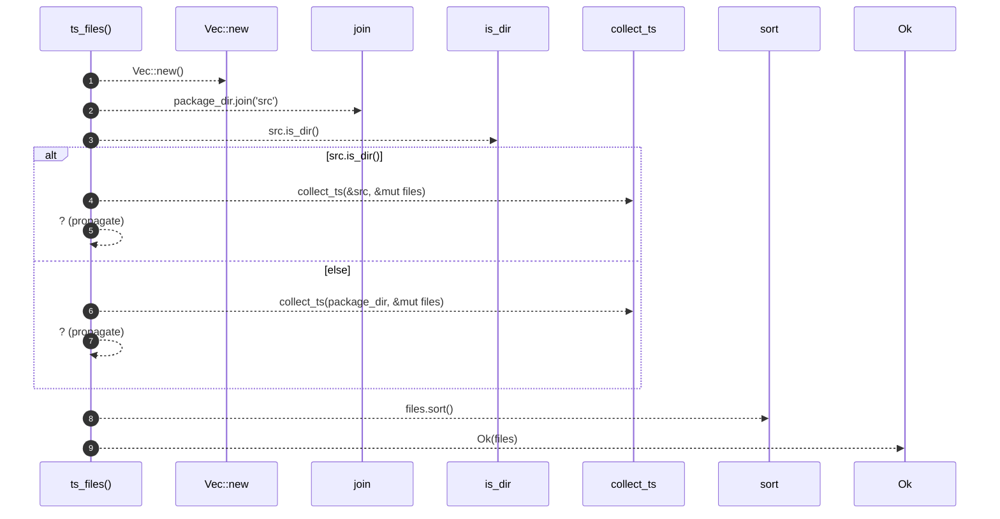

# `robby_extract::typescript::ts_files`

[Self-model](../../README.md) · [typescript](index.md)

| | |
|---|---|
| kind | `code.function` |
| signature | `fn ts_files(package_dir: &Path) -> Result<Vec<PathBuf>>` |
| location | [`crates/robby-extract/src/typescript.rs:136`](../../../../crates/robby-extract/src/typescript.rs#L136) |
| provenance | extractor · confidence 1.00 |

```rust
fn ts_files(package_dir: &Path) -> Result<Vec<PathBuf>> {
    let mut files = Vec::new();
    // Prefer src/, else package root (excluding node_modules/dist).
    let src = package_dir.join("src");
    if src.is_dir() {
        collect_ts(&src, &mut files)?;
    } else {
        collect_ts(package_dir, &mut files)?;
    }
    files.sort();
    Ok(files)
}
```



9 steps · 0 observed · 9 possible only

**Edges**

- calls → [`robby_extract::rust::impl LineIndex::new`](../rust/index.md)
- calls → [`robby_extract::typescript::collect_ts`](collect-ts.md)
- calls → [`robby_extract::typescript::collect_ts`](collect-ts.md)

## References

- calls → [`robby_extract::rust`](../rust/index.md) — new
- calls → [`robby_extract::typescript`](index.md) — collect_ts

## Referenced by

- calls ← [`robby_extract::typescript::package_at`](package-at.md)

