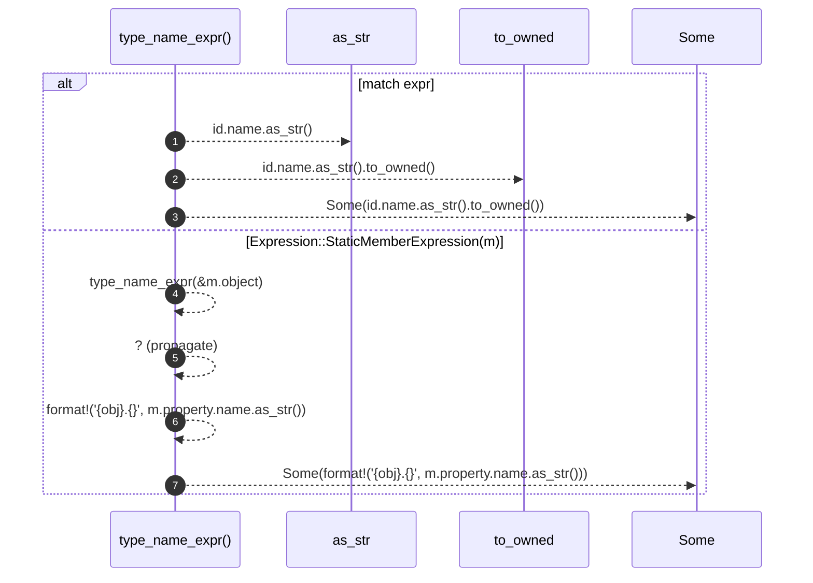

# `robby_extract::typescript::type_name_expr`

[Self-model](../../README.md) · [typescript](index.md)

| | |
|---|---|
| kind | `code.function` |
| signature | `fn type_name_expr(expr: &Expression<'_>) -> Option<String>` |
| location | [`crates/robby-extract/src/typescript.rs:697`](../../../../crates/robby-extract/src/typescript.rs#L697) |
| provenance | extractor · confidence 1.00 |

```rust
fn type_name_expr(expr: &Expression<'_>) -> Option<String> {
    match expr {
        Expression::Identifier(id) => Some(id.name.as_str().to_owned()),
        Expression::StaticMemberExpression(m) => {
            let obj = type_name_expr(&m.object)?;
            Some(format!("{obj}.{}", m.property.name.as_str()))
        }
        _ => None,
    }
}
```



7 steps · 0 observed · 7 possible only

**Edges**

- calls → [`robby_ir::kind::impl Kind::as_str`](../../robby_ir/kind/index.md)
- calls → [`robby_extract::typescript::type_name_expr`](type-name-expr.md)

## References

- calls → [`robby_ir::kind`](../../robby_ir/kind/index.md) — as_str

## Referenced by

- calls ← [`robby_extract::typescript::emit_class`](emit-class.md)

