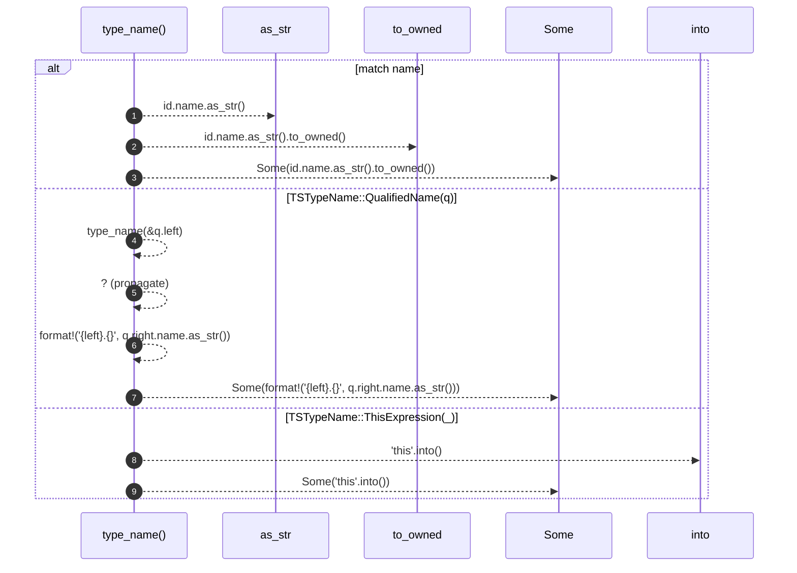

# `robby_extract::typescript::type_name`

[Self-model](../../README.md) · [typescript](index.md)

| | |
|---|---|
| kind | `code.function` |
| signature | `fn type_name(name: &TSTypeName<'_>) -> Option<String>` |
| location | [`crates/robby-extract/src/typescript.rs:721`](../../../../crates/robby-extract/src/typescript.rs#L721) |
| provenance | extractor · confidence 1.00 |

```rust
fn type_name(name: &TSTypeName<'_>) -> Option<String> {
    match name {
        TSTypeName::IdentifierReference(id) => Some(id.name.as_str().to_owned()),
        TSTypeName::QualifiedName(q) => {
            let left = type_name(&q.left)?;
            Some(format!("{left}.{}", q.right.name.as_str()))
        }
        TSTypeName::ThisExpression(_) => Some("this".into()),
    }
}
```



9 steps · 0 observed · 9 possible only

**Edges**

- calls → [`robby_ir::kind::impl Kind::as_str`](../../robby_ir/kind/index.md)
- calls → [`robby_extract::typescript::type_name`](type-name.md)

## References

- calls → [`robby_ir::kind`](../../robby_ir/kind/index.md) — as_str

## Referenced by

- calls ← [`robby_extract::typescript::emit_class`](emit-class.md)
- calls ← [`robby_extract::typescript::emit_interface`](emit-interface.md)

