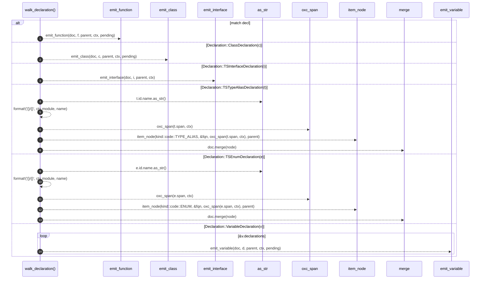

# `robby_extract::typescript::walk_declaration`

[Self-model](../../README.md) · [typescript](index.md)

| | |
|---|---|
| kind | `code.function` |
| signature | `fn walk_declaration(     doc: &mut Document,     decl: &Declaration<'_>,     parent: &NodeId,     ctx: &Ctx<'_>,     pending: &mut Vec<PendingCall>, )` |
| location | [`crates/robby-extract/src/typescript.rs:312`](../../../../crates/robby-extract/src/typescript.rs#L312) |
| provenance | extractor · confidence 1.00 |

```rust
fn walk_declaration(
    doc: &mut Document,
    decl: &Declaration<'_>,
    parent: &NodeId,
    ctx: &Ctx<'_>,
    pending: &mut Vec<PendingCall>,
) {
    match decl {
        Declaration::FunctionDeclaration(f) => emit_function(doc, f, parent, ctx, pending),
        Declaration::ClassDeclaration(c) => emit_class(doc, c, parent, ctx, pending),
        Declaration::TSInterfaceDeclaration(i) => emit_interface(doc, i, parent, ctx),
        Declaration::TSTypeAliasDeclaration(t) => {
            let name = t.id.name.as_str();
            let fqn = format!("{}/{}", ctx.module, name);
            let node = item_node(kind::code::TYPE_ALIAS, &fqn, oxc_span(t.span, ctx), parent);
            doc.merge(node);
        }
        Declaration::TSEnumDeclaration(e) => {
            let name = e.id.name.as_str();
            let fqn = format!("{}/{}", ctx.module, name);
            let node = item_node(kind::code::ENUM, &fqn, oxc_span(e.span, ctx), parent);
            doc.merge(node);
        }
        Declaration::VariableDeclaration(v) => {
            for d in &v.declarations {
                emit_variable(doc, d, parent, ctx, pending);
            }
        }
        _ => {}
    }
}
```



14 steps · 0 observed · 14 possible only

**Edges**

- calls → [`robby_extract::typescript::emit_function`](emit-function.md)
- calls → [`robby_extract::typescript::emit_class`](emit-class.md)
- calls → [`robby_extract::typescript::emit_interface`](emit-interface.md)
- calls → [`robby_ir::kind::impl Kind::as_str`](../../robby_ir/kind/index.md)
- calls → [`robby_extract::typescript::oxc_span`](oxc-span.md)
- calls → [`robby_extract::typescript::item_node`](item-node.md)
- calls → [`robby_ir::model::impl Document::merge`](../../robby_ir/model/index.md)
- calls → [`robby_ir::kind::impl Kind::as_str`](../../robby_ir/kind/index.md)
- calls → [`robby_extract::typescript::oxc_span`](oxc-span.md)
- calls → [`robby_extract::typescript::item_node`](item-node.md)
- calls → [`robby_ir::model::impl Document::merge`](../../robby_ir/model/index.md)
- calls → [`robby_extract::typescript::emit_variable`](emit-variable.md)

## References

- calls → [`robby_extract::typescript`](index.md) — 6 items
- calls → [`robby_ir::kind`](../../robby_ir/kind/index.md) — as_str
- calls → [`robby_ir::model`](../../robby_ir/model/index.md) — merge

## Referenced by

- calls ← [`robby_extract::typescript::walk_statements`](walk-statements.md)

