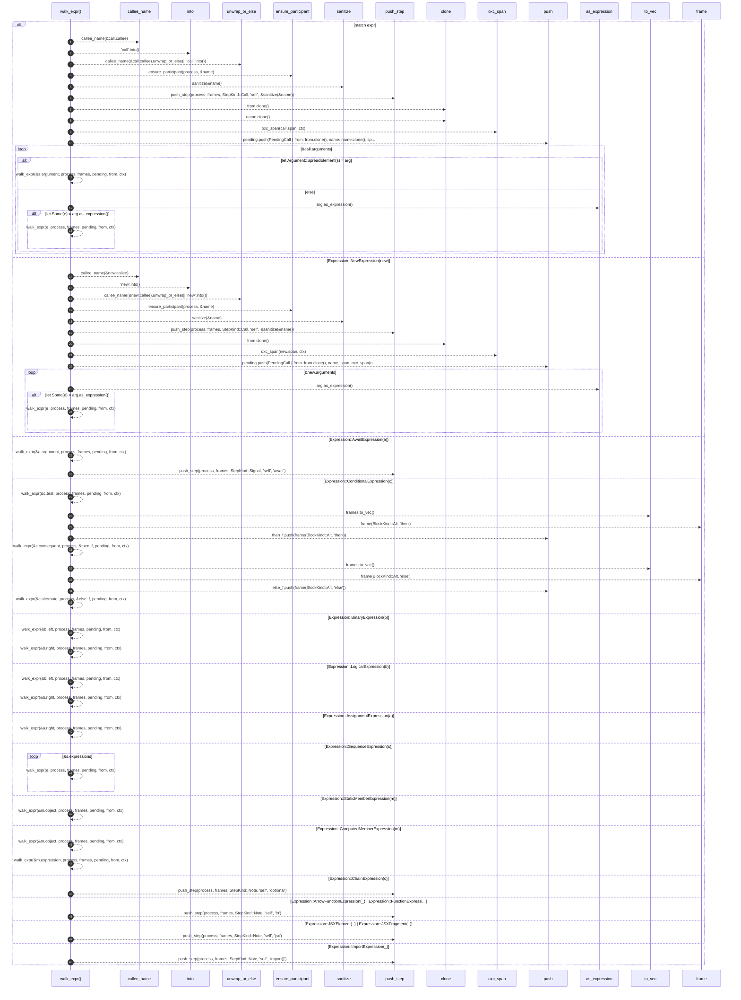

# `robby_extract::typescript::walk_expr`

[Self-model](../../README.md) · [typescript](index.md)

| | |
|---|---|
| kind | `code.function` |
| signature | `fn walk_expr<'a>(     expr: &Expression<'a>,     process: &mut Process,     frames: &[Block],     pending: &mut Vec<PendingCall>,     from: &NodeId,     ctx: &Ctx<'_>, )` |
| location | [`crates/robby-extract/src/typescript.rs:869`](../../../../crates/robby-extract/src/typescript.rs#L869) |
| provenance | extractor · confidence 1.00 |

```rust
fn walk_expr<'a>(
    expr: &Expression<'a>,
    process: &mut Process,
    frames: &[Block],
    pending: &mut Vec<PendingCall>,
    from: &NodeId,
    ctx: &Ctx<'_>,
) {
    match expr {
        Expression::CallExpression(call) => {
            let name = callee_name(&call.callee).unwrap_or_else(|| "call".into());
            ensure_participant(process, &name);
            push_step(process, frames, StepKind::Call, "self", &sanitize(&name));
            pending.push(PendingCall {
                from: from.clone(),
                name: name.clone(),
                span: oxc_span(call.span, ctx),
            });
            for arg in &call.arguments {
                if let Argument::SpreadElement(s) = arg {
                    walk_expr(&s.argument, process, frames, pending, from, ctx);
                } else if let Some(e) = arg.as_expression() {
                    walk_expr(e, process, frames, pending, from, ctx);
                }
            }
        }
        Expression::NewExpression(new) => {
            let name = callee_name(&new.callee).unwrap_or_else(|| "new".into());
            ensure_participant(process, &name);
            push_step(process, frames, StepKind::Call, "self", &sanitize(&name));
            pending.push(PendingCall {
                from: from.clone(),
                name,
                span: oxc_span(new.span, ctx),
            });
            for arg in &new.arguments {
                if let Some(e) = arg.as_expression() {
                    walk_expr(e, process, frames, pending, from, ctx);
                }
            }
        }
        Expression::AwaitExpression(a) => {
            walk_expr(&a.argument, process, frames, pending, from, ctx);
            push_step(process, frames, StepKind::Signal, "self", "await");
        }
        Expression::ConditionalExpression(c) => {
            walk_expr(&c.test, process, frames, pending, from, ctx);
            let mut then_f = frames.to_vec();
            then_f.push(frame(BlockKind::Alt, "then"));
            walk_expr(&c.consequent, process, &then_f, pending, from, ctx);
            let mut else_f = frames.to_vec();
            else_f.push(frame(BlockKind::Alt, "else"));
            walk_expr(&c.alternate, process, &else_f, pending, from, ctx);
        }
        Expression::BinaryExpression(b) => {
            walk_expr(&b.left, process, frames, pending, from, ctx);
            walk_expr(&b.right, process, frames, pending, from, ctx);
        }
        Expression::LogicalExpression(b) => {
            walk_expr(&b.left, process, frames, pending, from, ctx);
            walk_expr(&b.right, process, frames, pending, from, ctx);
        }
        Expression::AssignmentExpression(a) => {
            walk_expr(&a.right, process, frames, pending, from, ctx);
        }
        Expression::SequenceExpression(s) => {
            for e in &s.expressions {
                walk_expr(e, process, frames, pending, from, ctx);
            }
        }
        Expression::StaticMemberExpression(m) => {
            walk_expr(&m.object, process, frames, pending, from, ctx);
        }
        Expression::ComputedMemberExpression(m) => {
            walk_expr(&m.object, process, frames, pending, from, ctx);
            walk_expr(&m.expression, process, frames, pending, from, ctx);
        }
        Expression::ChainExpression(c) => {
            // Treat optional chaining as a note; still walk inner expression if present.
            push_step(process, frames, StepKind::Note, "self", "optional");
            let _ = c;
        }
        Expression::ArrowFunctionExpression(_) | Expression::FunctionExpression(_) => {
            push_step(process, frames, StepKind::Note, "self", "fn");
        }
        Expression::JSXElement(_) | Expression::JSXFragment(_) => {
            push_step(process, frames, StepKind::Note, "self", "jsx");
        }
        Expression::ImportExpression(_) => {
            push_step(process, frames, StepKind::Note, "self", "import()");
        }
        _ => {}
    }
}
```



48 steps · 0 observed · 48 possible only

**Edges**

- calls → [`robby_extract::typescript::callee_name`](callee-name.md)
- calls → [`robby_extract::typescript::ensure_participant`](ensure-participant.md)
- calls → [`robby_extract::typescript::sanitize`](sanitize.md)
- calls → [`robby_extract::typescript::push_step`](push-step.md)
- calls → [`robby_extract::typescript::oxc_span`](oxc-span.md)
- calls → [`robby_render::report::impl Report::push`](../../robby_render/report/index.md)
- calls → [`robby_extract::typescript::walk_expr`](walk-expr.md)
- calls → [`robby_extract::typescript::walk_expr`](walk-expr.md)
- calls → [`robby_extract::typescript::callee_name`](callee-name.md)
- calls → [`robby_extract::typescript::ensure_participant`](ensure-participant.md)
- calls → [`robby_extract::typescript::sanitize`](sanitize.md)
- calls → [`robby_extract::typescript::push_step`](push-step.md)
- calls → [`robby_extract::typescript::oxc_span`](oxc-span.md)
- calls → [`robby_render::report::impl Report::push`](../../robby_render/report/index.md)
- calls → [`robby_extract::typescript::walk_expr`](walk-expr.md)
- calls → [`robby_extract::typescript::walk_expr`](walk-expr.md)
- calls → [`robby_extract::typescript::push_step`](push-step.md)
- calls → [`robby_extract::typescript::walk_expr`](walk-expr.md)
- calls → [`robby_extract::typescript::frame`](frame.md)
- calls → [`robby_render::report::impl Report::push`](../../robby_render/report/index.md)
- calls → [`robby_extract::typescript::walk_expr`](walk-expr.md)
- calls → [`robby_extract::typescript::frame`](frame.md)
- calls → [`robby_render::report::impl Report::push`](../../robby_render/report/index.md)
- calls → [`robby_extract::typescript::walk_expr`](walk-expr.md)
- calls → [`robby_extract::typescript::walk_expr`](walk-expr.md)
- calls → [`robby_extract::typescript::walk_expr`](walk-expr.md)
- calls → [`robby_extract::typescript::walk_expr`](walk-expr.md)
- calls → [`robby_extract::typescript::walk_expr`](walk-expr.md)
- calls → [`robby_extract::typescript::walk_expr`](walk-expr.md)
- calls → [`robby_extract::typescript::walk_expr`](walk-expr.md)
- calls → [`robby_extract::typescript::walk_expr`](walk-expr.md)
- calls → [`robby_extract::typescript::walk_expr`](walk-expr.md)
- calls → [`robby_extract::typescript::walk_expr`](walk-expr.md)
- calls → [`robby_extract::typescript::push_step`](push-step.md)
- calls → [`robby_extract::typescript::push_step`](push-step.md)
- calls → [`robby_extract::typescript::push_step`](push-step.md)
- calls → [`robby_extract::typescript::push_step`](push-step.md)

## References

- calls → [`robby_extract::typescript`](index.md) — 6 items
- calls → [`robby_render::report`](../../robby_render/report/index.md) — push

## Referenced by

- calls ← [`robby_extract::typescript::emit_variable`](emit-variable.md)
- calls ← [`robby_extract::typescript::walk_stmts`](walk-stmts.md)

