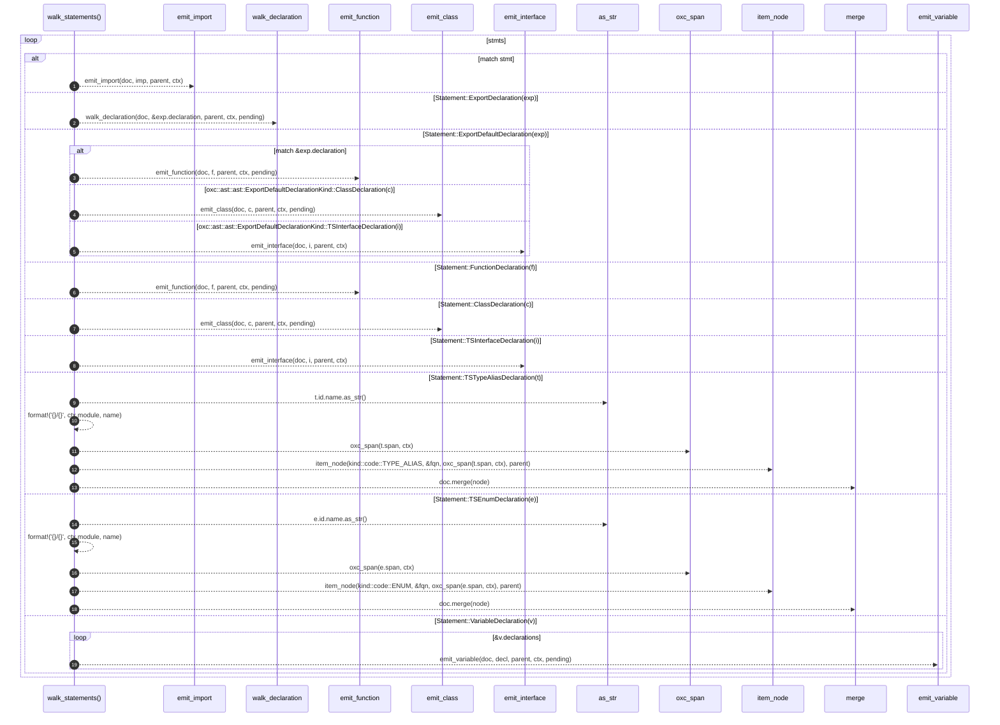

# `robby_extract::typescript::walk_statements`

[Self-model](../../README.md) · [typescript](index.md)

| | |
|---|---|
| kind | `code.function` |
| signature | `fn walk_statements<'a>(     doc: &mut Document,     stmts: &[Statement<'a>],     parent: &NodeId,     ctx: &Ctx<'_>,     pending: &mut Vec<PendingCall>, )` |
| location | [`crates/robby-extract/src/typescript.rs:260`](../../../../crates/robby-extract/src/typescript.rs#L260) |
| provenance | extractor · confidence 1.00 |

```rust
fn walk_statements<'a>(
    doc: &mut Document,
    stmts: &[Statement<'a>],
    parent: &NodeId,
    ctx: &Ctx<'_>,
    pending: &mut Vec<PendingCall>,
) {
    for stmt in stmts {
        match stmt {
            Statement::ImportDeclaration(imp) => {
                emit_import(doc, imp, parent, ctx);
            }
            Statement::ExportDeclaration(exp) => {
                walk_declaration(doc, &exp.declaration, parent, ctx, pending);
            }
            Statement::ExportDefaultDeclaration(exp) => {
                // Best-effort: only named function/class defaults.
                match &exp.declaration {
                    oxc::ast::ast::ExportDefaultDeclarationKind::FunctionDeclaration(f) => {
                        emit_function(doc, f, parent, ctx, pending);
                    }
                    oxc::ast::ast::ExportDefaultDeclarationKind::ClassDeclaration(c) => {
                        emit_class(doc, c, parent, ctx, pending);
                    }
                    oxc::ast::ast::ExportDefaultDeclarationKind::TSInterfaceDeclaration(i) => {
                        emit_interface(doc, i, parent, ctx);
                    }
                    _ => {}
                }
            }
            Statement::FunctionDeclaration(f) => emit_function(doc, f, parent, ctx, pending),
            Statement::ClassDeclaration(c) => emit_class(doc, c, parent, ctx, pending),
            Statement::TSInterfaceDeclaration(i) => emit_interface(doc, i, parent, ctx),
            Statement::TSTypeAliasDeclaration(t) => {
                let name = t.id.name.as_str();
                let fqn = format!("{}/{}", ctx.module, name);
                let node = item_node(kind::code::TYPE_ALIAS, &fqn, oxc_span(t.span, ctx), parent);
                doc.merge(node);
            }
            Statement::TSEnumDeclaration(e) => {
                let name = e.id.name.as_str();
                let fqn = format!("{}/{}", ctx.module, name);
                let node = item_node(kind::code::ENUM, &fqn, oxc_span(e.span, ctx), parent);
                doc.merge(node);
            }
            Statement::VariableDeclaration(v) => {
                for decl in &v.declarations {
                    emit_variable(doc, decl, parent, ctx, pending);
                }
            }
            _ => {}
        }
    }
}
```



19 steps · 0 observed · 19 possible only

**Edges**

- calls → [`robby_extract::typescript::emit_import`](emit-import.md)
- calls → [`robby_extract::typescript::walk_declaration`](walk-declaration.md)
- calls → [`robby_extract::typescript::emit_function`](emit-function.md)
- calls → [`robby_extract::typescript::emit_class`](emit-class.md)
- calls → [`robby_extract::typescript::emit_interface`](emit-interface.md)
- calls → [`robby_extract::typescript::emit_function`](emit-function.md)
- calls → [`robby_extract::typescript::emit_class`](emit-class.md)
- calls → [`robby_extract::typescript::emit_interface`](emit-interface.md)
- calls → [`robby_ir::kind::impl Kind::as_str`](../../robby_ir/kind/index.md)
- calls → [`robby_extract::typescript::oxc_span`](oxc-span.md)
- calls → [`robby_extract::typescript::item_node`](item-node.md)
- calls → [`robby_ir::model::impl Document::merge`](../../robby_ir/model/index.md)
- calls → [`robby_ir::kind::impl Kind::as_str`](../../robby_ir/kind/index.md)
- calls → [`robby_extract::typescript::oxc_span`](oxc-span.md)
- calls → [`robby_extract::typescript::item_node`](item-node.md)
- calls → [`robby_ir::model::impl Document::merge`](../../robby_ir/model/index.md)
- calls → [`robby_extract::typescript::emit_variable`](emit-variable.md)

## References

- calls → [`robby_extract::typescript`](index.md) — 8 items
- calls → [`robby_ir::kind`](../../robby_ir/kind/index.md) — as_str
- calls → [`robby_ir::model`](../../robby_ir/model/index.md) — merge

## Referenced by

- calls ← [`robby_extract::typescript::extract_file`](extract-file.md)

