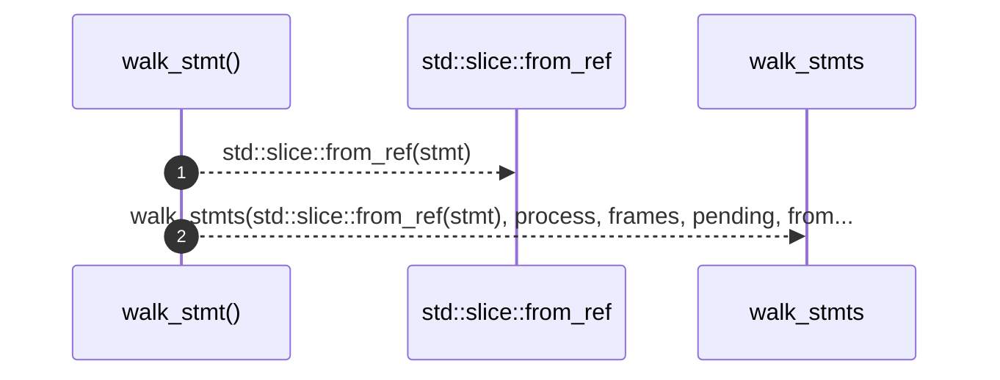

# `robby_extract::typescript::walk_stmt`

[Self-model](../../README.md) · [typescript](index.md)

| | |
|---|---|
| kind | `code.function` |
| signature | `fn walk_stmt<'a>(     stmt: &Statement<'a>,     process: &mut Process,     frames: &[Block],     pending: &mut Vec<PendingCall>,     from: &NodeId,     ctx: &Ctx<'_>, )` |
| location | [`crates/robby-extract/src/typescript.rs:858`](../../../../crates/robby-extract/src/typescript.rs#L858) |
| provenance | extractor · confidence 1.00 |

```rust
fn walk_stmt<'a>(
    stmt: &Statement<'a>,
    process: &mut Process,
    frames: &[Block],
    pending: &mut Vec<PendingCall>,
    from: &NodeId,
    ctx: &Ctx<'_>,
) {
    walk_stmts(std::slice::from_ref(stmt), process, frames, pending, from, ctx);
}
```



2 steps · 0 observed · 2 possible only

**Edges**

- calls → [`robby_extract::typescript::walk_stmts`](walk-stmts.md)

## References

- calls → [`robby_extract::typescript`](index.md) — walk_stmts

## Referenced by

- calls ← [`robby_extract::typescript::walk_stmts`](walk-stmts.md)

