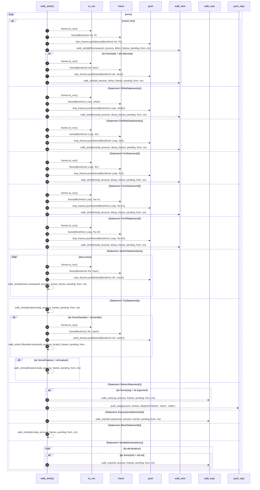

# `robby_extract::typescript::walk_stmts`

[Self-model](../../README.md) · [typescript](index.md)

| | |
|---|---|
| kind | `code.function` |
| signature | `fn walk_stmts<'a>(     stmts: &[Statement<'a>],     process: &mut Process,     frames: &[Block],     pending: &mut Vec<PendingCall>,     from: &NodeId,     ctx: &Ctx<'_>, )` |
| location | [`crates/robby-extract/src/typescript.rs:764`](../../../../crates/robby-extract/src/typescript.rs#L764) |
| provenance | extractor · confidence 1.00 |

```rust
fn walk_stmts<'a>(
    stmts: &[Statement<'a>],
    process: &mut Process,
    frames: &[Block],
    pending: &mut Vec<PendingCall>,
    from: &NodeId,
    ctx: &Ctx<'_>,
) {
    for stmt in stmts {
        match stmt {
            Statement::IfStatement(iff) => {
                let mut then_frames = frames.to_vec();
                then_frames.push(frame(BlockKind::Alt, "if"));
                walk_stmt(&iff.consequent, process, &then_frames, pending, from, ctx);
                if let Some(alt) = &iff.alternate {
                    let mut else_frames = frames.to_vec();
                    else_frames.push(frame(BlockKind::Alt, "else"));
                    walk_stmt(alt, process, &else_frames, pending, from, ctx);
                }
            }
            Statement::WhileStatement(w) => {
                let mut loop_frames = frames.to_vec();
                loop_frames.push(frame(BlockKind::Loop, "while"));
                walk_stmt(&w.body, process, &loop_frames, pending, from, ctx);
            }
            Statement::DoWhileStatement(w) => {
                let mut loop_frames = frames.to_vec();
                loop_frames.push(frame(BlockKind::Loop, "do"));
                walk_stmt(&w.body, process, &loop_frames, pending, from, ctx);
            }
            Statement::ForStatement(f) => {
                let mut loop_frames = frames.to_vec();
                loop_frames.push(frame(BlockKind::Loop, "for"));
                walk_stmt(&f.body, process, &loop_frames, pending, from, ctx);
            }
            Statement::ForInStatement(f) => {
                let mut loop_frames = frames.to_vec();
                loop_frames.push(frame(BlockKind::Loop, "for-in"));
                walk_stmt(&f.body, process, &loop_frames, pending, from, ctx);
            }
            Statement::ForOfStatement(f) => {
                let mut loop_frames = frames.to_vec();
                loop_frames.push(frame(BlockKind::Loop, "for-of"));
                walk_stmt(&f.body, process, &loop_frames, pending, from, ctx);
            }
            Statement::SwitchStatement(sw) => {
                for case in &sw.cases {
                    let mut case_frames = frames.to_vec();
                    case_frames.push(frame(BlockKind::Alt, "case"));
                    walk_stmts(&case.consequent, process, &case_frames, pending, from, ctx);
                }
            }
            Statement::TryStatement(t) => {
                walk_stmts(&t.block.body, process, frames, pending, from, ctx);
                if let Some(handler) = &t.handler {
                    let mut catch_frames = frames.to_vec();
                    catch_frames.push(frame(BlockKind::Alt, "catch"));
                    walk_stmts(
                        &handler.body.body,
                        process,
                        &catch_frames,
                        pending,
                        from,
                        ctx,
                    );
                }
                if let Some(finalizer) = &t.finalizer {
                    walk_stmts(&finalizer.body, process, frames, pending, from, ctx);
                }
            }
            Statement::ReturnStatement(r) => {
                if let Some(arg) = &r.argument {
                    walk_expr(arg, process, frames, pending, from, ctx);
                }
                push_step(process, frames, StepKind::Return, "return", "caller");
            }
            Statement::ExpressionStatement(e) => {
                walk_expr(&e.expression, process, frames, pending, from, ctx);
            }
            Statement::BlockStatement(b) => {
                walk_stmts(&b.body, process, frames, pending, from, ctx);
            }
            Statement::VariableDeclaration(v) => {
                for d in &v.declarations {
                    if let Some(init) = &d.init {
                        walk_expr(init, process, frames, pending, from, ctx);
                    }
                }
            }
            _ => {}
        }
    }
}
```



43 steps · 0 observed · 43 possible only

**Edges**

- calls → [`robby_extract::typescript::frame`](frame.md)
- calls → [`robby_render::report::impl Report::push`](../../robby_render/report/index.md)
- calls → [`robby_extract::typescript::walk_stmt`](walk-stmt.md)
- calls → [`robby_extract::typescript::frame`](frame.md)
- calls → [`robby_render::report::impl Report::push`](../../robby_render/report/index.md)
- calls → [`robby_extract::typescript::walk_stmt`](walk-stmt.md)
- calls → [`robby_extract::typescript::frame`](frame.md)
- calls → [`robby_render::report::impl Report::push`](../../robby_render/report/index.md)
- calls → [`robby_extract::typescript::walk_stmt`](walk-stmt.md)
- calls → [`robby_extract::typescript::frame`](frame.md)
- calls → [`robby_render::report::impl Report::push`](../../robby_render/report/index.md)
- calls → [`robby_extract::typescript::walk_stmt`](walk-stmt.md)
- calls → [`robby_extract::typescript::frame`](frame.md)
- calls → [`robby_render::report::impl Report::push`](../../robby_render/report/index.md)
- calls → [`robby_extract::typescript::walk_stmt`](walk-stmt.md)
- calls → [`robby_extract::typescript::frame`](frame.md)
- calls → [`robby_render::report::impl Report::push`](../../robby_render/report/index.md)
- calls → [`robby_extract::typescript::walk_stmt`](walk-stmt.md)
- calls → [`robby_extract::typescript::frame`](frame.md)
- calls → [`robby_render::report::impl Report::push`](../../robby_render/report/index.md)
- calls → [`robby_extract::typescript::walk_stmt`](walk-stmt.md)
- calls → [`robby_extract::typescript::frame`](frame.md)
- calls → [`robby_render::report::impl Report::push`](../../robby_render/report/index.md)
- calls → [`robby_extract::typescript::walk_stmts`](walk-stmts.md)
- calls → [`robby_extract::typescript::walk_stmts`](walk-stmts.md)
- calls → [`robby_extract::typescript::frame`](frame.md)
- calls → [`robby_render::report::impl Report::push`](../../robby_render/report/index.md)
- calls → [`robby_extract::typescript::walk_stmts`](walk-stmts.md)
- calls → [`robby_extract::typescript::walk_stmts`](walk-stmts.md)
- calls → [`robby_extract::typescript::walk_expr`](walk-expr.md)
- calls → [`robby_extract::typescript::push_step`](push-step.md)
- calls → [`robby_extract::typescript::walk_expr`](walk-expr.md)
- calls → [`robby_extract::typescript::walk_stmts`](walk-stmts.md)
- calls → [`robby_extract::typescript::walk_expr`](walk-expr.md)

## References

- calls → [`robby_extract::typescript`](index.md) — frame, push_step, walk_expr, walk_stmt
- calls → [`robby_render::report`](../../robby_render/report/index.md) — push

## Referenced by

- calls ← [`robby_extract::typescript::build_function_process`](build-function-process.md)
- calls ← [`robby_extract::typescript::emit_variable`](emit-variable.md)
- calls ← [`robby_extract::typescript::walk_stmt`](walk-stmt.md)

