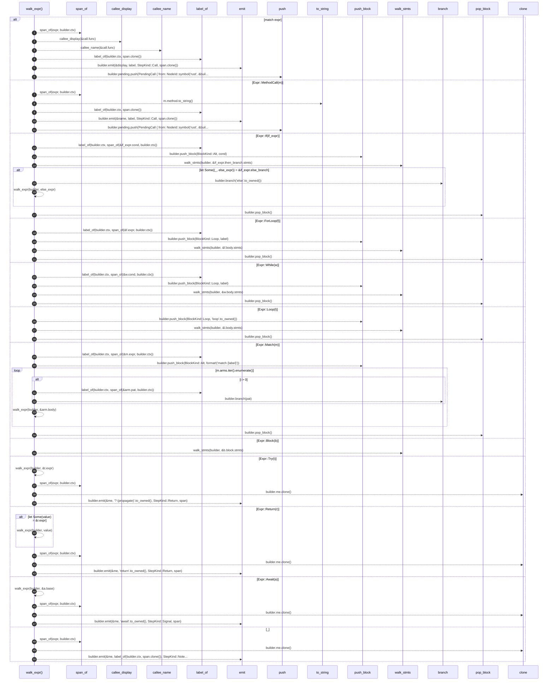

# `robby_extract::walk_expr`

[Self-model](../README.md) · [robby_extract](index.md)

| | |
|---|---|
| kind | `code.function` |
| signature | `fn walk_expr(builder: &mut ProcBuilder<'_, '_>, expr: &Expr)` |
| location | [`crates/robby-extract/src/lib.rs:666`](../../../crates/robby-extract/src/lib.rs#L666) |
| provenance | extractor · confidence 1.00 |

```rust
fn walk_expr(builder: &mut ProcBuilder<'_, '_>, expr: &Expr) {
    match expr {
        Expr::Call(call) => {
            let span = span_of(expr, builder.ctx);
            let display = callee_display(&call.func);
            let key = callee_name(&call.func);
            let label = label_of(builder.ctx, span.clone());
            builder.emit(&display, label, StepKind::Call, span.clone());
            builder.pending.push(PendingCall {
                from: NodeId::symbol("rust", &builder.me_id),
                name: key,
                span,
            });
        }
        Expr::MethodCall(m) => {
            let span = span_of(expr, builder.ctx);
            let name = m.method.to_string();
            let label = label_of(builder.ctx, span.clone());
            builder.emit(&name, label, StepKind::Call, span.clone());
            builder.pending.push(PendingCall {
                from: NodeId::symbol("rust", &builder.me_id),
                name,
                span,
            });
        }
        Expr::If(if_expr) => {
            let cond = label_of(builder.ctx, span_of(&if_expr.cond, builder.ctx));
            builder.push_block(BlockKind::Alt, cond);
            walk_stmts(builder, &if_expr.then_branch.stmts);
            if let Some((_, else_expr)) = &if_expr.else_branch {
                builder.branch("else".to_owned());
                walk_expr(builder, else_expr);
            }
            builder.pop_block();
        }
        Expr::ForLoop(f) => {
            let label = label_of(builder.ctx, span_of(&f.expr, builder.ctx));
            builder.push_block(BlockKind::Loop, label);
            walk_stmts(builder, &f.body.stmts);
            builder.pop_block();
        }
        Expr::While(w) => {
            let label = label_of(builder.ctx, span_of(&w.cond, builder.ctx));
            builder.push_block(BlockKind::Loop, label);
            walk_stmts(builder, &w.body.stmts);
            builder.pop_block();
        }
        Expr::Loop(l) => {
            builder.push_block(BlockKind::Loop, "loop".to_owned());
            walk_stmts(builder, &l.body.stmts);
            builder.pop_block();
        }
        Expr::Match(m) => {
            let label = label_of(builder.ctx, span_of(&m.expr, builder.ctx));
            builder.push_block(BlockKind::Alt, format!("match {label}"));
            for (i, arm) in m.arms.iter().enumerate() {
                if i > 0 {
                    let pat = label_of(builder.ctx, span_of(&arm.pat, builder.ctx));
                    builder.branch(pat);
                }
                walk_expr(builder, &arm.body);
            }
            builder.pop_block();
        }
        Expr::Block(b) => walk_stmts(builder, &b.block.stmts),
        Expr::Try(t) => {
            walk_expr(builder, &t.expr);
            let span = span_of(expr, builder.ctx);
            let me = builder.me.clone();
            builder.emit(&me, "? (propagate)".to_owned(), StepKind::Return, span);
        }
        Expr::Return(r) => {
            if let Some(value) = &r.expr {
                walk_expr(builder, value);
            }
            let span = span_of(expr, builder.ctx);
            let me = builder.me.clone();
            builder.emit(&me, "return".to_owned(), StepKind::Return, span);
        }
        Expr::Await(a) => {
            walk_expr(builder, &a.base);
            let span = span_of(expr, builder.ctx);
            let me = builder.me.clone();
            builder.emit(&me, "await".to_owned(), StepKind::Signal, span);
        }
        _ => {
            let span = span_of(expr, builder.ctx);
            let me = builder.me.clone();
            builder.emit(&me, label_of(builder.ctx, span.clone()), StepKind::Note, span);
        }
    }
}
```



50 steps · 0 observed · 50 possible only

**Edges**

- calls → [`robby_extract::span_of`](span-of.md)
- calls → [`robby_extract::callee_display`](callee-display.md)
- calls → [`robby_extract::callee_name`](callee-name.md)
- calls → [`robby_extract::label_of`](label-of.md)
- calls → [`robby_extract::impl ProcBuilder<'_, '_>::emit`](index.md)
- calls → [`robby_extract::span_of`](span-of.md)
- calls → [`robby_extract::label_of`](label-of.md)
- calls → [`robby_extract::impl ProcBuilder<'_, '_>::emit`](index.md)
- calls → [`robby_extract::label_of`](label-of.md)
- calls → [`robby_extract::impl ProcBuilder<'_, '_>::push_block`](index.md)
- calls → [`robby_extract::walk_stmts`](walk-stmts.md)
- calls → [`robby_extract::impl ProcBuilder<'_, '_>::branch`](index.md)
- calls → [`robby_extract::walk_expr`](walk-expr.md)
- calls → [`robby_extract::impl ProcBuilder<'_, '_>::pop_block`](index.md)
- calls → [`robby_extract::label_of`](label-of.md)
- calls → [`robby_extract::impl ProcBuilder<'_, '_>::push_block`](index.md)
- calls → [`robby_extract::walk_stmts`](walk-stmts.md)
- calls → [`robby_extract::impl ProcBuilder<'_, '_>::pop_block`](index.md)
- calls → [`robby_extract::label_of`](label-of.md)
- calls → [`robby_extract::impl ProcBuilder<'_, '_>::push_block`](index.md)
- calls → [`robby_extract::walk_stmts`](walk-stmts.md)
- calls → [`robby_extract::impl ProcBuilder<'_, '_>::pop_block`](index.md)
- calls → [`robby_extract::impl ProcBuilder<'_, '_>::push_block`](index.md)
- calls → [`robby_extract::walk_stmts`](walk-stmts.md)
- calls → [`robby_extract::impl ProcBuilder<'_, '_>::pop_block`](index.md)
- calls → [`robby_extract::label_of`](label-of.md)
- calls → [`robby_extract::impl ProcBuilder<'_, '_>::push_block`](index.md)
- calls → [`robby_extract::label_of`](label-of.md)
- calls → [`robby_extract::impl ProcBuilder<'_, '_>::branch`](index.md)
- calls → [`robby_extract::walk_expr`](walk-expr.md)
- calls → [`robby_extract::impl ProcBuilder<'_, '_>::pop_block`](index.md)
- calls → [`robby_extract::walk_stmts`](walk-stmts.md)
- calls → [`robby_extract::walk_expr`](walk-expr.md)
- calls → [`robby_extract::span_of`](span-of.md)
- calls → [`robby_extract::impl ProcBuilder<'_, '_>::emit`](index.md)
- calls → [`robby_extract::walk_expr`](walk-expr.md)
- calls → [`robby_extract::span_of`](span-of.md)
- calls → [`robby_extract::impl ProcBuilder<'_, '_>::emit`](index.md)
- calls → [`robby_extract::walk_expr`](walk-expr.md)
- calls → [`robby_extract::span_of`](span-of.md)
- calls → [`robby_extract::impl ProcBuilder<'_, '_>::emit`](index.md)
- calls → [`robby_extract::span_of`](span-of.md)
- calls → [`robby_extract::impl ProcBuilder<'_, '_>::emit`](index.md)

