# `robby_extract::walk_items`

[Self-model](../README.md) · [robby_extract](index.md)

| | |
|---|---|
| kind | `code.function` |
| signature | `fn walk_items(     doc: &mut Document,     items: &[Item],     parent: &NodeId,     ctx: &Ctx<'_>,     pending: &mut Vec<PendingCall>, )` |
| location | [`crates/robby-extract/src/lib.rs:193`](../../../crates/robby-extract/src/lib.rs#L193) |
| provenance | extractor · confidence 1.00 |

```rust
fn walk_items(
    doc: &mut Document,
    items: &[Item],
    parent: &NodeId,
    ctx: &Ctx<'_>,
    pending: &mut Vec<PendingCall>,
) {
    for item in items {
        let span = span_of(item, ctx);
        let fqn_base = ctx.module.clone();

        match item {
            Item::Fn(f) => {
                let fqn = format!("{fqn_base}::{}", f.sig.ident);
                let mut node = item_node(kind::code::FUNCTION, &fqn, span.clone(), parent);
                node.signature = Some(signature_of(f, ctx));
                node.docs = docs_of(&f.sig, &f.attrs);
                node.process = Some(build_process(f, ctx, &fqn, pending));
                doc.merge(node);
            }
            Item::Struct(s) => {
                let fqn = format!("{fqn_base}::{}", s.ident);
                let mut node = item_node(kind::code::STRUCT, &fqn, span.clone(), parent);
                node.docs = docs_of(&s.ident, &s.attrs);
                for field in &s.fields {
                    if let Some(ident) = &field.ident {
                        let child_fqn = format!("{fqn}::{ident}");
                        let child = item_node(
                            kind::code::FIELD,
                            &child_fqn,
                            span_of(field, ctx),
                            &NodeId::symbol("rust", &fqn),
                        );
                        doc.merge(child);
                        node.children.push(NodeId::symbol("rust", &child_fqn));
                    }
                }
                doc.merge(node);
            }
            Item::Enum(e) => {
                let fqn = format!("{fqn_base}::{}", e.ident);
                let mut node = item_node(kind::code::ENUM, &fqn, span.clone(), parent);
                node.docs = docs_of(&e.ident, &e.attrs);
                for variant in &e.variants {
                    let child_fqn = format!("{fqn}::{}", variant.ident);
                    doc.merge(item_node(
                        kind::code::VARIANT,
                        &child_fqn,
                        span_of(variant, ctx),
                        &NodeId::symbol("rust", &fqn),
                    ));
                    node.children.push(NodeId::symbol("rust", &child_fqn));
                }
                doc.merge(node);
            }
            Item::Union(u) => {
                let fqn = format!("{fqn_base}::{}", u.ident);
                doc.merge(item_node(kind::code::UNION, &fqn, span, parent));
            }
            Item::Trait(t) => {
                let fqn = format!("{fqn_base}::{}", t.ident);
                let mut node = item_node(kind::code::TRAIT, &fqn, span.clone(), parent);
                node.docs = docs_of(&t.ident, &t.attrs);
                for ti in &t.items {
                    if let syn::TraitItem::Fn(m) = ti {
                        let child_fqn = format!("{fqn}::{}", m.sig.ident);
                        doc.merge(item_node(
                            kind::code::METHOD,
                            &child_fqn,
                            span_of(m, ctx),
                            &NodeId::symbol("rust", &fqn),
                        ));
                        node.children.push(NodeId::symbol("rust", &child_fqn));
                    }
                }
                doc.merge(node);
            }
            Item::Impl(i) => {
                let self_name = type_text(&i.self_ty);
                let trait_part = i
                    .trait_
                    .as_ref()
                    .map(|(path, _)| format!("{} for ", path_text(path)))
                    .unwrap_or_default();
                let fqn = format!("{fqn_base}::impl {trait_part}{self_name}");
                let mut node = item_node(kind::code::IMPL, &fqn, span.clone(), parent);
                for ii in &i.items {
                    match ii {
                        syn::ImplItem::Fn(m) => {
                            let child_fqn = format!("{fqn}::{}", m.sig.ident);
                            let mut child = item_node(
                                kind::code::METHOD,
                                &child_fqn,
                                span_of(m, ctx),
                                &NodeId::symbol("rust", &fqn),
                            );
                            child.signature = Some(format!(
                                "fn {}({})",
                                m.sig.ident,
                                m.sig.inputs.len()
                            ));
                            child.docs = docs_of(&m.sig, &m.attrs);
                            child.process =
                                Some(build_process_sig(&m.sig, &m.block, ctx, &child_fqn, pending));
                            doc.merge(child);
                            node.children.push(NodeId::symbol("rust", &child_fqn));
                        }
                        syn::ImplItem::Const(c) => {
                            let child_fqn = format!("{fqn}::{}", c.ident);
                            doc.merge(item_node(
                                kind::code::CONST,
                                &child_fqn,
                                span_of(c, ctx),
                                &NodeId::symbol("rust", &fqn),
                            ));
                            node.children.push(NodeId::symbol("rust", &child_fqn));
                        }
                        syn::ImplItem::Type(t) => {
                            let child_fqn = format!("{fqn}::{}", t.ident);
                            doc.merge(item_node(
                                kind::code::TYPE_ALIAS,
                                &child_fqn,
                                span_of(t, ctx),
                                &NodeId::symbol("rust", &fqn),
                            ));
                            node.children.push(NodeId::symbol("rust", &child_fqn));
                        }
                        _ => {}
                    }
                }
                doc.merge(node);
            }
            Item::Mod(m) => {
                let fqn = format!("{fqn_base}::{}", m.ident);
                let mut node = item_node(kind::code::MODULE, &fqn, span.clone(), parent);
                if let Some((_, items)) = &m.content {
                    node.children.clear();
                    doc.merge(node);
                    walk_items(doc, items, &NodeId::symbol("rust", &fqn), ctx, pending);
                } else {
                    doc.merge(node);
                }
            }
            Item::Const(c) => {
                let fqn = format!("{fqn_base}::{}", c.ident);
                doc.merge(item_node(kind::code::CONST, &fqn, span, parent));
            }
            Item::Static(s) => {
                let fqn = format!("{fqn_base}::{}", s.ident);
                doc.merge(item_node(kind::code::STATIC, &fqn, span, parent));
            }
            Item::Type(t) => {
                let fqn = format!("{fqn_base}::{}", t.ident);
                doc.merge(item_node(kind::code::TYPE_ALIAS, &fqn, span, parent));
            }
            Item::TraitAlias(t) => {
                let fqn = format!("{fqn_base}::{}", t.ident);
                doc.merge(item_node(kind::code::TRAIT_ALIAS, &fqn, span, parent));
            }
            Item::Use(u) => {
                let fqn = format!("{fqn_base}::use@{}", span.start.byte);
                doc.merge(item_node(kind::code::IMPORT, &fqn, span, parent));
                let _ = u;
            }
            Item::ExternCrate(e) => {
                let fqn = format!("{fqn_base}::extern {}", e.ident);
                doc.merge(item_node(kind::code::EXTERN_CRATE, &fqn, span, parent));
            }
            Item::ForeignMod(f) => {
                let fqn = format!("{fqn_base}::extern@{}", span.start.byte);
                doc.merge(item_node(kind::code::FOREIGN_MOD, &fqn, span, parent));
                let _ = f;
            }
            Item::Macro(m) => {
                let name = m
                    .ident
                    .as_ref()
                    .map(|i| i.to_string())
                    .unwrap_or_else(|| "macro".to_owned());
                let fqn = format!("{fqn_base}::{name}@{}", span.start.byte);
                doc.merge(item_node(kind::code::MACRO, &fqn, span, parent));
            }
            _ => {
                let fqn = format!("{fqn_base}::item@{}", span.start.byte);
                doc.merge(item_node(kind::code::VERBATIM, &fqn, span, parent));
            }
        }
    }
}
```

```mermaid
sequenceDiagram
    autonumber
    participant walk_items as walk_items()
    participant span_of as span_of
    participant clone as clone
    participant item_node as item_node
    participant merge as merge
    participant push as push
    participant type_text as type_text
    participant unwrap_or_default as unwrap_or_default
    participant clear as clear
    participant unwrap_or_else as unwrap_or_else
    loop items
    walk_items-->>span_of: span_of(item, ctx)
    walk_items-->>clone: ctx.module.clone()
    alt match item
    walk_items-->>walk_items: format!('{fqn_base}::{}', f.sig.ident)
    walk_items-->>item_node: item_node(kind::code::FUNCTION, &fqn, span.clone(), parent)
    walk_items-->>walk_items: node.signature = Some(signature_of(f, ctx))
    walk_items-->>walk_items: node.docs = docs_of(&f.sig, &f.attrs)
    walk_items-->>walk_items: node.process = Some(build_process(f, ctx, &fqn, pending))
    walk_items-->>merge: doc.merge(node)
    else Item::Struct(s)
    walk_items-->>walk_items: format!('{fqn_base}::{}', s.ident)
    walk_items-->>item_node: item_node(kind::code::STRUCT, &fqn, span.clone(), parent)
    walk_items-->>walk_items: node.docs = docs_of(&s.ident, &s.attrs)
    loop &s.fields
    alt let Some(ident) = &field.ident
    walk_items-->>walk_items: format!('{fqn}::{ident}')
    walk_items-->>item_node: item_node( kind::code::FIELD, &child_fqn, span_of(field, ctx), &NodeI...
    walk_items-->>merge: doc.merge(child)
    walk_items-->>push: node.children.push(NodeId::symbol('rust', &child_fqn))
    end
    end
    walk_items-->>merge: doc.merge(node)
    else Item::Enum(e)
    walk_items-->>walk_items: format!('{fqn_base}::{}', e.ident)
    walk_items-->>item_node: item_node(kind::code::ENUM, &fqn, span.clone(), parent)
    walk_items-->>walk_items: node.docs = docs_of(&e.ident, &e.attrs)
    loop &e.variants
    walk_items-->>walk_items: format!('{fqn}::{}', variant.ident)
    walk_items-->>merge: doc.merge(item_node( kind::code::VARIANT, &child_fqn, span_of(variant...
    walk_items-->>push: node.children.push(NodeId::symbol('rust', &child_fqn))
    end
    walk_items-->>merge: doc.merge(node)
    else Item::Union(u)
    walk_items-->>walk_items: format!('{fqn_base}::{}', u.ident)
    walk_items-->>merge: doc.merge(item_node(kind::code::UNION, &fqn, span, parent))
    else Item::Trait(t)
    walk_items-->>walk_items: format!('{fqn_base}::{}', t.ident)
    walk_items-->>item_node: item_node(kind::code::TRAIT, &fqn, span.clone(), parent)
    walk_items-->>walk_items: node.docs = docs_of(&t.ident, &t.attrs)
    loop &t.items
    alt let syn::TraitItem::Fn(m) = ti
    walk_items-->>walk_items: format!('{fqn}::{}', m.sig.ident)
    walk_items-->>merge: doc.merge(item_node( kind::code::METHOD, &child_fqn, span_of(m, ctx),...
    walk_items-->>push: node.children.push(NodeId::symbol('rust', &child_fqn))
    end
    end
    walk_items-->>merge: doc.merge(node)
    else Item::Impl(i)
    walk_items-->>type_text: type_text(&i.self_ty)
    walk_items-->>unwrap_or_default: i .trait_ .as_ref() .map(|(path, _)| format!('{} for ', path_text(pat...
    walk_items-->>walk_items: format!('{fqn_base}::impl {trait_part}{self_name}')
    walk_items-->>item_node: item_node(kind::code::IMPL, &fqn, span.clone(), parent)
    loop &i.items
    alt match ii
    walk_items-->>walk_items: format!('{fqn}::{}', m.sig.ident)
    walk_items-->>item_node: item_node( kind::code::METHOD, &child_fqn, span_of(m, ctx), &NodeId::...
    walk_items-->>walk_items: child.signature = Some(format!( 'fn {}({})', m.sig.ident, m.sig.input...
    walk_items-->>walk_items: child.docs = docs_of(&m.sig, &m.attrs)
    walk_items-->>walk_items: child.process = Some(build_process_sig(&m.sig, &m.block, ctx, &child_...
    walk_items-->>merge: doc.merge(child)
    walk_items-->>push: node.children.push(NodeId::symbol('rust', &child_fqn))
    else syn::ImplItem::Const(c)
    walk_items-->>walk_items: format!('{fqn}::{}', c.ident)
    walk_items-->>merge: doc.merge(item_node( kind::code::CONST, &child_fqn, span_of(c, ctx), ...
    walk_items-->>push: node.children.push(NodeId::symbol('rust', &child_fqn))
    else syn::ImplItem::Type(t)
    walk_items-->>walk_items: format!('{fqn}::{}', t.ident)
    walk_items-->>merge: doc.merge(item_node( kind::code::TYPE_ALIAS, &child_fqn, span_of(t, c...
    walk_items-->>push: node.children.push(NodeId::symbol('rust', &child_fqn))
    end
    end
    walk_items-->>merge: doc.merge(node)
    else Item::Mod(m)
    walk_items-->>walk_items: format!('{fqn_base}::{}', m.ident)
    walk_items-->>item_node: item_node(kind::code::MODULE, &fqn, span.clone(), parent)
    alt let Some((_, items)) = &m.content
    walk_items-->>clear: node.children.clear()
    walk_items-->>merge: doc.merge(node)
    walk_items-->>walk_items: walk_items(doc, items, &NodeId::symbol('rust', &fqn), ctx, pending)
    else else
    walk_items-->>merge: doc.merge(node)
    end
    walk_items-->>walk_items: format!('{fqn_base}::{}', c.ident)
    walk_items-->>merge: doc.merge(item_node(kind::code::CONST, &fqn, span, parent))
    else Item::Static(s)
    walk_items-->>walk_items: format!('{fqn_base}::{}', s.ident)
    walk_items-->>merge: doc.merge(item_node(kind::code::STATIC, &fqn, span, parent))
    else Item::Type(t)
    walk_items-->>walk_items: format!('{fqn_base}::{}', t.ident)
    walk_items-->>merge: doc.merge(item_node(kind::code::TYPE_ALIAS, &fqn, span, parent))
    else Item::TraitAlias(t)
    walk_items-->>walk_items: format!('{fqn_base}::{}', t.ident)
    walk_items-->>merge: doc.merge(item_node(kind::code::TRAIT_ALIAS, &fqn, span, parent))
    else Item::Use(u)
    walk_items-->>walk_items: format!('{fqn_base}::use@{}', span.start.byte)
    walk_items-->>merge: doc.merge(item_node(kind::code::IMPORT, &fqn, span, parent))
    walk_items-->>walk_items: u
    else Item::ExternCrate(e)
    walk_items-->>walk_items: format!('{fqn_base}::extern {}', e.ident)
    walk_items-->>merge: doc.merge(item_node(kind::code::EXTERN_CRATE, &fqn, span, parent))
    else Item::ForeignMod(f)
    walk_items-->>walk_items: format!('{fqn_base}::extern@{}', span.start.byte)
    walk_items-->>merge: doc.merge(item_node(kind::code::FOREIGN_MOD, &fqn, span, parent))
    walk_items-->>walk_items: f
    else Item::Macro(m)
    walk_items-->>unwrap_or_else: m .ident .as_ref() .map(|i| i.to_string()) .unwrap_or_else(|| 'macro'...
    walk_items-->>walk_items: format!('{fqn_base}::{name}@{}', span.start.byte)
    walk_items-->>merge: doc.merge(item_node(kind::code::MACRO, &fqn, span, parent))
    else _
    walk_items-->>walk_items: format!('{fqn_base}::item@{}', span.start.byte)
    walk_items-->>merge: doc.merge(item_node(kind::code::VERBATIM, &fqn, span, parent))
    end
    end
```



77 steps · 0 observed · 77 possible only

**Edges**

- calls → [`robby_extract::span_of`](span-of.md)
- calls → [`robby_extract::item_node`](item-node.md)
- calls → [`robby_ir::model::impl Document::merge`](../robby_ir/model/index.md)
- calls → [`robby_extract::item_node`](item-node.md)
- calls → [`robby_extract::item_node`](item-node.md)
- calls → [`robby_ir::model::impl Document::merge`](../robby_ir/model/index.md)
- calls → [`robby_ir::model::impl Document::merge`](../robby_ir/model/index.md)
- calls → [`robby_extract::item_node`](item-node.md)
- calls → [`robby_ir::model::impl Document::merge`](../robby_ir/model/index.md)
- calls → [`robby_ir::model::impl Document::merge`](../robby_ir/model/index.md)
- calls → [`robby_ir::model::impl Document::merge`](../robby_ir/model/index.md)
- calls → [`robby_extract::item_node`](item-node.md)
- calls → [`robby_ir::model::impl Document::merge`](../robby_ir/model/index.md)
- calls → [`robby_ir::model::impl Document::merge`](../robby_ir/model/index.md)
- calls → [`robby_extract::type_text`](type-text.md)
- calls → [`robby_extract::item_node`](item-node.md)
- calls → [`robby_extract::item_node`](item-node.md)
- calls → [`robby_ir::model::impl Document::merge`](../robby_ir/model/index.md)
- calls → [`robby_ir::model::impl Document::merge`](../robby_ir/model/index.md)
- calls → [`robby_ir::model::impl Document::merge`](../robby_ir/model/index.md)
- calls → [`robby_ir::model::impl Document::merge`](../robby_ir/model/index.md)
- calls → [`robby_extract::item_node`](item-node.md)
- calls → [`robby_ir::model::impl Document::merge`](../robby_ir/model/index.md)
- calls → [`robby_extract::walk_items`](walk-items.md)
- calls → [`robby_ir::model::impl Document::merge`](../robby_ir/model/index.md)
- calls → [`robby_ir::model::impl Document::merge`](../robby_ir/model/index.md)
- calls → [`robby_ir::model::impl Document::merge`](../robby_ir/model/index.md)
- calls → [`robby_ir::model::impl Document::merge`](../robby_ir/model/index.md)
- calls → [`robby_ir::model::impl Document::merge`](../robby_ir/model/index.md)
- calls → [`robby_ir::model::impl Document::merge`](../robby_ir/model/index.md)
- calls → [`robby_ir::model::impl Document::merge`](../robby_ir/model/index.md)
- calls → [`robby_ir::model::impl Document::merge`](../robby_ir/model/index.md)
- calls → [`robby_ir::model::impl Document::merge`](../robby_ir/model/index.md)
- calls → [`robby_ir::model::impl Document::merge`](../robby_ir/model/index.md)

