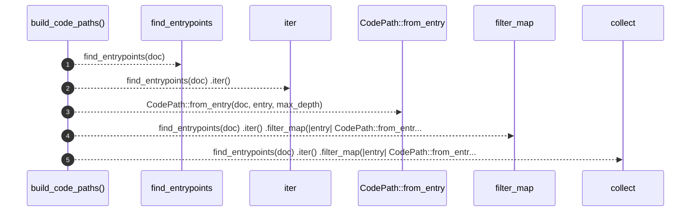

# `robby_ir::codepath::build_code_paths`

[Self-model](../../README.md) · [codepath](index.md)

| | |
|---|---|
| kind | `code.function` |
| signature | `fn build_code_paths(doc: &Document, max_depth: u32) -> Vec<CodePath>` |
| location | [`crates/robby-ir/src/codepath.rs:121`](../../../../crates/robby-ir/src/codepath.rs#L121) |
| provenance | extractor · confidence 1.00 |

> Build a [`CodePath`] for every discovered entrypoint.

```rust
/// Build a [`CodePath`] for every discovered entrypoint.
pub fn build_code_paths(doc: &Document, max_depth: u32) -> Vec<CodePath> {
    find_entrypoints(doc)
        .iter()
        .filter_map(|entry| CodePath::from_entry(doc, entry, max_depth))
        .collect()
}
```



5 steps · 0 observed · 5 possible only

**Edges**

- calls → [`robby_ir::codepath::find_entrypoints`](find-entrypoints.md)
- calls → [`robby_ir::codepath::impl CodePath::from_entry`](index.md)
- calls → [`robby_render::view::select::collect`](../../robby_render/view/select/collect.md)

## References

- calls → [`robby_ir::codepath`](index.md) — find_entrypoints, from_entry
- calls → [`robby_render::view::select`](../../robby_render/view/select/index.md) — collect

## Referenced by

- calls ← [`robby_ir::codepath::builds_path_from_main`](tests/builds-path-from-main.md)
- calls ← [`robby_ir::model::impl Document::rebuild_code_paths`](../model/index.md)

