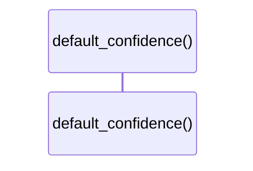

# `robby_ir::codepath::default_confidence`

[Self-model](../../README.md) · [codepath](index.md)

| | |
|---|---|
| kind | `code.function` |
| signature | `fn default_confidence() -> f32` |
| location | [`crates/robby-ir/src/codepath.rs:30`](../../../../crates/robby-ir/src/codepath.rs#L30) |
| provenance | extractor · confidence 1.00 |

```rust
fn default_confidence() -> f32 {
    1.0
}
```



0 steps · 0 observed · 0 possible only

