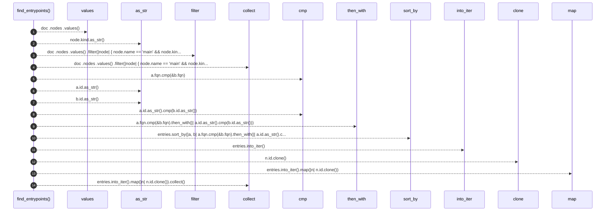

# `robby_ir::codepath::find_entrypoints`

[Self-model](../../README.md) · [codepath](index.md)

| | |
|---|---|
| kind | `code.function` |
| signature | `fn find_entrypoints(doc: &Document) -> Vec<NodeId>` |
| location | [`crates/robby-ir/src/codepath.rs:108`](../../../../crates/robby-ir/src/codepath.rs#L108) |
| provenance | extractor · confidence 1.00 |

> Functions named `main` (MVP entrypoint set), sorted by FQN.

```rust
/// Functions named `main` (MVP entrypoint set), sorted by FQN.
pub fn find_entrypoints(doc: &Document) -> Vec<NodeId> {
    let mut entries: Vec<&crate::Node> = doc
        .nodes
        .values()
        .filter(|node| {
            node.name == "main" && node.kind.as_str() == kind::code::FUNCTION
        })
        .collect();
    entries.sort_by(|a, b| a.fqn.cmp(&b.fqn).then_with(|| a.id.as_str().cmp(b.id.as_str())));
    entries.into_iter().map(|n| n.id.clone()).collect()
}
```



14 steps · 0 observed · 14 possible only

**Edges**

- calls → [`robby_ir::kind::impl Kind::as_str`](../kind/index.md)
- calls → [`robby_render::view::select::collect`](../../robby_render/view/select/collect.md)
- calls → [`robby_ir::kind::impl Kind::as_str`](../kind/index.md)
- calls → [`robby_ir::kind::impl Kind::as_str`](../kind/index.md)
- calls → [`robby_render::view::select::collect`](../../robby_render/view/select/collect.md)

## References

- calls → [`robby_ir::kind`](../kind/index.md) — as_str
- calls → [`robby_render::view::select`](../../robby_render/view/select/index.md) — collect

## Referenced by

- calls ← [`robby_ir::codepath::build_code_paths`](build-code-paths.md)
- calls ← [`robby_render::view::entrypoints::impl CallTree::from_document`](../../robby_render/view/entrypoints/index.md)

