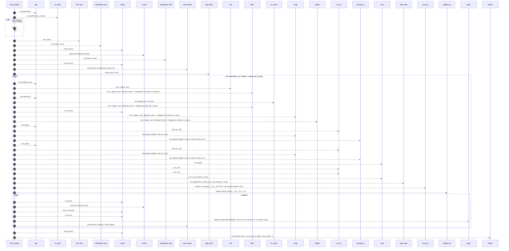

# `robby_ir::codepath::impl CodePath`

[Self-model](../../README.md) · [codepath](index.md)

| | |
|---|---|
| kind | `code.impl` |
| location | [`crates/robby-ir/src/codepath.rs:49`](../../../../crates/robby-ir/src/codepath.rs#L49) |
| provenance | extractor · confidence 1.00 |

```rust
impl CodePath {
    /// Build one path from `entry` over resolved `Calls` edges.
    pub fn from_entry(doc: &Document, entry: &NodeId, max_depth: u32) -> Option<Self> {
        if doc.get(entry).is_none() {
            return None;
        }

        let mut edges = Vec::new();
        let mut placed = BTreeSet::new();
        placed.insert(entry.clone());

        let mut queue: VecDeque<(NodeId, u32)> = VecDeque::new();
        queue.push_back((entry.clone(), 0));

        while let Some((from_id, depth)) = queue.pop_front() {
            if depth >= max_depth {
                continue;
            }
            let Some(from) = doc.get(&from_id) else {
                continue;
            };

            let mut callees: Vec<(NodeId, f32)> = from
                .edges
                .iter()
                .filter(|e| e.kind == EdgeKind::Calls && e.resolved)
                .filter(|e| doc.get(&e.to).is_some())
                .map(|e| (e.to.clone(), e.confidence))
                .collect();
            callees.sort_by(|(a, _), (b, _)| {
                let fa = doc.get(a).map(|n| n.fqn.as_str()).unwrap_or("");
                let fb = doc.get(b).map(|n| n.fqn.as_str()).unwrap_or("");
                fa.cmp(fb).then_with(|| a.as_str().cmp(b.as_str()))
            });
            callees.dedup_by(|(a, _), (b, _)| a == b);

            for (to, confidence) in callees {
                if to == from_id || !placed.insert(to.clone()) {
                    continue;
                }
                let child_depth = depth + 1;
                edges.push(CodePathEdge {
                    from: from_id.clone(),
                    to: to.clone(),
                    depth: child_depth,
                    confidence,
                });
                queue.push_back((to, child_depth));
            }
        }

        Some(Self {
            entry: entry.clone(),
            edges,
            max_depth,
        })
    }
}
```

## References

- calls → [`robby_ir::kind`](../kind/index.md) — as_str, new
- calls → [`robby_ir::model`](../model/index.md) — get, insert
- calls → [`robby_render::report`](../../robby_render/report/index.md) — push
- calls → [`robby_render::view::select`](../../robby_render/view/select/index.md) — collect

## Referenced by

- calls ← [`robby_ir::codepath::build_code_paths`](build-code-paths.md)
- calls ← [`robby_ir::codepath::respects_max_depth`](tests/respects-max-depth.md)
- calls ← [`robby_render::view::entrypoints::impl CallTree::from_entries`](../../robby_render/view/entrypoints/index.md)
- calls ← [`robby_render::view::execution::execution_process`](../../robby_render/view/execution/execution-process.md)

### `from_entry`

| | |
|---|---|
| kind | `code.method` |
| signature | `fn from_entry(3)` |
| location | [`crates/robby-ir/src/codepath.rs:50`](../../../../crates/robby-ir/src/codepath.rs#L50) |
| provenance | extractor · confidence 1.00 |

> Build one path from `entry` over resolved `Calls` edges.

```rust
/// Build one path from `entry` over resolved `Calls` edges.
    pub fn from_entry(doc: &Document, entry: &NodeId, max_depth: u32) -> Option<Self> {
        if doc.get(entry).is_none() {
            return None;
        }

        let mut edges = Vec::new();
        let mut placed = BTreeSet::new();
        placed.insert(entry.clone());

        let mut queue: VecDeque<(NodeId, u32)> = VecDeque::new();
        queue.push_back((entry.clone(), 0));

        while let Some((from_id, depth)) = queue.pop_front() {
            if depth >= max_depth {
                continue;
            }
            let Some(from) = doc.get(&from_id) else {
                continue;
            };

            let mut callees: Vec<(NodeId, f32)> = from
                .edges
                .iter()
                .filter(|e| e.kind == EdgeKind::Calls && e.resolved)
                .filter(|e| doc.get(&e.to).is_some())
                .map(|e| (e.to.clone(), e.confidence))
                .collect();
            callees.sort_by(|(a, _), (b, _)| {
                let fa = doc.get(a).map(|n| n.fqn.as_str()).unwrap_or("");
                let fb = doc.get(b).map(|n| n.fqn.as_str()).unwrap_or("");
                fa.cmp(fb).then_with(|| a.as_str().cmp(b.as_str()))
            });
            callees.dedup_by(|(a, _), (b, _)| a == b);

            for (to, confidence) in callees {
                if to == from_id || !placed.insert(to.clone()) {
                    continue;
                }
                let child_depth = depth + 1;
                edges.push(CodePathEdge {
                    from: from_id.clone(),
                    to: to.clone(),
                    depth: child_depth,
                    confidence,
                });
                queue.push_back((to, child_depth));
            }
        }

        Some(Self {
            entry: entry.clone(),
            edges,
            max_depth,
        })
    }
```



43 steps · 0 observed · 43 possible only

**Edges**

- calls → [`robby_ir::model::impl Document::get`](../model/index.md)
- calls → [`robby_ir::kind::impl Kind::new`](../kind/index.md)
- calls → [`robby_ir::kind::impl Kind::new`](../kind/index.md)
- calls → [`robby_ir::model::impl Document::insert`](../model/index.md)
- calls → [`robby_ir::kind::impl Kind::new`](../kind/index.md)
- calls → [`robby_ir::model::impl Document::get`](../model/index.md)
- calls → [`robby_ir::model::impl Document::get`](../model/index.md)
- calls → [`robby_render::view::select::collect`](../../robby_render/view/select/collect.md)
- calls → [`robby_ir::model::impl Document::get`](../model/index.md)
- calls → [`robby_ir::kind::impl Kind::as_str`](../kind/index.md)
- calls → [`robby_ir::model::impl Document::get`](../model/index.md)
- calls → [`robby_ir::kind::impl Kind::as_str`](../kind/index.md)
- calls → [`robby_ir::kind::impl Kind::as_str`](../kind/index.md)
- calls → [`robby_ir::kind::impl Kind::as_str`](../kind/index.md)
- calls → [`robby_ir::model::impl Document::insert`](../model/index.md)
- calls → [`robby_render::report::impl Report::push`](../../robby_render/report/index.md)

