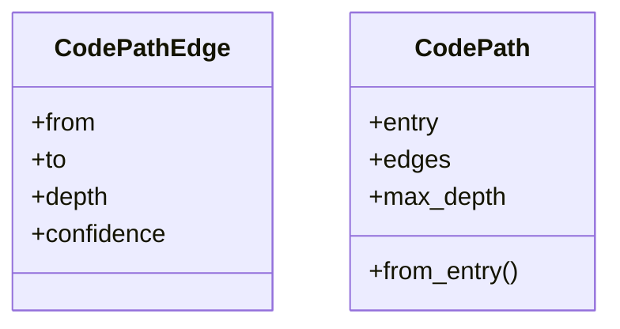
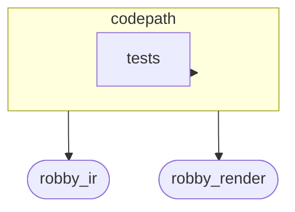
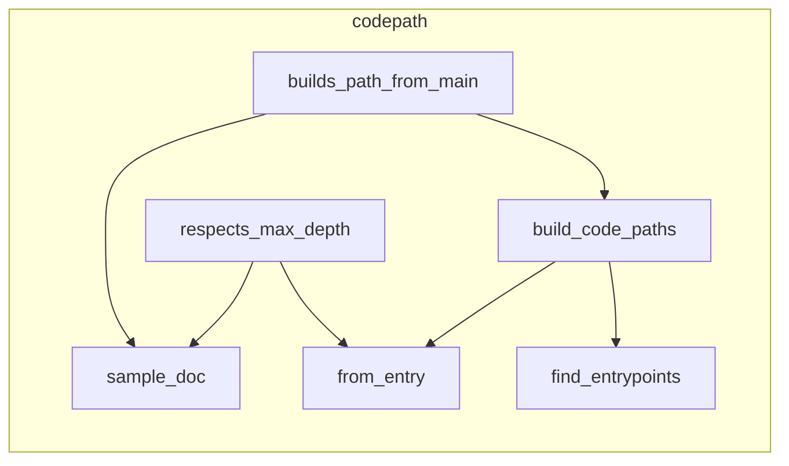

# `robby_ir::codepath`

[Self-model](../../README.md) · [robby_ir](../index.md)

| | |
|---|---|
| kind | `code.module` |
| declared at | [`crates/robby-ir/src/lib.rs:18`](../../../../crates/robby-ir/src/lib.rs#L18) |
| provenance | extractor · confidence 1.00 |
| nodes | 28 |

## Types



## Package diagram



## Module coupling



## Dependency matrix

| | codepath | robby_ir | tests | robby_render |
|---|---:|---:|---:|---:|
| **codepath** | · | 32 | 2 | 7 |
| **robby_ir** | | · | | |
| **tests** | | | · | |
| **robby_render** | | | | · |

## Comments

- `crates/robby-ir/src/codepath.rs:108:1` (docs, `robby_ir::codepath::find_entrypoints`): "Functions named `main` (MVP entrypoint set), sorted by FQN."
  ```
  /// Functions named `main` (MVP entrypoint set), sorted by FQN.
  pub fn find_entrypoints(doc: &Document) -> Vec<NodeId> {
      let mut entries: Vec<&crate::Node> = doc
          .nodes
          .values()
          .filter(|node| node.name == "main" && node.kind.as_str() == kind::code::FUNCTION)
          .collect();
      entries.sort_by(|a, b| {
          a.fqn
              .cmp(&b.fqn)
              .then_with(|| a.id.as_str().cmp(b.id.as_str()))
      });
      entries.into_iter().map(|n| n.id.clone()).collect()
  }
  ```
- `crates/robby-ir/src/codepath.rs:123:1` (docs, `robby_ir::codepath::build_code_paths`): "Build a [`CodePath`] for every discovered entrypoint."
  ```
  /// Build a [`CodePath`] for every discovered entrypoint.
  pub fn build_code_paths(doc: &Document, max_depth: u32) -> Vec<CodePath> {
      find_entrypoints(doc)
          .iter()
          .filter_map(|entry| CodePath::from_entry(doc, entry, max_depth))
          .collect()
  }
  ```
- `crates/robby-ir/src/codepath.rs:19:1` (docs, `robby_ir::codepath::CodePathEdge`): "One hop in an entrypoint call tree."
  ```
  /// One hop in an entrypoint call tree.
  #[derive(Debug, Clone, PartialEq, Serialize, Deserialize, JsonSchema)]
  pub struct CodePathEdge {
      pub from: NodeId,
      pub to: NodeId,
      /// Depth of [`Self::to`] from the path entry (entry itself is 0).
      pub depth: u32,
      #[serde(default = "default_confidence", skip_serializing_if = "is_one")]
      pub confidence: f32,
  }
  ```
- `crates/robby-ir/src/codepath.rs:40:1` (docs, `robby_ir::codepath::CodePath`): "Reachability tree rooted at one entrypoint function."
  ```
  /// Reachability tree rooted at one entrypoint function.
  #[derive(Debug, Clone, PartialEq, Serialize, Deserialize, JsonSchema)]
  pub struct CodePath {
      /// Entrypoint node (typically a `main`).
      pub entry: NodeId,
      /// BFS-ordered tree edges within this path. Shared callees may appear in
      /// multiple paths; consumers that need a single tree apply first-parent wins.
      pub edges: Vec<CodePathEdge>,
      pub max_depth: u32,
  }
  ```
- `crates/robby-ir/src/codepath.rs:52:5` (docs, `robby_ir::codepath::impl CodePath::from_entry`): "Build one path from `entry` over resolved `Calls` edges."
  ```
  /// Build one path from `entry` over resolved `Calls` edges.
      pub fn from_entry(doc: &Document, entry: &NodeId, max_depth: u32) -> Option<Self> {
          doc.get(entry)?;
  
          let mut edges = Vec::new();
          let mut placed = BTreeSet::new();
          placed.insert(entry.clone());
  
          let mut queue: VecDeque<(NodeId, u32)> = VecDeque::new();
          queue.push_back((entry.clone(), 0));
  
          while let Some((from_id, depth)) = queue.pop_front() {
              if depth >= max_depth {
                  continue;
              }
              let Some(from) = doc.get(&from_id) else {
                  continue;
              };
  
              let mut callees: Vec<(NodeId, f32)> = from
                  .edges
                  .iter()
                  .filter(|e| e.kind == EdgeKind::Calls && e.resolved)
                  .filter(|e| doc.get(&e.to).is_some())
                  .map(|e| (e.to.clone(), e.confidence))
                  .collect();
              callees.sort_by(|(a, _), (b, _)| {
                  let fa = doc.get(a).map_or("", |n| n.fqn.as_str());
                  let fb = doc.get(b).map_or("", |n| n.fqn.as_str());
                  fa.cmp(fb).then_with(|| a.as_str().cmp(b.as_str()))
              });
              callees.dedup_by(|(a, _), (b, _)| a == b);
  
              for (to, confidence) in callees {
                  if to == from_id || !placed.insert(to.clone()) {
                      continue;
                  }
                  let child_depth = depth + 1;
                  edges.push(CodePathEdge {
                      from: from_id.clone(),
                      to: to.clone(),
                      depth: child_depth,
                      confidence,
                  });
                  queue.push_back((to, child_depth));
              }
          }
  
          Some(Self {
              entry: entry.clone(),
              edges,
              max_depth,
          })
      }
  ```
## References

- calls → [`robby_ir::kind`](../kind/index.md) — as_str, new
- calls → [`robby_ir::model`](../model/index.md) — insert, symbol
- calls → [`robby_ir::run`](../run/index.md) — get
- calls → [`robby_render::report`](../../robby_render/report/index.md) — push
- calls → [`robby_render::view::select`](../../robby_render/view/select/index.md) — collect

## Referenced by

- calls ← [`robby_ir::model::impl Document::rebuild_code_paths`](../model/index.md)
- calls ← [`robby_render::view::entrypoints::impl CallTree::from_document`](../../robby_render/view/entrypoints/index.md)
- calls ← [`robby_render::view::entrypoints::impl CallTree::from_entries`](../../robby_render/view/entrypoints/index.md)
- calls ← [`robby_render::view::execution::execution_process`](../../robby_render/view/execution/execution-process.md)

## Modules

- [`codepath::tests`](tests/index.md) — 6 nodes

## Items

| Item | Kind | Steps | Location |
|---|---|---:|---|
| [`DEFAULT_MAX_DEPTH`](default-max-depth.md) | `code.const` | — | `crates/robby-ir/src/codepath.rs:16:1` |
| [`CodePathEdge`](codepathedge.md) | `code.struct` | — | `crates/robby-ir/src/codepath.rs:19:1` |
| [`default_confidence`](default-confidence.md) | `code.function` | 0 | `crates/robby-ir/src/codepath.rs:30:1` |
| [`is_one`](is-one.md) | `code.function` | 1 | `crates/robby-ir/src/codepath.rs:35:1` |
| [`CodePath`](codepath.md) | `code.struct` | — | `crates/robby-ir/src/codepath.rs:40:1` |
| [`impl CodePath`](impl-codepath.md) | `code.impl` | — | `crates/robby-ir/src/codepath.rs:51:1` |
| [`find_entrypoints`](find-entrypoints.md) | `code.function` | 14 | `crates/robby-ir/src/codepath.rs:108:1` |
| [`build_code_paths`](build-code-paths.md) | `code.function` | 5 | `crates/robby-ir/src/codepath.rs:123:1` |

## Imports

- `use std::collections::{BTreeSet, VecDeque};`
- `use schemars::JsonSchema;`
- `use serde::{Deserialize, Serialize};`
- `use crate::kind;`
- `use crate::model::{Document, EdgeKind, NodeId};`

