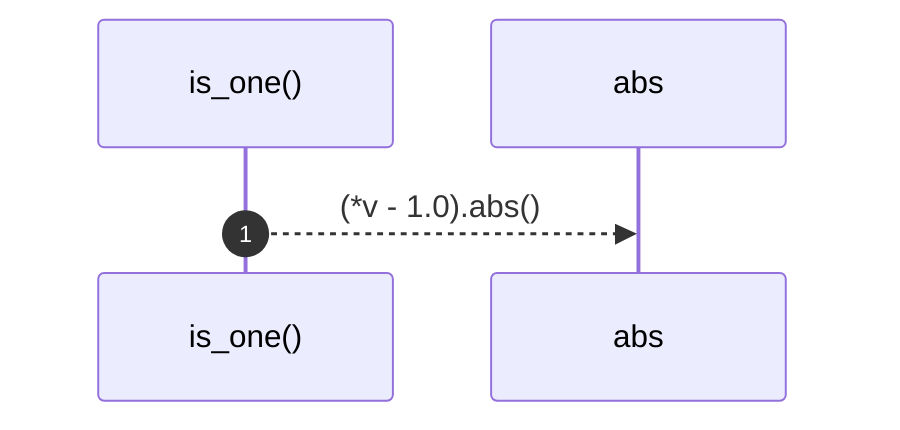

# `robby_ir::codepath::is_one`

[Self-model](../../README.md) · [codepath](index.md)

| | |
|---|---|
| kind | `code.function` |
| signature | `fn is_one(v: &f32) -> bool` |
| location | [`crates/robby-ir/src/codepath.rs:35`](../../../../crates/robby-ir/src/codepath.rs#L35) |
| provenance | extractor · confidence 1.00 |

```rust
#[allow(clippy::trivially_copy_pass_by_ref)]
fn is_one(v: &f32) -> bool {
    (*v - 1.0).abs() < f32::EPSILON
}
```



1 steps · 0 observed · 1 possible only

