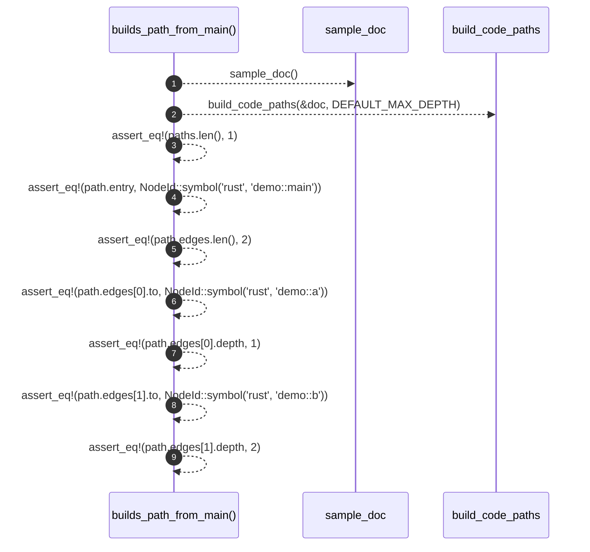

# `robby_ir::codepath::builds_path_from_main`

[Self-model](../../../README.md) · [codepath::tests](index.md)

| | |
|---|---|
| kind | `code.function` |
| signature | `fn builds_path_from_main()` |
| location | [`crates/robby-ir/src/codepath.rs:162`](../../../../../crates/robby-ir/src/codepath.rs#L162) |
| provenance | extractor · confidence 1.00 |

```rust
#[test]
    fn builds_path_from_main() {
        let doc = sample_doc();
        let paths = build_code_paths(&doc, DEFAULT_MAX_DEPTH);
        assert_eq!(paths.len(), 1);
        let path = &paths[0];
        assert_eq!(path.entry, NodeId::symbol("rust", "demo::main"));
        assert_eq!(path.edges.len(), 2);
        assert_eq!(path.edges[0].to, NodeId::symbol("rust", "demo::a"));
        assert_eq!(path.edges[0].depth, 1);
        assert_eq!(path.edges[1].to, NodeId::symbol("rust", "demo::b"));
        assert_eq!(path.edges[1].depth, 2);
    }
```



9 steps · 0 observed · 9 possible only

**Edges**

- calls → [`robby_ir::codepath::sample_doc`](sample-doc.md)
- calls → [`robby_ir::codepath::build_code_paths`](../build-code-paths.md)

## References

- calls → [`robby_ir::codepath`](../index.md) — build_code_paths
- calls → [`robby_ir::codepath::tests`](index.md) — sample_doc

