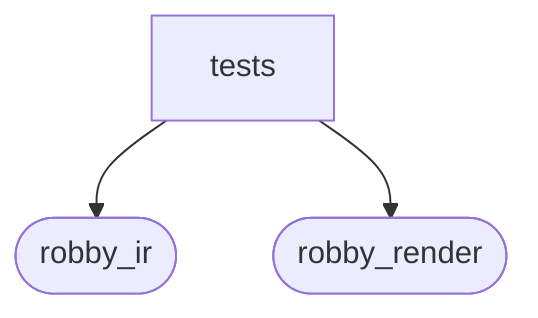

# `robby_ir::codepath::tests`

[Self-model](../../../README.md) · [codepath](../index.md)

| | |
|---|---|
| kind | `code.module` |
| declared at | [`crates/robby-ir/src/codepath.rs:131`](../../../../../crates/robby-ir/src/codepath.rs#L131) |
| provenance | extractor · confidence 1.00 |
| nodes | 6 |

## Package diagram

## Dependency matrix

| | tests | robby_ir | robby_render |
|---|---:|---:|---:|
| **tests** | · | 17 | 2 |
| **robby_ir** | | · | |
| **robby_render** | | | · |
## References

- calls → [`robby_ir::codepath`](../index.md) — build_code_paths, from_entry
- calls → [`robby_ir::kind`](../../kind/index.md) — new
- calls → [`robby_ir::model`](../../model/index.md) — insert, symbol
- calls → [`robby_render::report`](../../../robby_render/report/index.md) — push

## Items

| Item | Kind | Steps | Location |
|---|---|---:|---|
| [`sample_doc`](sample-doc.md) | `code.function` | 16 | `crates/robby-ir/src/codepath.rs:136:5` |
| [`builds_path_from_main`](builds-path-from-main.md) | `code.function` | 9 | `crates/robby-ir/src/codepath.rs:168:5` |
| [`respects_max_depth`](respects-max-depth.md) | `code.function` | 6 | `crates/robby-ir/src/codepath.rs:182:5` |

## Imports

- `use super::*;`
- `use crate::{Edge, Node};`

