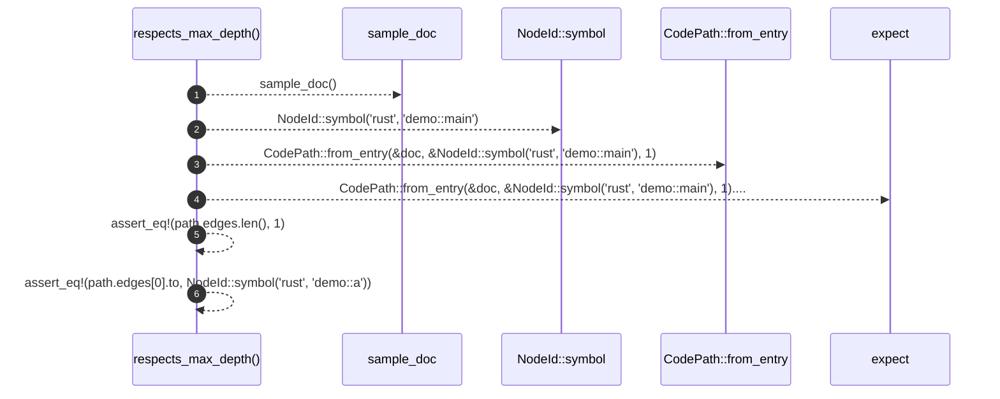

# `robby_ir::codepath::respects_max_depth`

[Self-model](../../../README.md) · [codepath::tests](index.md)

| | |
|---|---|
| kind | `code.function` |
| signature | `fn respects_max_depth()` |
| location | [`crates/robby-ir/src/codepath.rs:182`](../../../../../crates/robby-ir/src/codepath.rs#L182) |
| provenance | extractor · confidence 1.00 |

```rust
#[test]
    fn respects_max_depth() {
        let doc = sample_doc();
        let path =
            CodePath::from_entry(&doc, &NodeId::symbol("rust", "demo::main"), 1).expect("path");
        assert_eq!(path.edges.len(), 1);
        assert_eq!(path.edges[0].to, NodeId::symbol("rust", "demo::a"));
    }
```



6 steps · 0 observed · 6 possible only

**Edges**

- calls → [`robby_ir::codepath::sample_doc`](sample-doc.md)
- calls → [`robby_ir::model::impl NodeId::symbol`](../../model/index.md)
- calls → [`robby_ir::codepath::impl CodePath::from_entry`](../index.md)

## References

- calls → [`robby_ir::codepath`](../index.md) — from_entry
- calls → [`robby_ir::codepath::tests`](index.md) — sample_doc
- calls → [`robby_ir::model`](../../model/index.md) — symbol

