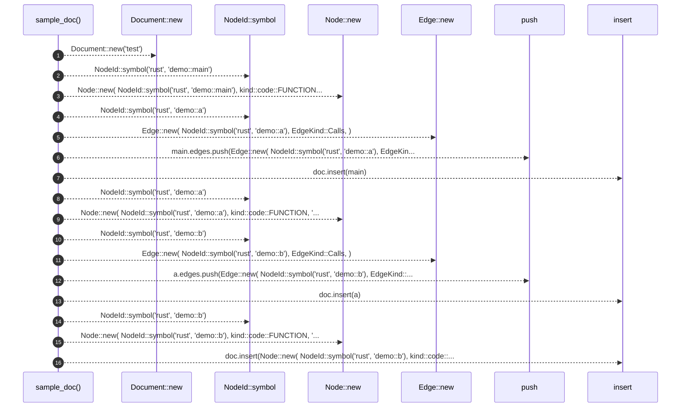

# `robby_ir::codepath::sample_doc`

[Self-model](../../../README.md) · [codepath::tests](index.md)

| | |
|---|---|
| kind | `code.function` |
| signature | `fn sample_doc() -> Document` |
| location | [`crates/robby-ir/src/codepath.rs:136`](../../../../../crates/robby-ir/src/codepath.rs#L136) |
| provenance | extractor · confidence 1.00 |

```rust
fn sample_doc() -> Document {
        let mut doc = Document::new("test");
        let mut main = Node::new(
            NodeId::symbol("rust", "demo::main"),
            kind::code::FUNCTION,
            "demo::main",
        );
        main.edges.push(Edge::new(
            NodeId::symbol("rust", "demo::a"),
            EdgeKind::Calls,
        ));
        doc.insert(main);

        let mut a = Node::new(
            NodeId::symbol("rust", "demo::a"),
            kind::code::FUNCTION,
            "demo::a",
        );
        a.edges.push(Edge::new(
            NodeId::symbol("rust", "demo::b"),
            EdgeKind::Calls,
        ));
        doc.insert(a);

        doc.insert(Node::new(
            NodeId::symbol("rust", "demo::b"),
            kind::code::FUNCTION,
            "demo::b",
        ));
        doc
    }
```



16 steps · 0 observed · 16 possible only

**Edges**

- calls → [`robby_ir::kind::impl Kind::new`](../../kind/index.md)
- calls → [`robby_ir::model::impl NodeId::symbol`](../../model/index.md)
- calls → [`robby_ir::kind::impl Kind::new`](../../kind/index.md)
- calls → [`robby_ir::model::impl NodeId::symbol`](../../model/index.md)
- calls → [`robby_ir::kind::impl Kind::new`](../../kind/index.md)
- calls → [`robby_render::report::impl Report::push`](../../../robby_render/report/index.md)
- calls → [`robby_ir::model::impl Document::insert`](../../model/index.md)
- calls → [`robby_ir::model::impl NodeId::symbol`](../../model/index.md)
- calls → [`robby_ir::kind::impl Kind::new`](../../kind/index.md)
- calls → [`robby_ir::model::impl NodeId::symbol`](../../model/index.md)
- calls → [`robby_ir::kind::impl Kind::new`](../../kind/index.md)
- calls → [`robby_render::report::impl Report::push`](../../../robby_render/report/index.md)
- calls → [`robby_ir::model::impl Document::insert`](../../model/index.md)
- calls → [`robby_ir::model::impl NodeId::symbol`](../../model/index.md)
- calls → [`robby_ir::kind::impl Kind::new`](../../kind/index.md)
- calls → [`robby_ir::model::impl Document::insert`](../../model/index.md)

## References

- calls → [`robby_ir::kind`](../../kind/index.md) — new
- calls → [`robby_ir::model`](../../model/index.md) — insert, symbol
- calls → [`robby_render::report`](../../../robby_render/report/index.md) — push

## Referenced by

- calls ← [`robby_ir::codepath::builds_path_from_main`](builds-path-from-main.md)
- calls ← [`robby_ir::codepath::respects_max_depth`](respects-max-depth.md)

