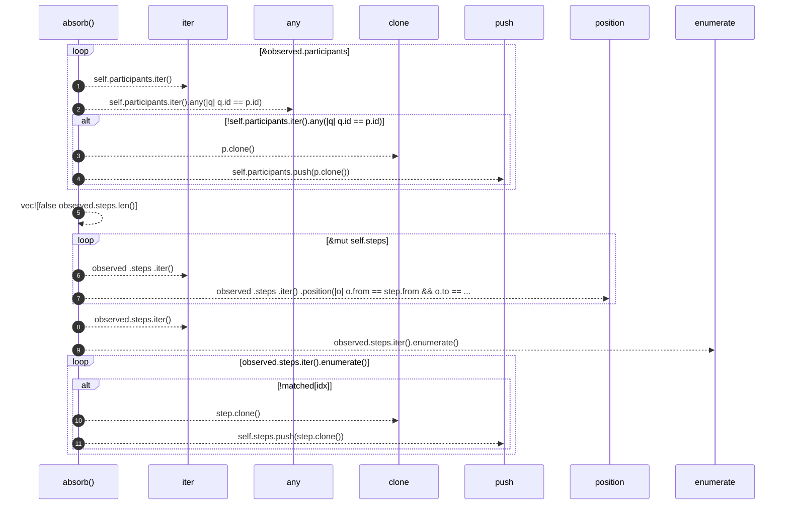

# `robby_ir::contract::impl Absorb for Process`

[Self-model](../../README.md) · [contract](index.md)

| | |
|---|---|
| kind | `code.impl` |
| location | [`crates/robby-ir/src/contract.rs:20`](../../../../crates/robby-ir/src/contract.rs#L20) |
| provenance | extractor · confidence 1.00 |

```rust
impl Absorb for Process {
    fn absorb(&mut self, observed: &Self) {
        for p in &observed.participants {
            if !self.participants.iter().any(|q| q.id == p.id) {
                self.participants.push(p.clone());
            }
        }

        let mut matched = vec![false; observed.steps.len()];
        for step in &mut self.steps {
            if let Some(idx) = observed
                .steps
                .iter()
                .position(|o| o.from == step.from && o.to == step.to && o.label == step.label)
            {
                step.observed = true;
                matched[idx] = true;
            }
        }
        for (idx, step) in observed.steps.iter().enumerate() {
            if !matched[idx] {
                self.steps.push(step.clone());
            }
        }
    }
}
```

## References

- calls → [`robby_render::report`](../../robby_render/report/index.md) — push

### `absorb`

| | |
|---|---|
| kind | `code.method` |
| signature | `fn absorb(2)` |
| location | [`crates/robby-ir/src/contract.rs:21`](../../../../crates/robby-ir/src/contract.rs#L21) |
| provenance | extractor · confidence 1.00 |

```rust
fn absorb(&mut self, observed: &Self) {
        for p in &observed.participants {
            if !self.participants.iter().any(|q| q.id == p.id) {
                self.participants.push(p.clone());
            }
        }

        let mut matched = vec![false; observed.steps.len()];
        for step in &mut self.steps {
            if let Some(idx) = observed
                .steps
                .iter()
                .position(|o| o.from == step.from && o.to == step.to && o.label == step.label)
            {
                step.observed = true;
                matched[idx] = true;
            }
        }
        for (idx, step) in observed.steps.iter().enumerate() {
            if !matched[idx] {
                self.steps.push(step.clone());
            }
        }
    }
```



11 steps · 0 observed · 11 possible only

**Edges**

- calls → [`robby_render::report::impl Report::push`](../../robby_render/report/index.md)
- calls → [`robby_render::report::impl Report::push`](../../robby_render/report/index.md)

