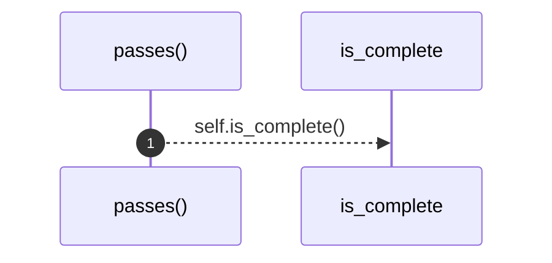
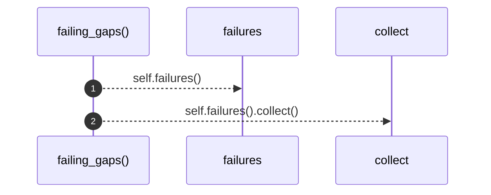

# `robby_ir::contract::impl CoverageGate for CoverageReport`

[Self-model](../../README.md) · [contract](index.md)

| | |
|---|---|
| kind | `code.impl` |
| location | [`crates/robby-ir/src/contract.rs:82`](../../../../crates/robby-ir/src/contract.rs#L82) |
| provenance | extractor · confidence 1.00 |

```rust
impl CoverageGate for CoverageReport {
    fn passes(&self) -> bool {
        self.is_complete()
    }

    fn failing_gaps(&self) -> Vec<(&FileCoverage, &Gap)> {
        self.failures().collect()
    }
}
```

## References

- calls → [`robby_ir::coverage`](../coverage/index.md) — failures, is_complete
- calls → [`robby_render::view::select`](../../robby_render/view/select/index.md) — collect

### `passes`

| | |
|---|---|
| kind | `code.method` |
| signature | `fn passes(1)` |
| location | [`crates/robby-ir/src/contract.rs:83`](../../../../crates/robby-ir/src/contract.rs#L83) |
| provenance | extractor · confidence 1.00 |

```rust
fn passes(&self) -> bool {
        self.is_complete()
    }
```



1 steps · 0 observed · 1 possible only

**Edges**

- calls → [`robby_ir::coverage::impl FileCoverage::is_complete`](../coverage/index.md)

### `failing_gaps`

| | |
|---|---|
| kind | `code.method` |
| signature | `fn failing_gaps(1)` |
| location | [`crates/robby-ir/src/contract.rs:87`](../../../../crates/robby-ir/src/contract.rs#L87) |
| provenance | extractor · confidence 1.00 |

```rust
fn failing_gaps(&self) -> Vec<(&FileCoverage, &Gap)> {
        self.failures().collect()
    }
```



2 steps · 0 observed · 2 possible only

**Edges**

- calls → [`robby_ir::coverage::impl CoverageReport::failures`](../coverage/index.md)
- calls → [`robby_render::view::select::collect`](../../robby_render/view/select/collect.md)

