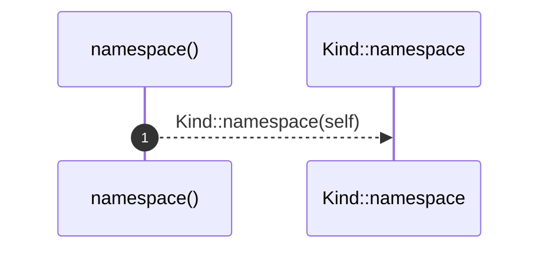

# `robby_ir::contract::impl KindNamespace for Kind`

[Self-model](../../README.md) · [contract](index.md)

| | |
|---|---|
| kind | `code.impl` |
| location | [`crates/robby-ir/src/contract.rs:69`](../../../../crates/robby-ir/src/contract.rs#L69) |
| provenance | extractor · confidence 1.00 |

```rust
impl KindNamespace for Kind {
    fn namespace(&self) -> &str {
        Kind::namespace(self)
    }
}
```

### `namespace`

| | |
|---|---|
| kind | `code.method` |
| signature | `fn namespace(1)` |
| location | [`crates/robby-ir/src/contract.rs:70`](../../../../crates/robby-ir/src/contract.rs#L70) |
| provenance | extractor · confidence 1.00 |

```rust
fn namespace(&self) -> &str {
        Kind::namespace(self)
    }
```



1 steps · 0 observed · 1 possible only

**Edges**

- calls → [`robby_ir::contract::impl KindNamespace for Kind::namespace`](index.md)

