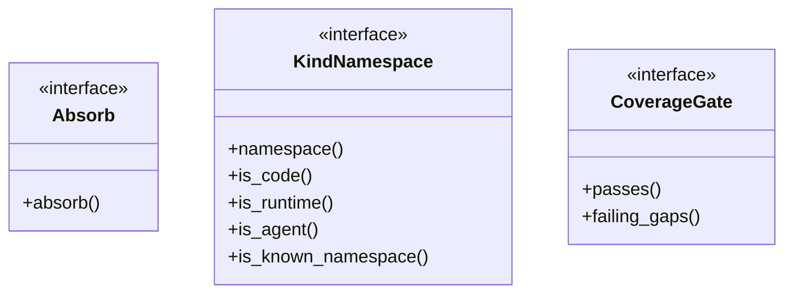
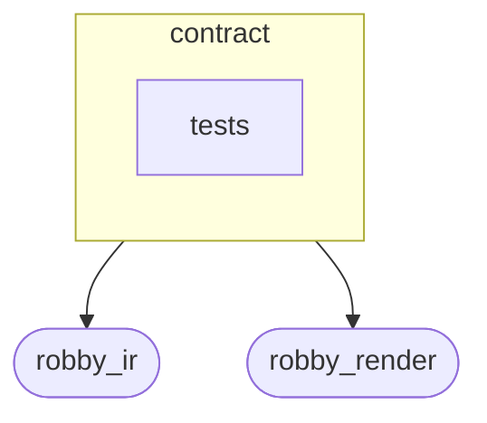
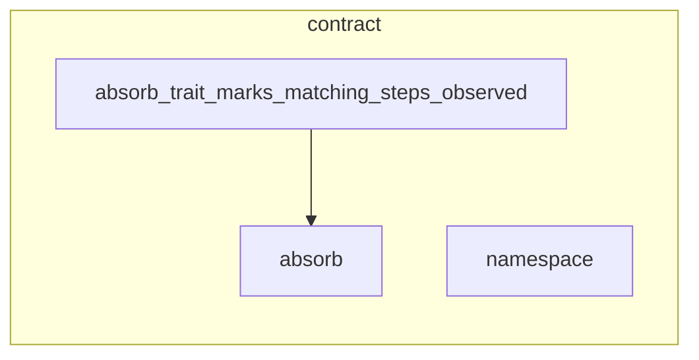

# `robby_ir::contract`

[Self-model](../../README.md) · [robby_ir](../index.md)

| | |
|---|---|
| kind | `code.module` |
| declared at | [`crates/robby-ir/src/lib.rs:19`](../../../../crates/robby-ir/src/lib.rs#L19) |
| provenance | extractor · confidence 1.00 |
| nodes | 28 |

## Types



## Package diagram



## Module coupling



## Dependency matrix

| | contract | tests | robby_ir | robby_render |
|---|---:|---:|---:|---:|
| **contract** | · | | 18 | 3 |
| **tests** | | · | | |
| **robby_ir** | | | · | |
| **robby_render** | | | | · |

## Comments

- `crates/robby-ir/src/contract.rs:11:1` (docs, `robby_ir::contract::Absorb`): "Merge an observed value into a static (or earlier) one without dropping prior structure. For [`Process`], matching is b…"
  ```
  /// Merge an observed value into a static (or earlier) one without dropping prior
  /// structure.
  ///
  /// For [`Process`], matching is by `(from, to, label)`: observed steps mark
  /// matches; unmatched observed steps append; static-only steps stay dashed.
  pub trait Absorb {
      fn absorb(&mut self, observed: &Self);
  }
  ```
- `crates/robby-ir/src/contract.rs:47:1` (docs, `robby_ir::contract::KindNamespace`): "Open-kind namespace queries. Unknown namespaces must still round-trip."
  ```
  /// Open-kind namespace queries. Unknown namespaces must still round-trip.
  pub trait KindNamespace {
      fn namespace(&self) -> &str;
  
      fn is_code(&self) -> bool {
          self.namespace() == "code"
      }
  
      fn is_runtime(&self) -> bool {
          self.namespace() == "runtime"
      }
  
      fn is_agent(&self) -> bool {
          self.namespace() == "agent"
      }
  
      /// `code` | `runtime` | `agent` — soft gap otherwise, never a hard error.
      fn is_known_namespace(&self) -> bool {
          matches!(self.namespace(), "code" | "runtime" | "agent")
      }
  }
  ```
- `crates/robby-ir/src/contract.rs:75:1` (docs, `robby_ir::contract::CoverageGate`): "Coverage completeness gate: unknown gaps fail; trivia does not."
  ```
  /// Coverage completeness gate: unknown gaps fail; trivia does not.
  pub trait CoverageGate {
      fn passes(&self) -> bool;
  
      fn failing_gaps(&self) -> Vec<(&FileCoverage, &Gap)>;
  }
  ```
## References

- calls → [`robby_ir::coverage`](../coverage/index.md) — failures, is_complete
- calls → [`robby_ir::kind`](../kind/index.md) — new
- calls → [`robby_ir::process`](../process/index.md) — participant, step
- calls → [`robby_render::report`](../../robby_render/report/index.md) — push
- calls → [`robby_render::view::select`](../../robby_render/view/select/index.md) — collect

## Referenced by

- calls ← [`robby_ir::kind::is_known`](../kind/is-known.md)
- calls ← [`robby_render::pipeline::impl Loaded::is_ok`](../../robby_render/pipeline/index.md)

## Modules

- [`contract::tests`](tests/index.md) — 6 nodes

## Items

| Item | Kind | Steps | Location |
|---|---|---:|---|
| [`Absorb`](absorb.md) | `code.trait` | — | `crates/robby-ir/src/contract.rs:11:1` |
| [`impl Absorb for Process`](impl-absorb-for-process.md) | `code.impl` | — | `crates/robby-ir/src/contract.rs:20:1` |
| [`KindNamespace`](kindnamespace.md) | `code.trait` | — | `crates/robby-ir/src/contract.rs:47:1` |
| [`impl KindNamespace for Kind`](impl-kindnamespace-for-kind.md) | `code.impl` | — | `crates/robby-ir/src/contract.rs:69:1` |
| [`CoverageGate`](coveragegate.md) | `code.trait` | — | `crates/robby-ir/src/contract.rs:75:1` |
| [`impl CoverageGate for CoverageReport`](impl-coveragegate-for-coveragereport.md) | `code.impl` | — | `crates/robby-ir/src/contract.rs:82:1` |

## Imports

- `use crate::coverage::{CoverageReport, FileCoverage, Gap};`
- `use crate::kind::Kind;`
- `use crate::process::Process;`

