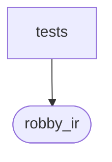

# `robby_ir::contract::tests`

[Self-model](../../../README.md) · [contract](../index.md)

| | |
|---|---|
| kind | `code.module` |
| declared at | [`crates/robby-ir/src/contract.rs:92`](../../../../../crates/robby-ir/src/contract.rs#L92) |
| provenance | extractor · confidence 1.00 |
| nodes | 6 |

## Package diagram

## Dependency matrix

| | tests | robby_ir |
|---|---:|---:|
| **tests** | · | 17 |
| **robby_ir** | | · |
## References

- calls → [`robby_ir::contract`](../index.md) — absorb
- calls → [`robby_ir::kind`](../../kind/index.md) — new
- calls → [`robby_ir::process`](../../process/index.md) — participant, step

## Items

| Item | Kind | Steps | Location |
|---|---|---:|---|
| [`absorb_trait_marks_matching_steps_observed`](absorb-trait-marks-matching-steps-observed.md) | `code.function` | 23 | `crates/robby-ir/src/contract.rs:98:5` |
| [`kind_namespace_helpers`](kind-namespace-helpers.md) | `code.function` | 7 | `crates/robby-ir/src/contract.rs:131:5` |

## Imports

- `use super::*;`
- `use crate::kind;`
- `use crate::process::{Step, StepKind};`

