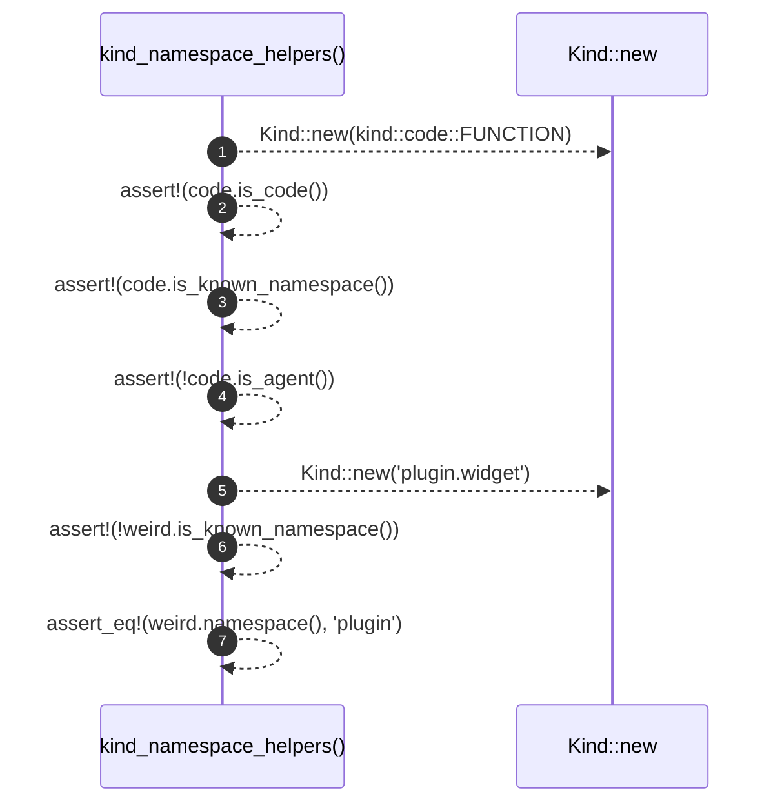

# `robby_ir::contract::kind_namespace_helpers`

[Self-model](../../../README.md) · [contract::tests](index.md)

| | |
|---|---|
| kind | `code.function` |
| signature | `fn kind_namespace_helpers()` |
| location | [`crates/robby-ir/src/contract.rs:131`](../../../../../crates/robby-ir/src/contract.rs#L131) |
| provenance | extractor · confidence 1.00 |

```rust
#[test]
    fn kind_namespace_helpers() {
        let code = Kind::new(kind::code::FUNCTION);
        assert!(code.is_code());
        assert!(code.is_known_namespace());
        assert!(!code.is_agent());

        let weird = Kind::new("plugin.widget");
        assert!(!weird.is_known_namespace());
        assert_eq!(weird.namespace(), "plugin");
    }
```



7 steps · 0 observed · 7 possible only

**Edges**

- calls → [`robby_ir::kind::impl Kind::new`](../../kind/index.md)
- calls → [`robby_ir::kind::impl Kind::new`](../../kind/index.md)

## References

- calls → [`robby_ir::kind`](../../kind/index.md) — new

