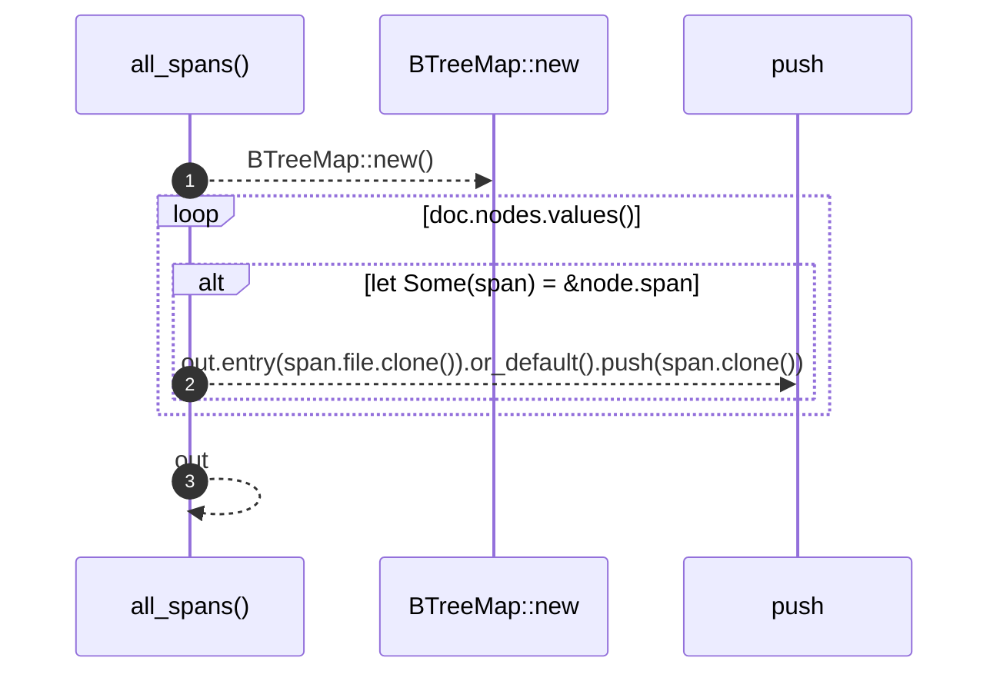

# `robby_ir::coverage::all_spans`

[Self-model](../../README.md) · [coverage](index.md)

| | |
|---|---|
| kind | `code.function` |
| signature | `fn all_spans(doc: &Document) -> BTreeMap<String, Vec<Span>>` |
| location | [`crates/robby-ir/src/coverage.rs:209`](../../../../crates/robby-ir/src/coverage.rs#L209) |
| provenance | extractor · confidence 1.00 |

> Every span in the document, per file.
> 
> This is the default claim set: a byte is represented when *some* node owns
> it, at any nesting level. It catches missing items, missing files, and code
> outside any item. It deliberately does **not** try to catch shallow nesting —
> a function span covers its own body, and proving that every statement got a
> node needs the AST. That check lives in the extractor.

```rust
/// Every span in the document, per file.
///
/// This is the default claim set: a byte is represented when *some* node owns
/// it, at any nesting level. It catches missing items, missing files, and code
/// outside any item. It deliberately does **not** try to catch shallow nesting —
/// a function span covers its own body, and proving that every statement got a
/// node needs the AST. That check lives in the extractor.
pub fn all_spans(doc: &Document) -> BTreeMap<String, Vec<Span>> {
    let mut out: BTreeMap<String, Vec<Span>> = BTreeMap::new();
    for node in doc.nodes.values() {
        if let Some(span) = &node.span {
            out.entry(span.file.clone()).or_default().push(span.clone());
        }
    }
    out
}
```



3 steps · 0 observed · 3 possible only

**Edges**

- calls → [`robby_extract::impl LineIndex::new`](../../robby_extract/index.md)

