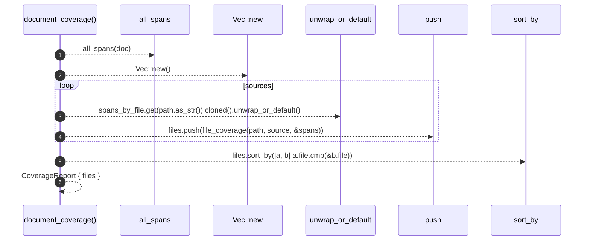

# `robby_ir::coverage::document_coverage`

[Self-model](../../README.md) · [coverage](index.md)

| | |
|---|---|
| kind | `code.function` |
| signature | `fn document_coverage(doc: &Document, sources: &BTreeMap<String, String>) -> CoverageReport` |
| location | [`crates/robby-ir/src/coverage.rs:191`](../../../../crates/robby-ir/src/coverage.rs#L191) |
| provenance | extractor · confidence 1.00 |

> Compute coverage for every source file referenced by the document.
> 
> Files present in `sources` but never referenced still appear in the report,
> fully uncovered. A file that exists and is invisible to the map is exactly
> the failure mode this tool exists to prevent.

```rust
/// Compute coverage for every source file referenced by the document.
///
/// Files present in `sources` but never referenced still appear in the report,
/// fully uncovered. A file that exists and is invisible to the map is exactly
/// the failure mode this tool exists to prevent.
pub fn document_coverage(doc: &Document, sources: &BTreeMap<String, String>) -> CoverageReport {
    let spans_by_file = all_spans(doc);

    let mut files = Vec::new();
    for (path, source) in sources {
        let spans = spans_by_file.get(path.as_str()).cloned().unwrap_or_default();
        files.push(file_coverage(path, source, &spans));
    }
    files.sort_by(|a, b| a.file.cmp(&b.file));

    CoverageReport { files }
}
```



6 steps · 0 observed · 6 possible only

**Edges**

- calls → [`robby_ir::coverage::all_spans`](all-spans.md)
- calls → [`robby_extract::impl LineIndex::new`](../../robby_extract/index.md)

