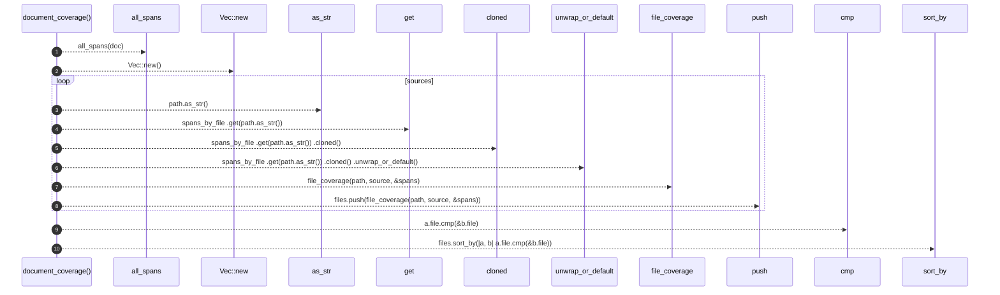

# `robby_ir::coverage::document_coverage`

[Self-model](../../README.md) · [coverage](index.md)

| | |
|---|---|
| kind | `code.function` |
| signature | `fn document_coverage(doc: &Document, sources: &BTreeMap<String, String>) -> CoverageReport` |
| location | [`crates/robby-ir/src/coverage.rs:191`](../../../../crates/robby-ir/src/coverage.rs#L191) |
| provenance | extractor · confidence 1.00 |

> Compute coverage for every source file referenced by the document.
> 
> Files present in `sources` but never referenced still appear in the report,
> fully uncovered. A file that exists and is invisible to the map is exactly
> the failure mode this tool exists to prevent.

```rust
/// Compute coverage for every source file referenced by the document.
///
/// Files present in `sources` but never referenced still appear in the report,
/// fully uncovered. A file that exists and is invisible to the map is exactly
/// the failure mode this tool exists to prevent.
pub fn document_coverage(doc: &Document, sources: &BTreeMap<String, String>) -> CoverageReport {
    let spans_by_file = all_spans(doc);

    let mut files = Vec::new();
    for (path, source) in sources {
        let spans = spans_by_file
            .get(path.as_str())
            .cloned()
            .unwrap_or_default();
        files.push(file_coverage(path, source, &spans));
    }
    files.sort_by(|a, b| a.file.cmp(&b.file));

    CoverageReport { files }
}
```



10 steps · 0 observed · 10 possible only

**Edges**

- calls → [`robby_ir::coverage::all_spans`](all-spans.md)
- calls → [`robby_ir::kind::impl Kind::new`](../kind/index.md)
- calls → [`robby_ir::kind::impl Kind::as_str`](../kind/index.md)
- calls → [`robby_ir::model::impl Document::get`](../model/index.md)
- calls → [`robby_ir::coverage::file_coverage`](file-coverage.md)
- calls → [`robby_render::report::impl Report::push`](../../robby_render/report/index.md)

## References

- calls → [`robby_ir::coverage`](index.md) — all_spans, file_coverage
- calls → [`robby_ir::kind`](../kind/index.md) — as_str, new
- calls → [`robby_ir::model`](../model/index.md) — get
- calls → [`robby_render::report`](../../robby_render/report/index.md) — push

## Referenced by

- calls ← [`robby_extract::test_extract::the_workspace_is_fully_covered`](../../robby_extract/test_extract/the-workspace-is-fully-covered.md)
- calls ← [`robby_extract::test_typescript::typescript_fixture_is_fully_covered`](../../robby_extract/test_typescript/typescript-fixture-is-fully-covered.md)
- calls ← [`robby_ir::test_coverage::document_coverage_is_union_at_any_depth`](../test_coverage/document-coverage-is-union-at-any-depth.md)
- calls ← [`robby_ir::test_coverage::report_orders_worst_files_first`](../test_coverage/report-orders-worst-files-first.md)
- calls ← [`robby_ir::test_coverage::unreferenced_files_appear_fully_uncovered`](../test_coverage/unreferenced-files-appear-fully-uncovered.md)
- calls ← [`robby_render::pipeline::from_document`](../../robby_render/pipeline/from-document.md)

