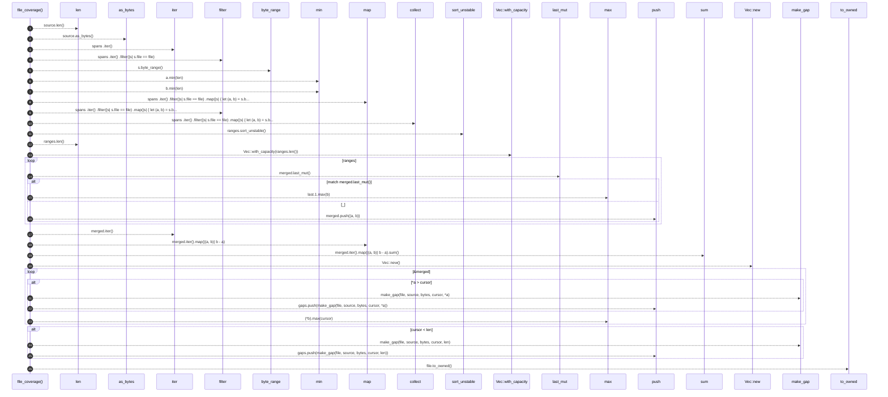

# `robby_ir::coverage::file_coverage`

[Self-model](../../README.md) · [coverage](index.md)

| | |
|---|---|
| kind | `code.function` |
| signature | `fn file_coverage(file: &str, source: &str, spans: &[Span]) -> FileCoverage` |
| location | [`crates/robby-ir/src/coverage.rs:145`](../../../../crates/robby-ir/src/coverage.rs#L145) |
| provenance | extractor · confidence 1.00 |

> Compute coverage for one file given the spans that claim it.

```rust
/// Compute coverage for one file given the spans that claim it.
pub fn file_coverage(file: &str, source: &str, spans: &[Span]) -> FileCoverage {
    let len = source.len() as u32;
    let bytes = source.as_bytes();

    let mut ranges: Vec<(u32, u32)> = spans
        .iter()
        .filter(|s| s.file == file)
        .map(|s| {
            let (a, b) = s.byte_range();
            (a.min(len), b.min(len))
        })
        .filter(|(a, b)| a < b)
        .collect();
    ranges.sort_unstable();

    let mut merged: Vec<(u32, u32)> = Vec::with_capacity(ranges.len());
    for (a, b) in ranges {
        match merged.last_mut() {
            Some(last) if a <= last.1 => last.1 = last.1.max(b),
            _ => merged.push((a, b)),
        }
    }

    let covered_bytes: u32 = merged.iter().map(|(a, b)| b - a).sum();

    let mut gaps = Vec::new();
    let mut cursor = 0u32;
    for (a, b) in &merged {
        if *a > cursor {
            gaps.push(make_gap(file, source, bytes, cursor, *a));
        }
        cursor = (*b).max(cursor);
    }
    if cursor < len {
        gaps.push(make_gap(file, source, bytes, cursor, len));
    }

    FileCoverage {
        file: file.to_owned(),
        total_bytes: len,
        covered_bytes,
        gaps,
    }
}
```



26 steps · 0 observed · 26 possible only

**Edges**

- calls → [`robby_ir::span::impl Span::byte_range`](../span/index.md)
- calls → [`robby_render::view::select::collect`](../../robby_render/view/select/collect.md)
- calls → [`robby_render::report::impl Report::push`](../../robby_render/report/index.md)
- calls → [`robby_ir::kind::impl Kind::new`](../kind/index.md)
- calls → [`robby_ir::coverage::make_gap`](make-gap.md)
- calls → [`robby_render::report::impl Report::push`](../../robby_render/report/index.md)
- calls → [`robby_ir::coverage::make_gap`](make-gap.md)
- calls → [`robby_render::report::impl Report::push`](../../robby_render/report/index.md)

## References

- calls → [`robby_ir::coverage`](index.md) — make_gap
- calls → [`robby_ir::kind`](../kind/index.md) — new
- calls → [`robby_ir::span`](../span/index.md) — byte_range
- calls → [`robby_render::report`](../../robby_render/report/index.md) — push
- calls → [`robby_render::view::select`](../../robby_render/view/select/index.md) — collect

## Referenced by

- calls ← [`robby_ir::coverage::document_coverage`](document-coverage.md)
- calls ← [`robby_ir::test_coverage::attributes_are_classified`](../test_coverage/attributes-are-classified.md)
- calls ← [`robby_ir::test_coverage::empty_file_is_trivially_complete`](../test_coverage/empty-file-is-trivially-complete.md)
- calls ← [`robby_ir::test_coverage::fully_covered_file_has_no_gaps`](../test_coverage/fully-covered-file-has-no-gaps.md)
- calls ← [`robby_ir::test_coverage::gap_preview_is_whitespace_collapsed`](../test_coverage/gap-preview-is-whitespace-collapsed.md)
- calls ← [`robby_ir::test_coverage::nested_spans_are_unioned_not_double_counted`](../test_coverage/nested-spans-are-unioned-not-double-counted.md)
- calls ← [`robby_ir::test_coverage::spans_beyond_eof_are_clamped_not_panicking`](../test_coverage/spans-beyond-eof-are-clamped-not-panicking.md)
- calls ← [`robby_ir::test_coverage::spans_from_other_files_are_ignored`](../test_coverage/spans-from-other-files-are-ignored.md)
- calls ← [`robby_ir::test_coverage::typescript_comments_and_shebang_are_trivia`](../test_coverage/typescript-comments-and-shebang-are-trivia.md)
- calls ← [`robby_ir::test_coverage::typescript_hash_is_not_a_rust_attribute`](../test_coverage/typescript-hash-is-not-a-rust-attribute.md)
- calls ← [`robby_ir::test_coverage::unclaimed_code_fails_with_the_exact_byte`](../test_coverage/unclaimed-code-fails-with-the-exact-byte.md)
- calls ← [`robby_ir::test_coverage::whitespace_and_comments_are_classified_not_failed`](../test_coverage/whitespace-and-comments-are-classified-not-failed.md)

