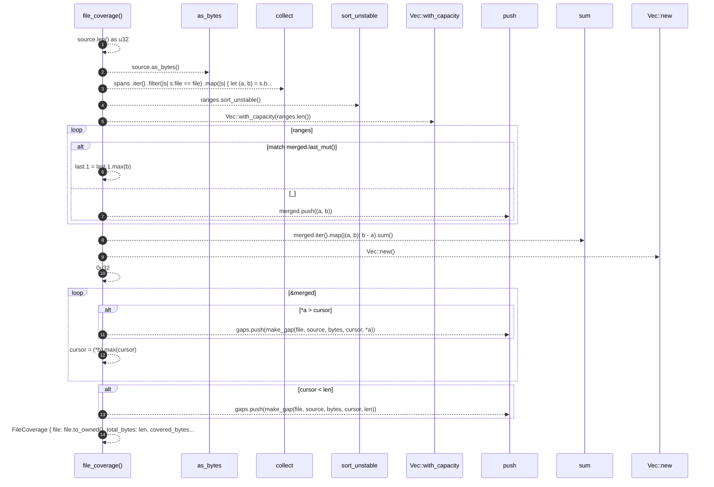

# `robby_ir::coverage::file_coverage`

[Self-model](../../README.md) · [coverage](index.md)

| | |
|---|---|
| kind | `code.function` |
| signature | `fn file_coverage(file: &str, source: &str, spans: &[Span]) -> FileCoverage` |
| location | [`crates/robby-ir/src/coverage.rs:145`](../../../../crates/robby-ir/src/coverage.rs#L145) |
| provenance | extractor · confidence 1.00 |

> Compute coverage for one file given the spans that claim it.

```rust
/// Compute coverage for one file given the spans that claim it.
pub fn file_coverage(file: &str, source: &str, spans: &[Span]) -> FileCoverage {
    let len = source.len() as u32;
    let bytes = source.as_bytes();

    let mut ranges: Vec<(u32, u32)> = spans
        .iter()
        .filter(|s| s.file == file)
        .map(|s| {
            let (a, b) = s.byte_range();
            (a.min(len), b.min(len))
        })
        .filter(|(a, b)| a < b)
        .collect();
    ranges.sort_unstable();

    let mut merged: Vec<(u32, u32)> = Vec::with_capacity(ranges.len());
    for (a, b) in ranges {
        match merged.last_mut() {
            Some(last) if a <= last.1 => last.1 = last.1.max(b),
            _ => merged.push((a, b)),
        }
    }

    let covered_bytes: u32 = merged.iter().map(|(a, b)| b - a).sum();

    let mut gaps = Vec::new();
    let mut cursor = 0u32;
    for (a, b) in &merged {
        if *a > cursor {
            gaps.push(make_gap(file, source, bytes, cursor, *a));
        }
        cursor = (*b).max(cursor);
    }
    if cursor < len {
        gaps.push(make_gap(file, source, bytes, cursor, len));
    }

    FileCoverage {
        file: file.to_owned(),
        total_bytes: len,
        covered_bytes,
        gaps,
    }
}
```



14 steps · 0 observed · 14 possible only

**Edges**

- calls → [`robby_extract::impl LineIndex::new`](../../robby_extract/index.md)

