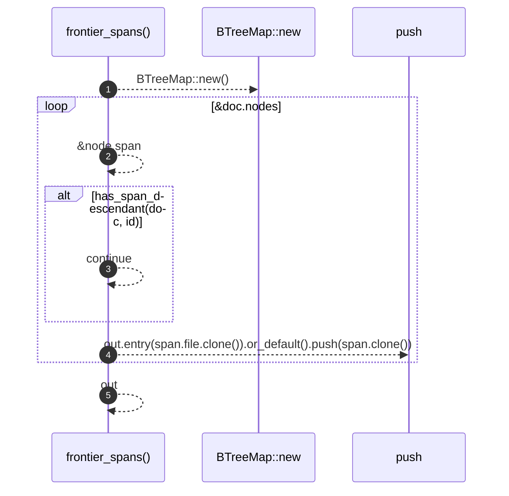

# `robby_ir::coverage::frontier_spans`

[Self-model](../../README.md) · [coverage](index.md)

| | |
|---|---|
| kind | `code.function` |
| signature | `fn frontier_spans(doc: &Document) -> BTreeMap<String, Vec<Span>>` |
| location | [`crates/robby-ir/src/coverage.rs:226`](../../../../crates/robby-ir/src/coverage.rs#L226) |
| provenance | extractor · confidence 1.00 |

> The spans that actually claim source, per file.
> 
> A node is a **frontier** node when no descendant carries a span. Only
> frontier spans count towards coverage: a parent's span is structural, and
> including it would make coverage trivially 100% for any file with a
> top-level item. The finest claim is the claim.

```rust
/// The spans that actually claim source, per file.
///
/// A node is a **frontier** node when no descendant carries a span. Only
/// frontier spans count towards coverage: a parent's span is structural, and
/// including it would make coverage trivially 100% for any file with a
/// top-level item. The finest claim is the claim.
pub fn frontier_spans(doc: &Document) -> BTreeMap<String, Vec<Span>> {
    let mut out: BTreeMap<String, Vec<Span>> = BTreeMap::new();
    for (id, node) in &doc.nodes {
        let Some(span) = &node.span else { continue };
        if has_span_descendant(doc, id) {
            continue;
        }
        out.entry(span.file.clone()).or_default().push(span.clone());
    }
    out
}
```



5 steps · 0 observed · 5 possible only

**Edges**

- calls → [`robby_extract::impl LineIndex::new`](../../robby_extract/index.md)

