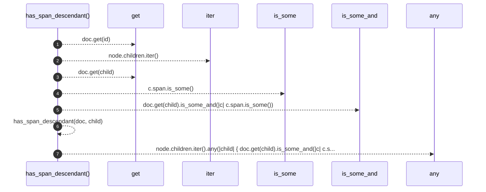

# `robby_ir::coverage::has_span_descendant`

[Self-model](../../README.md) · [coverage](index.md)

| | |
|---|---|
| kind | `code.function` |
| signature | `fn has_span_descendant(doc: &Document, id: &crate::model::NodeId) -> bool` |
| location | [`crates/robby-ir/src/coverage.rs:247`](../../../../crates/robby-ir/src/coverage.rs#L247) |
| provenance | extractor · confidence 1.00 |

```rust
fn has_span_descendant(doc: &Document, id: &crate::model::NodeId) -> bool {
    let Some(node) = doc.get(id) else {
        return false;
    };
    node.children.iter().any(|child| {
        doc.get(child).is_some_and(|c| c.span.is_some()) || has_span_descendant(doc, child)
    })
}
```



7 steps · 0 observed · 7 possible only

**Edges**

- calls → [`robby_ir::run::RecipeCatalog::get`](../run/index.md)
- calls → [`robby_ir::run::RecipeCatalog::get`](../run/index.md)
- calls → [`robby_ir::coverage::has_span_descendant`](has-span-descendant.md)

## References

- calls → [`robby_ir::run`](../run/index.md) — get

## Referenced by

- calls ← [`robby_ir::coverage::frontier_spans`](frontier-spans.md)

