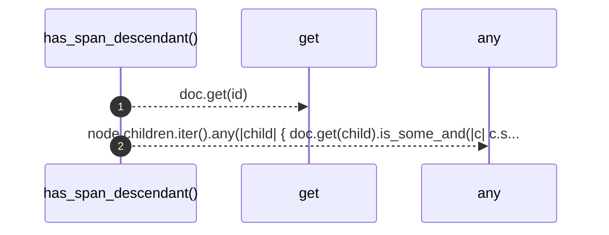

# `robby_ir::coverage::has_span_descendant`

[Self-model](../../README.md) · [coverage](index.md)

| | |
|---|---|
| kind | `code.function` |
| signature | `fn has_span_descendant(doc: &Document, id: &crate::model::NodeId) -> bool` |
| location | [`crates/robby-ir/src/coverage.rs:244`](../../../../crates/robby-ir/src/coverage.rs#L244) |
| provenance | extractor · confidence 1.00 |

```rust
fn has_span_descendant(doc: &Document, id: &crate::model::NodeId) -> bool {
    let Some(node) = doc.get(id) else {
        return false;
    };
    node.children.iter().any(|child| {
        doc.get(child).is_some_and(|c| c.span.is_some()) || has_span_descendant(doc, child)
    })
}
```



2 steps · 0 observed · 2 possible only

**Edges**

- calls → [`robby_ir::model::impl Document::get`](../model/index.md)

