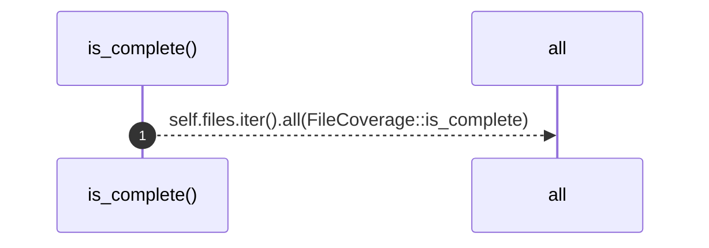
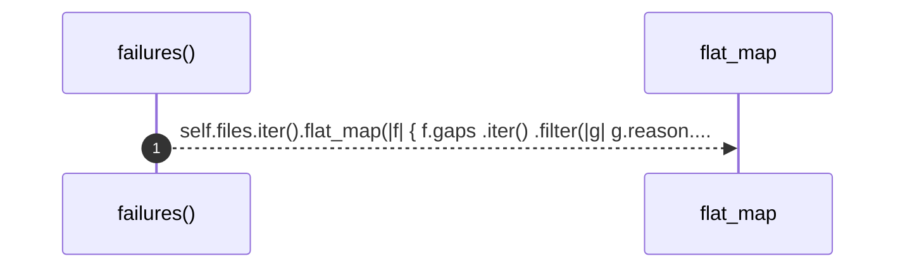
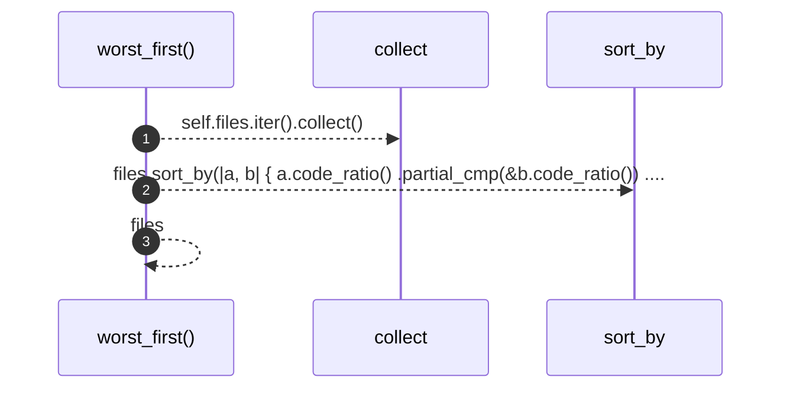

# `robby_ir::coverage::impl CoverageReport`

[Self-model](../../README.md) · [coverage](index.md)

| | |
|---|---|
| kind | `code.impl` |
| location | [`crates/robby-ir/src/coverage.rs:118`](../../../../crates/robby-ir/src/coverage.rs#L118) |
| provenance | extractor · confidence 1.00 |

```rust
impl CoverageReport {
    pub fn is_complete(&self) -> bool {
        self.files.iter().all(FileCoverage::is_complete)
    }

    pub fn failures(&self) -> impl Iterator<Item = (&FileCoverage, &Gap)> {
        self.files.iter().flat_map(|f| {
            f.gaps
                .iter()
                .filter(|g| g.reason.is_failure())
                .map(move |g| (f, g))
        })
    }

    /// Files sorted worst-first. This is the "where do I look?" ordering.
    pub fn worst_first(&self) -> Vec<&FileCoverage> {
        let mut files: Vec<&FileCoverage> = self.files.iter().collect();
        files.sort_by(|a, b| {
            a.code_ratio()
                .partial_cmp(&b.code_ratio())
                .unwrap_or(std::cmp::Ordering::Equal)
                .then_with(|| a.file.cmp(&b.file))
        });
        files
    }
}
```

### `is_complete`

| | |
|---|---|
| kind | `code.method` |
| signature | `fn is_complete(1)` |
| location | [`crates/robby-ir/src/coverage.rs:119`](../../../../crates/robby-ir/src/coverage.rs#L119) |
| provenance | extractor · confidence 1.00 |

```rust
pub fn is_complete(&self) -> bool {
        self.files.iter().all(FileCoverage::is_complete)
    }
```



1 steps · 0 observed · 1 possible only

### `failures`

| | |
|---|---|
| kind | `code.method` |
| signature | `fn failures(1)` |
| location | [`crates/robby-ir/src/coverage.rs:123`](../../../../crates/robby-ir/src/coverage.rs#L123) |
| provenance | extractor · confidence 1.00 |

```rust
pub fn failures(&self) -> impl Iterator<Item = (&FileCoverage, &Gap)> {
        self.files.iter().flat_map(|f| {
            f.gaps
                .iter()
                .filter(|g| g.reason.is_failure())
                .map(move |g| (f, g))
        })
    }
```



1 steps · 0 observed · 1 possible only

### `worst_first`

| | |
|---|---|
| kind | `code.method` |
| signature | `fn worst_first(1)` |
| location | [`crates/robby-ir/src/coverage.rs:132`](../../../../crates/robby-ir/src/coverage.rs#L132) |
| provenance | extractor · confidence 1.00 |

> Files sorted worst-first. This is the "where do I look?" ordering.

```rust
/// Files sorted worst-first. This is the "where do I look?" ordering.
    pub fn worst_first(&self) -> Vec<&FileCoverage> {
        let mut files: Vec<&FileCoverage> = self.files.iter().collect();
        files.sort_by(|a, b| {
            a.code_ratio()
                .partial_cmp(&b.code_ratio())
                .unwrap_or(std::cmp::Ordering::Equal)
                .then_with(|| a.file.cmp(&b.file))
        });
        files
    }
```



3 steps · 0 observed · 3 possible only

