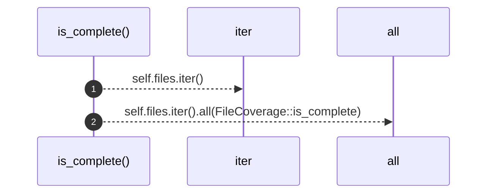
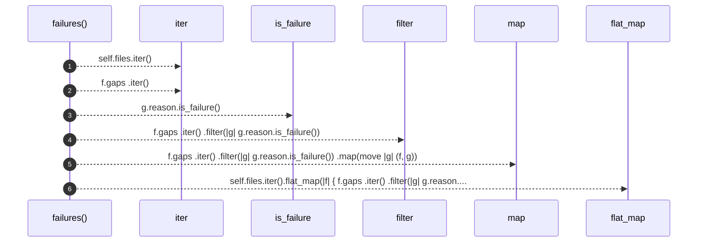
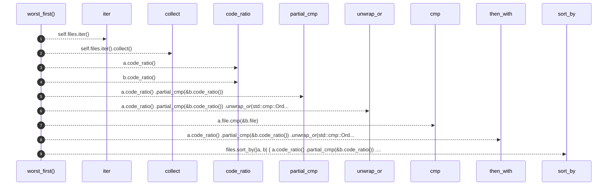

# `robby_ir::coverage::impl CoverageReport`

[Self-model](../../README.md) · [coverage](index.md)

| | |
|---|---|
| kind | `code.impl` |
| location | [`crates/robby-ir/src/coverage.rs:118`](../../../../crates/robby-ir/src/coverage.rs#L118) |
| provenance | extractor · confidence 1.00 |

```rust
impl CoverageReport {
    pub fn is_complete(&self) -> bool {
        self.files.iter().all(FileCoverage::is_complete)
    }

    pub fn failures(&self) -> impl Iterator<Item = (&FileCoverage, &Gap)> {
        self.files.iter().flat_map(|f| {
            f.gaps
                .iter()
                .filter(|g| g.reason.is_failure())
                .map(move |g| (f, g))
        })
    }

    /// Files sorted worst-first. This is the "where do I look?" ordering.
    pub fn worst_first(&self) -> Vec<&FileCoverage> {
        let mut files: Vec<&FileCoverage> = self.files.iter().collect();
        files.sort_by(|a, b| {
            a.code_ratio()
                .partial_cmp(&b.code_ratio())
                .unwrap_or(std::cmp::Ordering::Equal)
                .then_with(|| a.file.cmp(&b.file))
        });
        files
    }
}
```

## References

- calls → [`robby_ir::coverage`](index.md) — code_ratio, is_failure
- calls → [`robby_render::view::select`](../../robby_render/view/select/index.md) — collect

## Referenced by

- calls ← [`robby_cli::build::main`](../../robby_cli/build/main.md)
- calls ← [`robby_cli::example_self_model::run`](../../robby_cli/example_self_model/run.md)
- calls ← [`robby_cli::print_human`](../../robby_cli/print-human.md)
- calls ← [`robby_extract::test_extract::the_workspace_is_fully_covered`](../../robby_extract/test_extract/the-workspace-is-fully-covered.md)
- calls ← [`robby_extract::test_typescript::typescript_fixture_is_fully_covered`](../../robby_extract/test_typescript/typescript-fixture-is-fully-covered.md)
- calls ← [`robby_ir::test_coverage::report_orders_worst_files_first`](../test_coverage/report-orders-worst-files-first.md)
- calls ← [`robby_ir::test_coverage::unreferenced_files_appear_fully_uncovered`](../test_coverage/unreferenced-files-appear-fully-uncovered.md)
- calls ← [`robby_render::markdown::coverage_section`](../../robby_render/markdown/coverage-section.md)

### `is_complete`

| | |
|---|---|
| kind | `code.method` |
| signature | `fn is_complete(1)` |
| location | [`crates/robby-ir/src/coverage.rs:119`](../../../../crates/robby-ir/src/coverage.rs#L119) |
| provenance | extractor · confidence 1.00 |

```rust
pub fn is_complete(&self) -> bool {
        self.files.iter().all(FileCoverage::is_complete)
    }
```



2 steps · 0 observed · 2 possible only

### `failures`

| | |
|---|---|
| kind | `code.method` |
| signature | `fn failures(1)` |
| location | [`crates/robby-ir/src/coverage.rs:123`](../../../../crates/robby-ir/src/coverage.rs#L123) |
| provenance | extractor · confidence 1.00 |

```rust
pub fn failures(&self) -> impl Iterator<Item = (&FileCoverage, &Gap)> {
        self.files.iter().flat_map(|f| {
            f.gaps
                .iter()
                .filter(|g| g.reason.is_failure())
                .map(move |g| (f, g))
        })
    }
```



6 steps · 0 observed · 6 possible only

**Edges**

- calls → [`robby_ir::coverage::impl GapReason::is_failure`](index.md)

### `worst_first`

| | |
|---|---|
| kind | `code.method` |
| signature | `fn worst_first(1)` |
| location | [`crates/robby-ir/src/coverage.rs:132`](../../../../crates/robby-ir/src/coverage.rs#L132) |
| provenance | extractor · confidence 1.00 |

> Files sorted worst-first. This is the "where do I look?" ordering.

```rust
/// Files sorted worst-first. This is the "where do I look?" ordering.
    pub fn worst_first(&self) -> Vec<&FileCoverage> {
        let mut files: Vec<&FileCoverage> = self.files.iter().collect();
        files.sort_by(|a, b| {
            a.code_ratio()
                .partial_cmp(&b.code_ratio())
                .unwrap_or(std::cmp::Ordering::Equal)
                .then_with(|| a.file.cmp(&b.file))
        });
        files
    }
```



9 steps · 0 observed · 9 possible only

**Edges**

- calls → [`robby_render::view::select::collect`](../../robby_render/view/select/collect.md)
- calls → [`robby_ir::coverage::impl FileCoverage::code_ratio`](index.md)
- calls → [`robby_ir::coverage::impl FileCoverage::code_ratio`](index.md)

