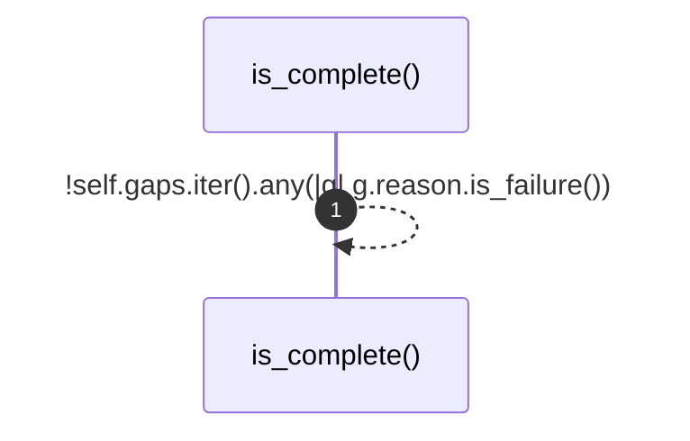
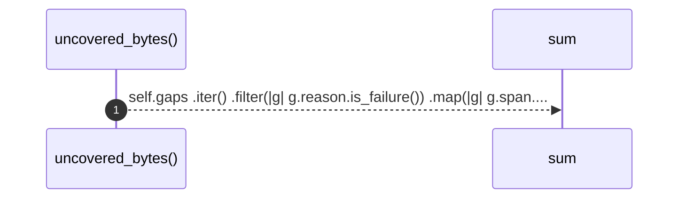
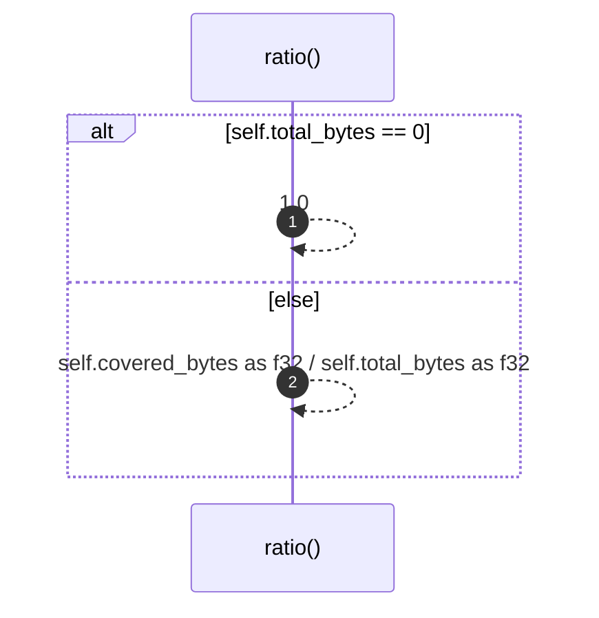
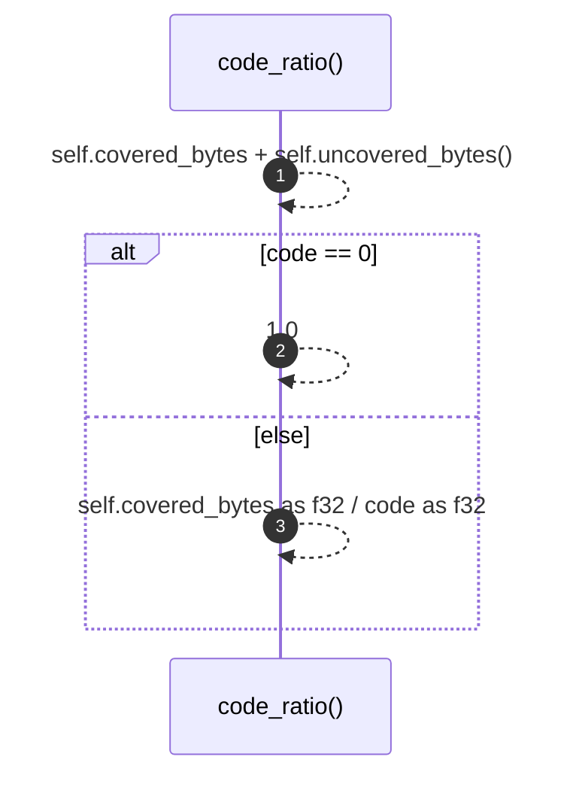
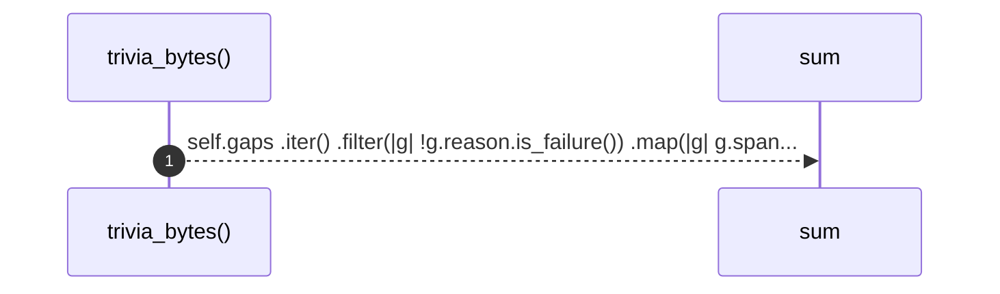

# `robby_ir::coverage::impl FileCoverage`

[Self-model](../../README.md) · [coverage](index.md)

| | |
|---|---|
| kind | `code.impl` |
| location | [`crates/robby-ir/src/coverage.rs:64`](../../../../crates/robby-ir/src/coverage.rs#L64) |
| provenance | extractor · confidence 1.00 |

```rust
impl FileCoverage {
    pub fn is_complete(&self) -> bool {
        !self.gaps.iter().any(|g| g.reason.is_failure())
    }

    /// Bytes in gaps that fail the gate.
    pub fn uncovered_bytes(&self) -> u32 {
        self.gaps
            .iter()
            .filter(|g| g.reason.is_failure())
            .map(|g| g.span.end.byte.saturating_sub(g.span.start.byte))
            .sum()
    }

    /// Fraction of the file owned by nodes, in `0.0..=1.0`.
    ///
    /// This counts comments and blank lines against the file, which is honest
    /// but reads badly. Prefer [`FileCoverage::code_ratio`] for a headline.
    pub fn ratio(&self) -> f32 {
        if self.total_bytes == 0 {
            1.0
        } else {
            self.covered_bytes as f32 / self.total_bytes as f32
        }
    }

    /// Fraction of *code* bytes owned by nodes, excluding classified trivia.
    ///
    /// This is the number that should be 100%: every byte that is not
    /// whitespace, comment, or attribute must belong to something.
    pub fn code_ratio(&self) -> f32 {
        let code = self.covered_bytes + self.uncovered_bytes();
        if code == 0 {
            1.0
        } else {
            self.covered_bytes as f32 / code as f32
        }
    }

    /// Bytes classified as trivia rather than claimed by a node.
    pub fn trivia_bytes(&self) -> u32 {
        self.gaps
            .iter()
            .filter(|g| !g.reason.is_failure())
            .map(|g| g.span.end.byte.saturating_sub(g.span.start.byte))
            .sum()
    }
}
```

### `is_complete`

| | |
|---|---|
| kind | `code.method` |
| signature | `fn is_complete(1)` |
| location | [`crates/robby-ir/src/coverage.rs:65`](../../../../crates/robby-ir/src/coverage.rs#L65) |
| provenance | extractor · confidence 1.00 |

```rust
pub fn is_complete(&self) -> bool {
        !self.gaps.iter().any(|g| g.reason.is_failure())
    }
```



1 steps · 0 observed · 1 possible only

### `uncovered_bytes`

| | |
|---|---|
| kind | `code.method` |
| signature | `fn uncovered_bytes(1)` |
| location | [`crates/robby-ir/src/coverage.rs:69`](../../../../crates/robby-ir/src/coverage.rs#L69) |
| provenance | extractor · confidence 1.00 |

> Bytes in gaps that fail the gate.

```rust
/// Bytes in gaps that fail the gate.
    pub fn uncovered_bytes(&self) -> u32 {
        self.gaps
            .iter()
            .filter(|g| g.reason.is_failure())
            .map(|g| g.span.end.byte.saturating_sub(g.span.start.byte))
            .sum()
    }
```



1 steps · 0 observed · 1 possible only

### `ratio`

| | |
|---|---|
| kind | `code.method` |
| signature | `fn ratio(1)` |
| location | [`crates/robby-ir/src/coverage.rs:78`](../../../../crates/robby-ir/src/coverage.rs#L78) |
| provenance | extractor · confidence 1.00 |

> Fraction of the file owned by nodes, in `0.0..=1.0`.
> 
> This counts comments and blank lines against the file, which is honest
> but reads badly. Prefer [`FileCoverage::code_ratio`] for a headline.

```rust
/// Fraction of the file owned by nodes, in `0.0..=1.0`.
    ///
    /// This counts comments and blank lines against the file, which is honest
    /// but reads badly. Prefer [`FileCoverage::code_ratio`] for a headline.
    pub fn ratio(&self) -> f32 {
        if self.total_bytes == 0 {
            1.0
        } else {
            self.covered_bytes as f32 / self.total_bytes as f32
        }
    }
```



2 steps · 0 observed · 2 possible only

### `code_ratio`

| | |
|---|---|
| kind | `code.method` |
| signature | `fn code_ratio(1)` |
| location | [`crates/robby-ir/src/coverage.rs:90`](../../../../crates/robby-ir/src/coverage.rs#L90) |
| provenance | extractor · confidence 1.00 |

> Fraction of *code* bytes owned by nodes, excluding classified trivia.
> 
> This is the number that should be 100%: every byte that is not
> whitespace, comment, or attribute must belong to something.

```rust
/// Fraction of *code* bytes owned by nodes, excluding classified trivia.
    ///
    /// This is the number that should be 100%: every byte that is not
    /// whitespace, comment, or attribute must belong to something.
    pub fn code_ratio(&self) -> f32 {
        let code = self.covered_bytes + self.uncovered_bytes();
        if code == 0 {
            1.0
        } else {
            self.covered_bytes as f32 / code as f32
        }
    }
```



3 steps · 0 observed · 3 possible only

### `trivia_bytes`

| | |
|---|---|
| kind | `code.method` |
| signature | `fn trivia_bytes(1)` |
| location | [`crates/robby-ir/src/coverage.rs:103`](../../../../crates/robby-ir/src/coverage.rs#L103) |
| provenance | extractor · confidence 1.00 |

> Bytes classified as trivia rather than claimed by a node.

```rust
/// Bytes classified as trivia rather than claimed by a node.
    pub fn trivia_bytes(&self) -> u32 {
        self.gaps
            .iter()
            .filter(|g| !g.reason.is_failure())
            .map(|g| g.span.end.byte.saturating_sub(g.span.start.byte))
            .sum()
    }
```



1 steps · 0 observed · 1 possible only

