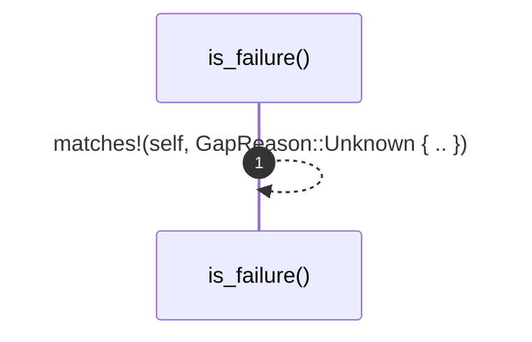

# `robby_ir::coverage::impl GapReason`

[Self-model](../../README.md) · [coverage](index.md)

| | |
|---|---|
| kind | `code.impl` |
| location | [`crates/robby-ir/src/coverage.rs:40`](../../../../crates/robby-ir/src/coverage.rs#L40) |
| provenance | extractor · confidence 1.00 |

```rust
impl GapReason {
    /// Only `Unknown` is a failure.
    pub fn is_failure(&self) -> bool {
        matches!(self, GapReason::Unknown { .. })
    }
}
```

### `is_failure`

| | |
|---|---|
| kind | `code.method` |
| signature | `fn is_failure(1)` |
| location | [`crates/robby-ir/src/coverage.rs:41`](../../../../crates/robby-ir/src/coverage.rs#L41) |
| provenance | extractor · confidence 1.00 |

> Only `Unknown` is a failure.

```rust
/// Only `Unknown` is a failure.
    pub fn is_failure(&self) -> bool {
        matches!(self, GapReason::Unknown { .. })
    }
```



1 steps · 0 observed · 1 possible only

