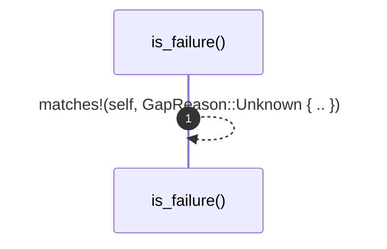

# `robby_ir::coverage::impl GapReason`

[Self-model](../../README.md) · [coverage](index.md)

| | |
|---|---|
| kind | `code.impl` |
| location | [`crates/robby-ir/src/coverage.rs:40`](../../../../crates/robby-ir/src/coverage.rs#L40) |
| provenance | extractor · confidence 1.00 |

```rust
impl GapReason {
    /// Only `Unknown` is a failure.
    pub fn is_failure(&self) -> bool {
        matches!(self, GapReason::Unknown { .. })
    }
}
```

## Referenced by

- calls ← [`robby_cli::print_human`](../../robby_cli/print-human.md)
- calls ← [`robby_ir::coverage::impl CoverageReport::failures`](index.md)
- calls ← [`robby_ir::coverage::impl FileCoverage::is_complete`](index.md)
- calls ← [`robby_ir::coverage::impl FileCoverage::trivia_bytes`](index.md)
- calls ← [`robby_ir::coverage::impl FileCoverage::uncovered_bytes`](index.md)
- calls ← [`robby_ir::test_coverage::gap_preview_is_whitespace_collapsed`](../test_coverage/gap-preview-is-whitespace-collapsed.md)
- calls ← [`robby_ir::test_coverage::unclaimed_code_fails_with_the_exact_byte`](../test_coverage/unclaimed-code-fails-with-the-exact-byte.md)

### `is_failure`

| | |
|---|---|
| kind | `code.method` |
| signature | `fn is_failure(1)` |
| location | [`crates/robby-ir/src/coverage.rs:41`](../../../../crates/robby-ir/src/coverage.rs#L41) |
| provenance | extractor · confidence 1.00 |

> Only `Unknown` is a failure.

```rust
/// Only `Unknown` is a failure.
    pub fn is_failure(&self) -> bool {
        matches!(self, GapReason::Unknown { .. })
    }
```



1 steps · 0 observed · 1 possible only

