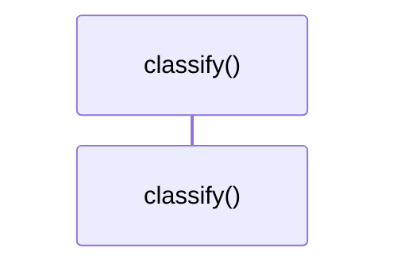

# `robby_ir::coverage::impl TriviaFlags`

[Self-model](../../README.md) · [coverage](index.md)

| | |
|---|---|
| kind | `code.impl` |
| location | [`crates/robby-ir/src/coverage.rs:305`](../../../../crates/robby-ir/src/coverage.rs#L305) |
| provenance | extractor · confidence 1.00 |

```rust
impl TriviaFlags {
    fn classify(self) -> GapReason {
        match (self.attribute, self.comment) {
            (true, false) => GapReason::Attribute,
            (false, true) => GapReason::Comment,
            (false, false) => GapReason::Whitespace,
            (true, true) => GapReason::Trivia,
        }
    }
}
```

## Referenced by

- calls ← [`robby_ir::coverage::make_gap`](make-gap.md)

### `classify`

| | |
|---|---|
| kind | `code.method` |
| signature | `fn classify(1)` |
| location | [`crates/robby-ir/src/coverage.rs:306`](../../../../crates/robby-ir/src/coverage.rs#L306) |
| provenance | extractor · confidence 1.00 |

```rust
fn classify(self) -> GapReason {
        match (self.attribute, self.comment) {
            (true, false) => GapReason::Attribute,
            (false, true) => GapReason::Comment,
            (false, false) => GapReason::Whitespace,
            (true, true) => GapReason::Trivia,
        }
    }
```



0 steps · 0 observed · 0 possible only

