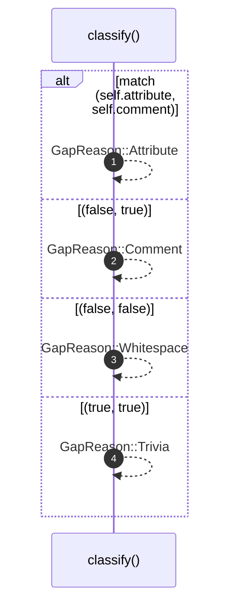

# `robby_ir::coverage::impl TriviaFlags`

[Self-model](../../README.md) · [coverage](index.md)

| | |
|---|---|
| kind | `code.impl` |
| location | [`crates/robby-ir/src/coverage.rs:285`](../../../../crates/robby-ir/src/coverage.rs#L285) |
| provenance | extractor · confidence 1.00 |

```rust
impl TriviaFlags {
    fn classify(self) -> GapReason {
        match (self.attribute, self.comment) {
            (true, false) => GapReason::Attribute,
            (false, true) => GapReason::Comment,
            (false, false) => GapReason::Whitespace,
            (true, true) => GapReason::Trivia,
        }
    }
}
```

### `classify`

| | |
|---|---|
| kind | `code.method` |
| signature | `fn classify(1)` |
| location | [`crates/robby-ir/src/coverage.rs:286`](../../../../crates/robby-ir/src/coverage.rs#L286) |
| provenance | extractor · confidence 1.00 |

```rust
fn classify(self) -> GapReason {
        match (self.attribute, self.comment) {
            (true, false) => GapReason::Attribute,
            (false, true) => GapReason::Comment,
            (false, false) => GapReason::Whitespace,
            (true, true) => GapReason::Trivia,
        }
    }
```



4 steps · 0 observed · 4 possible only

