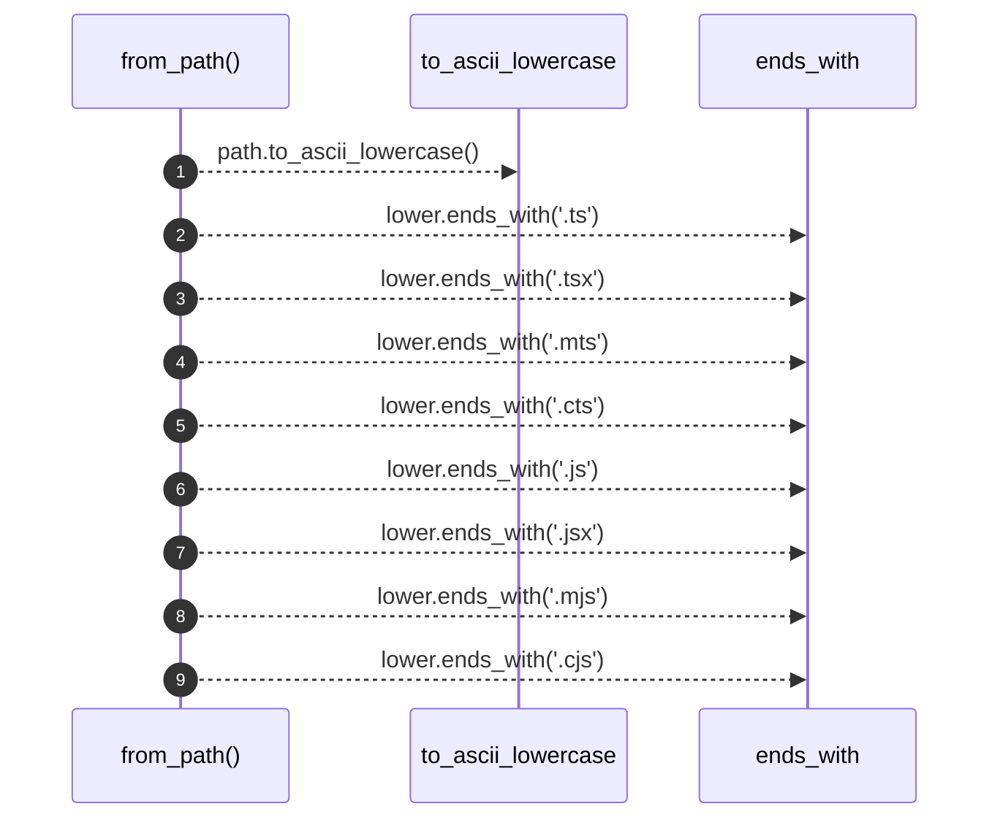

# `robby_ir::coverage::impl TriviaMode`

[Self-model](../../README.md) · [coverage](index.md)

| | |
|---|---|
| kind | `code.impl` |
| location | [`crates/robby-ir/src/coverage.rs:274`](../../../../crates/robby-ir/src/coverage.rs#L274) |
| provenance | extractor · confidence 1.00 |

```rust
impl TriviaMode {
    fn from_path(path: &str) -> Self {
        let lower = path.to_ascii_lowercase();
        if lower.ends_with(".ts")
            || lower.ends_with(".tsx")
            || lower.ends_with(".mts")
            || lower.ends_with(".cts")
            || lower.ends_with(".js")
            || lower.ends_with(".jsx")
            || lower.ends_with(".mjs")
            || lower.ends_with(".cjs")
        {
            Self::TypeScript
        } else {
            Self::Rust
        }
    }
}
```

## Referenced by

- calls ← [`robby_extract::typescript::extract_file`](../../robby_extract/typescript/extract-file.md)
- calls ← [`robby_ir::coverage::make_gap`](make-gap.md)

### `from_path`

| | |
|---|---|
| kind | `code.method` |
| signature | `fn from_path(1)` |
| location | [`crates/robby-ir/src/coverage.rs:275`](../../../../crates/robby-ir/src/coverage.rs#L275) |
| provenance | extractor · confidence 1.00 |

```rust
fn from_path(path: &str) -> Self {
        let lower = path.to_ascii_lowercase();
        if lower.ends_with(".ts")
            || lower.ends_with(".tsx")
            || lower.ends_with(".mts")
            || lower.ends_with(".cts")
            || lower.ends_with(".js")
            || lower.ends_with(".jsx")
            || lower.ends_with(".mjs")
            || lower.ends_with(".cjs")
        {
            Self::TypeScript
        } else {
            Self::Rust
        }
    }
```



9 steps · 0 observed · 9 possible only

