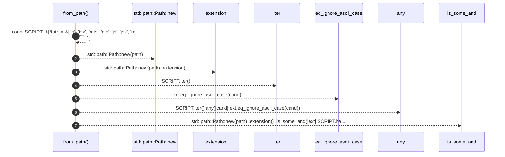

# `robby_ir::coverage::impl TriviaMode`

[Self-model](../../README.md) · [coverage](index.md)

| | |
|---|---|
| kind | `code.impl` |
| location | [`crates/robby-ir/src/coverage.rs:277`](../../../../crates/robby-ir/src/coverage.rs#L277) |
| provenance | extractor · confidence 1.00 |

```rust
impl TriviaMode {
    fn from_path(path: &str) -> Self {
        const SCRIPT: &[&str] = &["ts", "tsx", "mts", "cts", "js", "jsx", "mjs", "cjs"];
        let script = std::path::Path::new(path)
            .extension()
            .is_some_and(|ext| SCRIPT.iter().any(|cand| ext.eq_ignore_ascii_case(cand)));
        if script { Self::TypeScript } else { Self::Rust }
    }
}
```

## References

- calls → [`robby_ir::kind`](../kind/index.md) — new

## Referenced by

- calls ← [`robby_extract::typescript::extract_file`](../../robby_extract/typescript/extract-file.md)
- calls ← [`robby_ir::coverage::make_gap`](make-gap.md)

### `from_path`

| | |
|---|---|
| kind | `code.method` |
| signature | `fn from_path(1)` |
| location | [`crates/robby-ir/src/coverage.rs:278`](../../../../crates/robby-ir/src/coverage.rs#L278) |
| provenance | extractor · confidence 1.00 |

```rust
fn from_path(path: &str) -> Self {
        const SCRIPT: &[&str] = &["ts", "tsx", "mts", "cts", "js", "jsx", "mjs", "cjs"];
        let script = std::path::Path::new(path)
            .extension()
            .is_some_and(|ext| SCRIPT.iter().any(|cand| ext.eq_ignore_ascii_case(cand)));
        if script { Self::TypeScript } else { Self::Rust }
    }
```



7 steps · 0 observed · 7 possible only

**Edges**

- calls → [`robby_ir::kind::impl Kind::new`](../kind/index.md)

