# `robby_ir::coverage`

[Self-model](../../README.md) · [robby_ir](../index.md)

| | |
|---|---|
| kind | `code.module` |
| declared at | [`crates/robby-ir/src/lib.rs:17`](../../../../crates/robby-ir/src/lib.rs#L17) |
| provenance | extractor · confidence 1.00 |
| nodes | 50 |

```mermaid
flowchart TD
    subgraph n_965af55f4081b03f["coverage [module]"]
        direction TB
        n_73d1279886a37ecd["GapReason [enum]"]
        n_2b1a5e72f5fcb7c1["Gap [struct]"]
        n_d2077ec4f3b0536f["FileCoverage [struct]"]
        n_e3186668e03d2cd7["CoverageReport [struct]"]
        n_74e4ff10a7dfc268["fn file_coverage(file: &str, source: &str, spans: &[Span]) -> FileCoverage [function]"]
        n_e68b2f1462104869["fn document_coverage(doc: &Document, sources: &BTreeMap<String, String>) -> CoverageReport [function]"]
        n_1539d79370dab438["fn all_spans(doc: &Document) -> BTreeMap<String, Vec<Span>> [function]"]
        n_1a9a05bb45ea296c["fn frontier_spans(doc: &Document) -> BTreeMap<String, Vec<Span>> [function]"]
        n_99b47e2d08834c4c["fn has_span_descendant(doc: &Document, id: &crate::model::NodeId) -> bool [function]"]
        n_55d765f1c3d46722["fn make_gap(file: &str, source: &str, bytes: &[u8], start: u32, end: u32) -> Gap [function]"]
        n_65587228358ccdc9["fn preview(source: &str, start: u32, end: u32) -> String [function]"]
        n_c7110fb5c320cd73["TriviaFlags [struct]"]
        n_9181bfbdbc16c75c["fn scan_trivia(bytes: &[u8], start: u32, end: u32) -> Result<TriviaFlags, u32> [function]"]
        n_9b74c92d5feaa2bb["fn skip_attribute(bytes: &[u8], start: u32, end: u32) -> Option<u32> [function]"]
    end
    n_e68b2f1462104869 -->|calls| n_1539d79370dab438
```

## Items

| Item | Kind | Steps | Location |
|---|---|---:|---|
| [`GapReason`](gapreason.md) | `code.enum` | — | `crates/robby-ir/src/coverage.rs:24:1` |
| [`impl GapReason`](impl-gapreason.md) | `code.impl` | — | `crates/robby-ir/src/coverage.rs:40:1` |
| [`Gap`](gap.md) | `code.struct` | — | `crates/robby-ir/src/coverage.rs:47:1` |
| [`FileCoverage`](filecoverage.md) | `code.struct` | — | `crates/robby-ir/src/coverage.rs:55:1` |
| [`impl FileCoverage`](impl-filecoverage.md) | `code.impl` | — | `crates/robby-ir/src/coverage.rs:64:1` |
| [`CoverageReport`](coveragereport.md) | `code.struct` | — | `crates/robby-ir/src/coverage.rs:113:1` |
| [`impl CoverageReport`](impl-coveragereport.md) | `code.impl` | — | `crates/robby-ir/src/coverage.rs:118:1` |
| [`file_coverage`](file-coverage.md) | `code.function` | 14 | `crates/robby-ir/src/coverage.rs:145:1` |
| [`document_coverage`](document-coverage.md) | `code.function` | 6 | `crates/robby-ir/src/coverage.rs:191:1` |
| [`all_spans`](all-spans.md) | `code.function` | 3 | `crates/robby-ir/src/coverage.rs:209:1` |
| [`frontier_spans`](frontier-spans.md) | `code.function` | 5 | `crates/robby-ir/src/coverage.rs:226:1` |
| [`has_span_descendant`](has-span-descendant.md) | `code.function` | 2 | `crates/robby-ir/src/coverage.rs:244:1` |
| [`make_gap`](make-gap.md) | `code.function` | 3 | `crates/robby-ir/src/coverage.rs:253:1` |
| [`preview`](preview.md) | `code.function` | 5 | `crates/robby-ir/src/coverage.rs:267:1` |
| [`TriviaFlags`](triviaflags.md) | `code.struct` | — | `crates/robby-ir/src/coverage.rs:278:1` |
| [`impl TriviaFlags`](impl-triviaflags.md) | `code.impl` | — | `crates/robby-ir/src/coverage.rs:285:1` |
| [`scan_trivia`](scan-trivia.md) | `code.function` | 22 | `crates/robby-ir/src/coverage.rs:296:1` |
| [`skip_attribute`](skip-attribute.md) | `code.function` | 22 | `crates/robby-ir/src/coverage.rs:344:1` |

## Imports

- `use std::collections::BTreeMap;`
- `use schemars::JsonSchema;`
- `use serde::{Deserialize, Serialize};`
- `use crate::model::Document;`
- `use crate::span::{Position, Span};`

