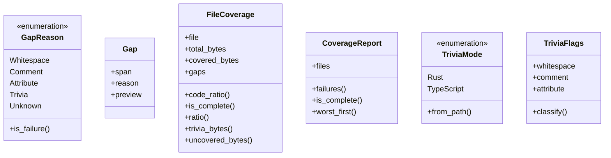
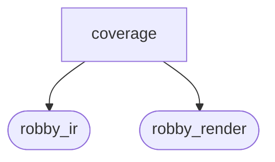
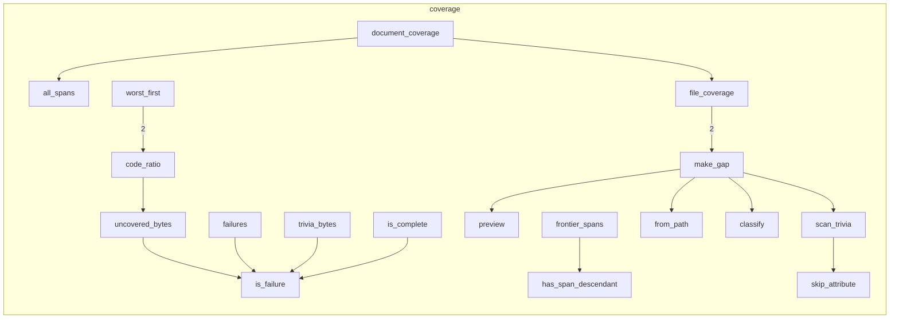

# `robby_ir::coverage`

[Self-model](../../README.md) · [robby_ir](../index.md)

| | |
|---|---|
| kind | `code.module` |
| declared at | [`crates/robby-ir/src/lib.rs:19`](../../../../crates/robby-ir/src/lib.rs#L19) |
| provenance | extractor · confidence 1.00 |
| nodes | 55 |

## Types



## Package diagram



## Module coupling



## Dependency matrix

| | coverage | robby_ir | robby_render |
|---|---:|---:|---:|
| **coverage** | · | 12 | 10 |
| **robby_ir** | | · | |
| **robby_render** | | | · |

## Comments

- `crates/robby-ir/src/coverage.rs:103:5` (docs, `robby_ir::coverage::impl FileCoverage::trivia_bytes`): "Bytes classified as trivia rather than claimed by a node."
  ```
  /// Bytes classified as trivia rather than claimed by a node.
      pub fn trivia_bytes(&self) -> u32 {
          self.gaps
              .iter()
              .filter(|g| !g.reason.is_failure())
              .map(|g| g.span.end.byte.saturating_sub(g.span.start.byte))
              .sum()
      }
  ```
- `crates/robby-ir/src/coverage.rs:132:5` (docs, `robby_ir::coverage::impl CoverageReport::worst_first`): "Files sorted worst-first. This is the "where do I look?" ordering."
  ```
  /// Files sorted worst-first. This is the "where do I look?" ordering.
      pub fn worst_first(&self) -> Vec<&FileCoverage> {
          let mut files: Vec<&FileCoverage> = self.files.iter().collect();
          files.sort_by(|a, b| {
              a.code_ratio()
                  .partial_cmp(&b.code_ratio())
                  .unwrap_or(std::cmp::Ordering::Equal)
                  .then_with(|| a.file.cmp(&b.file))
          });
          files
      }
  ```
- `crates/robby-ir/src/coverage.rs:145:1` (docs, `robby_ir::coverage::file_coverage`): "Compute coverage for one file given the spans that claim it."
  ```
  /// Compute coverage for one file given the spans that claim it.
  pub fn file_coverage(file: &str, source: &str, spans: &[Span]) -> FileCoverage {
      let len = source.len() as u32;
      let bytes = source.as_bytes();
  
      let mut ranges: Vec<(u32, u32)> = spans
          .iter()
          .filter(|s| s.file == file)
          .map(|s| {
              let (a, b) = s.byte_range();
              (a.min(len), b.min(len))
          })
          .filter(|(a, b)| a < b)
          .collect();
      ranges.sort_unstable();
  
      let mut merged: Vec<(u32, u32)> = Vec::with_capacity(ranges.len());
      for (a, b) in ranges {
          match merged.last_mut() {
              Some(last) if a <= last.1 => last.1 = last.1.max(b),
              _ => merged.push((a, b)),
          }
      }
  
      let covered_bytes: u32 = merged.iter().map(|(a, b)| b - a).sum();
  
      let mut gaps = Vec::new();
      let mut cursor = 0u32;
      for (a, b) in &merged {
          if *a > cursor {
              gaps.push(make_gap(file, source, bytes, cursor, *a));
          }
          cursor = (*b).max(cursor);
      }
      if cursor < len {
          gaps.push(make_gap(file, source, bytes, cursor, len));
      }
  
      FileCoverage {
          file: file.to_owned(),
          total_bytes: len,
          covered_bytes,
          gaps,
      }
  }
  ```
- `crates/robby-ir/src/coverage.rs:191:1` (docs, `robby_ir::coverage::document_coverage`): "Compute coverage for every source file referenced by the document. Files present in `sources` but never referenced stil…"
  ```
  /// Compute coverage for every source file referenced by the document.
  ///
  /// Files present in `sources` but never referenced still appear in the report,
  /// fully uncovered. A file that exists and is invisible to the map is exactly
  /// the failure mode this tool exists to prevent.
  pub fn document_coverage(doc: &Document, sources: &BTreeMap<String, String>) -> CoverageReport {
      let spans_by_file = all_spans(doc);
  
      let mut files = Vec::new();
      for (path, source) in sources {
          let spans = spans_by_file.get(path.as_str()).cloned().unwrap_or_default();
          files.push(file_coverage(path, source, &spans));
      }
      files.sort_by(|a, b| a.file.cmp(&b.file));
  
      CoverageReport { files }
  }
  ```
- `crates/robby-ir/src/coverage.rs:209:1` (docs, `robby_ir::coverage::all_spans`): "Every span in the document, per file. This is the default claim set: a byte is represented when *some* node owns it, at…"
  ```
  /// Every span in the document, per file.
  ///
  /// This is the default claim set: a byte is represented when *some* node owns
  /// it, at any nesting level. It catches missing items, missing files, and code
  /// outside any item. It deliberately does **not** try to catch shallow nesting —
  /// a function span covers its own body, and proving that every statement got a
  /// node needs the AST. That check lives in the extractor.
  pub fn all_spans(doc: &Document) -> BTreeMap<String, Vec<Span>> {
      let mut out: BTreeMap<String, Vec<Span>> = BTreeMap::new();
      for node in doc.nodes.values() {
          if let Some(span) = &node.span {
              out.entry(span.file.clone()).or_default().push(span.clone());
          }
      }
      out
  }
  ```
- `crates/robby-ir/src/coverage.rs:226:1` (docs, `robby_ir::coverage::frontier_spans`): "The spans that actually claim source, per file. A node is a **frontier** node when no descendant carries a span. Only f…"
  ```
  /// The spans that actually claim source, per file.
  ///
  /// A node is a **frontier** node when no descendant carries a span. Only
  /// frontier spans count towards coverage: a parent's span is structural, and
  /// including it would make coverage trivially 100% for any file with a
  /// top-level item. The finest claim is the claim.
  pub fn frontier_spans(doc: &Document) -> BTreeMap<String, Vec<Span>> {
      let mut out: BTreeMap<String, Vec<Span>> = BTreeMap::new();
      for (id, node) in &doc.nodes {
          let Some(span) = &node.span else { continue };
          if has_span_descendant(doc, id) {
              continue;
          }
          out.entry(span.file.clone()).or_default().push(span.clone());
      }
      out
  }
  ```
- `crates/robby-ir/src/coverage.rs:322:1` (docs, `robby_ir::coverage::scan_trivia`): "Walk a byte range, accepting only whitespace, comments and (Rust) attributes. Returns the byte offset of the first toke…"
  ```
  /// Walk a byte range, accepting only whitespace, comments and (Rust) attributes.
  ///
  /// Returns the byte offset of the first token that is none of those, which is
  /// what makes the gap report actionable: it points at the exact byte that is
  /// missing from the map.
  fn scan_trivia(
      bytes: &[u8],
      start: u32,
      end: u32,
      mode: TriviaMode,
  ) -> Result<TriviaFlags, u32> {
      let mut flags = TriviaFlags::default();
      let mut i = start;
      // TypeScript shebang is trivia when it opens the file.
      if mode == TriviaMode::TypeScript && i == 0 && end >= 2 && bytes[0] == b'#' && bytes[1] == b'!' {
          flags.comment = true;
          while i < end && bytes[i as usize] != b'\n' {
              i += 1;
          }
      }
      while i < end {
          let c = bytes[i as usize];
          if c.is_ascii_whitespace() {
              flags.whitespace = true;
              i += 1;
          } else if c == b'/' && i + 1 < end && bytes[(i + 1) as usize] == b'/' {
              flags.comment = true;
              while i < end && bytes[i as usize] != b'\n' {
                  i += 1;
              }
          } else if c == b'/' && i + 1 < end && bytes[(i + 1) as usize] == b'*' {
              flags.comment = true;
              let mut depth = 1u32;
              i += 2;
              while i < end && depth > 0 {
                  if i + 1 < end && bytes[i as usize] == b'/' && bytes[(i + 1) as usize] == b'*' {
                      depth += 1;
                      i += 2;
                  } else if i + 1 < end && bytes[i as usize] == b'*' && bytes[(i + 1) as usize] == b'/' {
                      depth -= 1;
                      i += 2;
                  } else {
                      i += 1;
                  }
              }
          } else if mode == TriviaMode::Rust && c == b'#' {
              match skip_attribute(bytes, i, end) {
                  Some(next) => {
                      flags.attribute = true;
                      i = next;
                  }
                  None => return Err(i),
              }
          } else {
              return Err(i);
          }
      }
      Ok(flags)
  }
  ```
- `crates/robby-ir/src/coverage.rs:382:1` (docs, `robby_ir::coverage::skip_attribute`): "Skip `#[...]` or `#![...]`, honouring nested brackets and string literals."
  ```
  /// Skip `#[...]` or `#![...]`, honouring nested brackets and string literals.
  fn skip_attribute(bytes: &[u8], start: u32, end: u32) -> Option<u32> {
      let mut i = start + 1;
      if i < end && bytes[i as usize] == b'!' {
          i += 1;
      }
      if i >= end || bytes[i as usize] != b'[' {
          return None;
      }
      let mut depth = 0i32;
      let mut in_string = false;
      while i < end {
          let c = bytes[i as usize];
          if in_string {
              if c == b'\\' {
                  i += 2;
                  continue;
              }
              if c == b'"' {
                  in_string = false;
              }
              i += 1;
              continue;
          }
          match c {
              b'"' => {
                  in_string = true;
                  i += 1;
              }
              b'[' => {
                  depth += 1;
                  i += 1;
              }
              b']' => {
                  depth -= 1;
                  i += 1;
                  if depth == 0 {
                      return Some(i);
                  }
              }
              _ => i += 1,
          }
      }
      None
  }
  ```
- `crates/robby-ir/src/coverage.rs:41:5` (docs, `robby_ir::coverage::impl GapReason::is_failure`): "Only `Unknown` is a failure."
  ```
  /// Only `Unknown` is a failure.
      pub fn is_failure(&self) -> bool {
          matches!(self, GapReason::Unknown { .. })
      }
  ```
- `crates/robby-ir/src/coverage.rs:69:5` (docs, `robby_ir::coverage::impl FileCoverage::uncovered_bytes`): "Bytes in gaps that fail the gate."
  ```
  /// Bytes in gaps that fail the gate.
      pub fn uncovered_bytes(&self) -> u32 {
          self.gaps
              .iter()
              .filter(|g| g.reason.is_failure())
              .map(|g| g.span.end.byte.saturating_sub(g.span.start.byte))
              .sum()
      }
  ```
- `crates/robby-ir/src/coverage.rs:78:5` (docs, `robby_ir::coverage::impl FileCoverage::ratio`): "Fraction of the file owned by nodes, in `0.0..=1.0`. This counts comments and blank lines against the file, which is ho…"
  ```
  /// Fraction of the file owned by nodes, in `0.0..=1.0`.
      ///
      /// This counts comments and blank lines against the file, which is honest
      /// but reads badly. Prefer [`FileCoverage::code_ratio`] for a headline.
      pub fn ratio(&self) -> f32 {
          if self.total_bytes == 0 {
              1.0
          } else {
              self.covered_bytes as f32 / self.total_bytes as f32
          }
      }
  ```
- `crates/robby-ir/src/coverage.rs:90:5` (docs, `robby_ir::coverage::impl FileCoverage::code_ratio`): "Fraction of *code* bytes owned by nodes, excluding classified trivia. This is the number that should be 100%: every byt…"
  ```
  /// Fraction of *code* bytes owned by nodes, excluding classified trivia.
      ///
      /// This is the number that should be 100%: every byte that is not
      /// whitespace, comment, or attribute must belong to something.
      pub fn code_ratio(&self) -> f32 {
          let code = self.covered_bytes + self.uncovered_bytes();
          if code == 0 {
              1.0
          } else {
              self.covered_bytes as f32 / code as f32
          }
      }
  ```
## References

- calls → [`robby_ir::kind`](../kind/index.md) — as_str, new
- calls → [`robby_ir::model`](../model/index.md) — get
- calls → [`robby_ir::process`](../process/index.md) — default
- calls → [`robby_ir::span`](../span/index.md) — at, byte_range
- calls → [`robby_render::report`](../../robby_render/report/index.md) — push
- calls → [`robby_render::view::select`](../../robby_render/view/select/index.md) — collect

## Referenced by

- calls ← [`robby_cli::build::main`](../../robby_cli/build/main.md)
- calls ← [`robby_cli::example_self_model::run`](../../robby_cli/example_self_model/run.md)
- calls ← [`robby_cli::print_human`](../../robby_cli/print-human.md)
- calls ← [`robby_extract::test_extract::the_workspace_is_fully_covered`](../../robby_extract/test_extract/the-workspace-is-fully-covered.md)
- calls ← [`robby_extract::test_typescript::typescript_fixture_is_fully_covered`](../../robby_extract/test_typescript/typescript-fixture-is-fully-covered.md)
- calls ← [`robby_extract::typescript::extract_file`](../../robby_extract/typescript/extract-file.md)
- calls ← [`robby_ir::test_coverage::attributes_are_classified`](../test_coverage/attributes-are-classified.md)
- calls ← [`robby_ir::test_coverage::document_coverage_is_union_at_any_depth`](../test_coverage/document-coverage-is-union-at-any-depth.md)
- calls ← [`robby_ir::test_coverage::empty_file_is_trivially_complete`](../test_coverage/empty-file-is-trivially-complete.md)
- calls ← [`robby_ir::test_coverage::frontier_spans_exclude_parents_that_have_span_children`](../test_coverage/frontier-spans-exclude-parents-that-have-span-children.md)
- calls ← [`robby_ir::test_coverage::fully_covered_file_has_no_gaps`](../test_coverage/fully-covered-file-has-no-gaps.md)
- calls ← [`robby_ir::test_coverage::gap_preview_is_whitespace_collapsed`](../test_coverage/gap-preview-is-whitespace-collapsed.md)
- calls ← [`robby_ir::test_coverage::nested_spans_are_unioned_not_double_counted`](../test_coverage/nested-spans-are-unioned-not-double-counted.md)
- calls ← [`robby_ir::test_coverage::report_orders_worst_files_first`](../test_coverage/report-orders-worst-files-first.md)
- calls ← [`robby_ir::test_coverage::spans_beyond_eof_are_clamped_not_panicking`](../test_coverage/spans-beyond-eof-are-clamped-not-panicking.md)
- calls ← [`robby_ir::test_coverage::spans_from_other_files_are_ignored`](../test_coverage/spans-from-other-files-are-ignored.md)
- calls ← [`robby_ir::test_coverage::typescript_comments_and_shebang_are_trivia`](../test_coverage/typescript-comments-and-shebang-are-trivia.md)
- calls ← [`robby_ir::test_coverage::typescript_hash_is_not_a_rust_attribute`](../test_coverage/typescript-hash-is-not-a-rust-attribute.md)
- calls ← [`robby_ir::test_coverage::unclaimed_code_fails_with_the_exact_byte`](../test_coverage/unclaimed-code-fails-with-the-exact-byte.md)
- calls ← [`robby_ir::test_coverage::unreferenced_files_appear_fully_uncovered`](../test_coverage/unreferenced-files-appear-fully-uncovered.md)
- calls ← [`robby_ir::test_coverage::whitespace_and_comments_are_classified_not_failed`](../test_coverage/whitespace-and-comments-are-classified-not-failed.md)
- calls ← [`robby_render::markdown::coverage_section`](../../robby_render/markdown/coverage-section.md)
- calls ← [`robby_render::pipeline::from_document`](../../robby_render/pipeline/from-document.md)
- calls ← [`robby_render::pipeline::impl Loaded::is_ok`](../../robby_render/pipeline/index.md)
- calls ← [`robby_render::pipeline::impl Loaded::summary`](../../robby_render/pipeline/index.md)
- calls ← [`robby_render::pipeline::load_sources`](../../robby_render/pipeline/load-sources.md)

## Items

| Item | Kind | Steps | Location |
|---|---|---:|---|
| [`GapReason`](gapreason.md) | `code.enum` | — | `crates/robby-ir/src/coverage.rs:24:1` |
| [`impl GapReason`](impl-gapreason.md) | `code.impl` | — | `crates/robby-ir/src/coverage.rs:40:1` |
| [`Gap`](gap.md) | `code.struct` | — | `crates/robby-ir/src/coverage.rs:47:1` |
| [`FileCoverage`](filecoverage.md) | `code.struct` | — | `crates/robby-ir/src/coverage.rs:55:1` |
| [`impl FileCoverage`](impl-filecoverage.md) | `code.impl` | — | `crates/robby-ir/src/coverage.rs:64:1` |
| [`CoverageReport`](coveragereport.md) | `code.struct` | — | `crates/robby-ir/src/coverage.rs:113:1` |
| [`impl CoverageReport`](impl-coveragereport.md) | `code.impl` | — | `crates/robby-ir/src/coverage.rs:118:1` |
| [`file_coverage`](file-coverage.md) | `code.function` | 26 | `crates/robby-ir/src/coverage.rs:145:1` |
| [`document_coverage`](document-coverage.md) | `code.function` | 10 | `crates/robby-ir/src/coverage.rs:191:1` |
| [`all_spans`](all-spans.md) | `code.function` | 7 | `crates/robby-ir/src/coverage.rs:209:1` |
| [`frontier_spans`](frontier-spans.md) | `code.function` | 7 | `crates/robby-ir/src/coverage.rs:226:1` |
| [`has_span_descendant`](has-span-descendant.md) | `code.function` | 7 | `crates/robby-ir/src/coverage.rs:244:1` |
| [`make_gap`](make-gap.md) | `code.function` | 6 | `crates/robby-ir/src/coverage.rs:253:1` |
| [`TriviaMode`](triviamode.md) | `code.enum` | — | `crates/robby-ir/src/coverage.rs:268:1` |
| [`impl TriviaMode`](impl-triviamode.md) | `code.impl` | — | `crates/robby-ir/src/coverage.rs:274:1` |
| [`preview`](preview.md) | `code.function` | 9 | `crates/robby-ir/src/coverage.rs:293:1` |
| [`TriviaFlags`](triviaflags.md) | `code.struct` | — | `crates/robby-ir/src/coverage.rs:304:1` |
| [`impl TriviaFlags`](impl-triviaflags.md) | `code.impl` | — | `crates/robby-ir/src/coverage.rs:311:1` |
| [`scan_trivia`](scan-trivia.md) | `code.function` | 8 | `crates/robby-ir/src/coverage.rs:322:1` |
| [`skip_attribute`](skip-attribute.md) | `code.function` | 3 | `crates/robby-ir/src/coverage.rs:382:1` |

## Imports

- `use std::collections::BTreeMap;`
- `use schemars::JsonSchema;`
- `use serde::{Deserialize, Serialize};`
- `use crate::model::Document;`
- `use crate::span::{Position, Span};`

