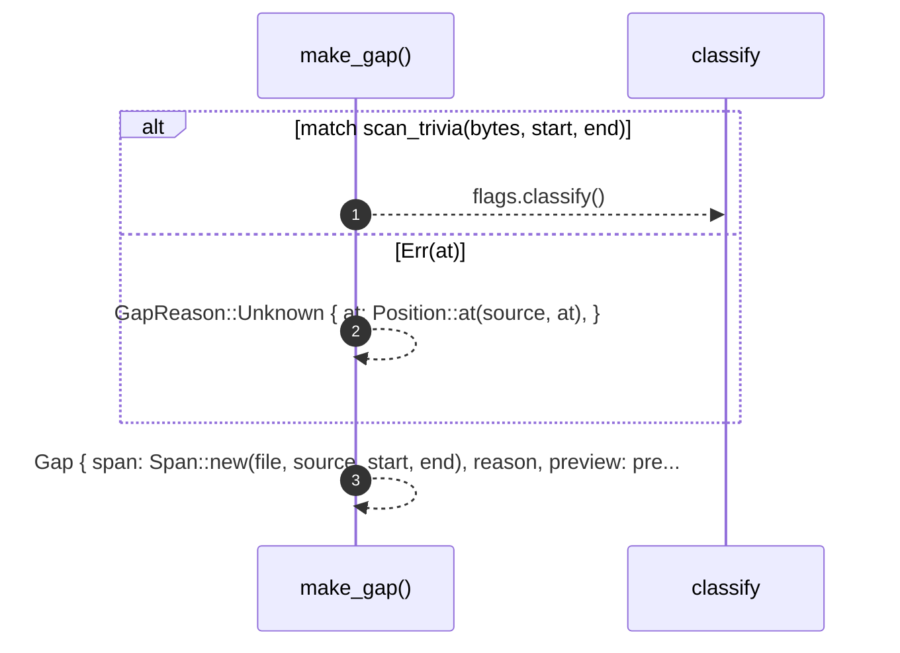

# `robby_ir::coverage::make_gap`

[Self-model](../../README.md) · [coverage](index.md)

| | |
|---|---|
| kind | `code.function` |
| signature | `fn make_gap(file: &str, source: &str, bytes: &[u8], start: u32, end: u32) -> Gap` |
| location | [`crates/robby-ir/src/coverage.rs:253`](../../../../crates/robby-ir/src/coverage.rs#L253) |
| provenance | extractor · confidence 1.00 |

```rust
fn make_gap(file: &str, source: &str, bytes: &[u8], start: u32, end: u32) -> Gap {
    let reason = match scan_trivia(bytes, start, end) {
        Ok(flags) => flags.classify(),
        Err(at) => GapReason::Unknown {
            at: Position::at(source, at),
        },
    };
    Gap {
        span: Span::new(file, source, start, end),
        reason,
        preview: preview(source, start, end),
    }
}
```



3 steps · 0 observed · 3 possible only

**Edges**

- calls → [`robby_ir::coverage::impl TriviaFlags::classify`](index.md)

