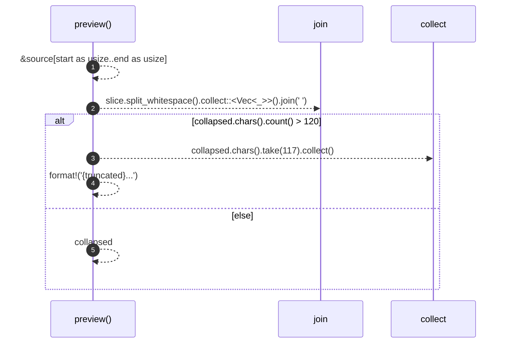

# `robby_ir::coverage::preview`

[Self-model](../../README.md) · [coverage](index.md)

| | |
|---|---|
| kind | `code.function` |
| signature | `fn preview(source: &str, start: u32, end: u32) -> String` |
| location | [`crates/robby-ir/src/coverage.rs:267`](../../../../crates/robby-ir/src/coverage.rs#L267) |
| provenance | extractor · confidence 1.00 |

```rust
fn preview(source: &str, start: u32, end: u32) -> String {
    let slice = &source[start as usize..end as usize];
    let collapsed: String = slice.split_whitespace().collect::<Vec<_>>().join(" ");
    if collapsed.chars().count() > 120 {
        let truncated: String = collapsed.chars().take(117).collect();
        format!("{truncated}...")
    } else {
        collapsed
    }
}
```



5 steps · 0 observed · 5 possible only

